[Home - TM268](/README.md#-exercises)

# Exercise 1: Functional Analysis of a Read-Only UI Service on Top of a CDS View

## Introduction

In the Getting Started section, you familiarized yourself with the data model and the CDS Views (see [Getting Started](../getting-started/readme.md)). There, the Consumption View **`ZTM268_C_BOOKING_CONN_CARR_###`** was introduced. In this exercise, the focus is on displaying the result set not only directly in the so-called **Data Preview** in **ABAP Development Tools (ADT)** but also through a read-only OData service in the UI.

> [!NOTE]
> The read-only OData service still has a **functional issue: the result set is not visible** <br>
> <kbd>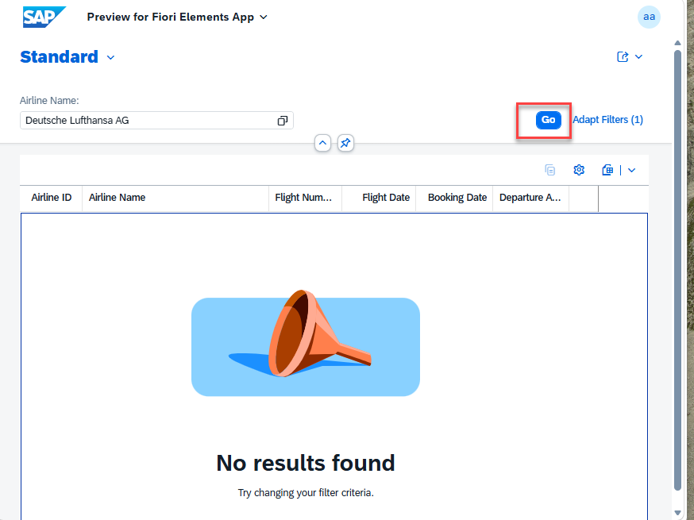</kbd>

**[Exercise 1](readme.md) equips you with the tools to diagnose and fix this functional issue, resulting in a fully working Read-Only List Reporting App:**

- use the **ABAP Cross Trace** to examine backend request processing and analyze the OData response
- perform a further deep-dive analysis on the frontend using the **F12 Developer Tools** of your browser.

---

### What you will learn

In this exercise, you will:

1. Discover how to use the **Data Preview** of a CDS view and the **Preview** of a UI Service
2. Understand why a successfully published service still cannot display the result set of a query
3. Set up and run a Gateway trace using the **ABAP Cross Trace**, and interpret what it reveals about backend request processing and the OData response content
4. Discover how combining the **ABAP Cross Trace** and the **F12 Developer Tools** Console systematically uncovers declaration issues that cause data to remain invisible in the UI

---

> [!NOTE]
> - Throughout this exercise, use package **`ZTM268_###`** , where **`###`** is your personal suffix. <br> 
> - The **ABAP Cross Trace** introduced in this exercise also serves as a starting point for the performance analysis in Exercises 2 to 5. <br>
> - In [Exercise 6](../exercise-06/readme.md), the Read-Only app is then integrated into a RAP application.

### Exercises

- [Exercise 1: Functional Analysis of a Read-Only UI Service on Top of a CDS View](#exercise-1-functional-analysis-of-a-read-only-ui-service-on-top-of-a-cds-view)
  - [Exercise 1.1: Display the Data Preview and Test the Read Only Service](#exercise-11-display-the-data-preview-and-test-the-read-only-service)
  - [Exercise 1.2: Analyze the Gateway Trace Performed with the ABAP Cross Trace](#exercise-12-analyze-the-gateway-trace-performed-with-the-abap-cross-trace)
  - [Exercise 1.3: Use F12 Developer Tools in the Browser for further Root Cause Analysis](#exercise-13-use-f12-developer-tools-in-the-browser-for-further-root-cause-analysis)
  - [Exercise 1.4: Fix the Issue](#exercise-14-fix-the-issue)

### Summary
- [Summary & Next Exercise](#summary--next-exercise)

## Exercise 1.1: Display the Data Preview and Test the Read Only Service
[^Top of page](#)

During development, it is important to verify that data is correct not only at the database layer but also at the service layer. ADT's Data Preview provides a direct look at the raw result set of a CDS view as retrieved from the database, while the Preview of a Published Service allows you to test if the data is correctly exposed and consumable through the OData service on top.

> In this step, you will learn to 
> 1. Display the result data of a CDS view directly in ADT using the **Data Preview**
> 2. Apply filters to the **Data Preview**
> 3. Display the Preview of a Published Service
> 4. Verify functional and performance issues in the OData Service 

> Background information on how to expose a CDS view as an OData UI Service is provided for reference at the end of Exercise 1.1.

<details>
 <summary>🔵 Click to expand!</summary>

With the help of the **Data Preview** you can directly inspect the data set returned by this view — without any UI service.<br>

1. Call the **Data Preview**
   
   - Open the CDS View `ZTM268_C_BOOKING_CONN_CARR_###` in ABAP Development Tools (ADT):<br>
     <kbd>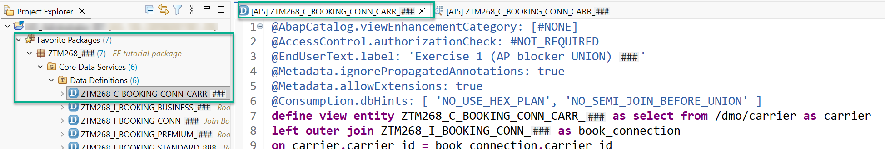</kbd> <br> 
   
   - Press `F8` to launch the **Data Preview** (limited to the first 100 rows).

    ---

2. Apply filters to the **Data Preview**, e.g. for **carrier_name**<br>
   - Click on **Add Filter**: <br>
     <kbd>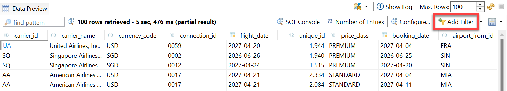</kbd> <br>
   - Provide the filter criteria **carrier_name** = <pre><code>`Deutsche Lufthansa AG`</code></pre> 
     <kbd>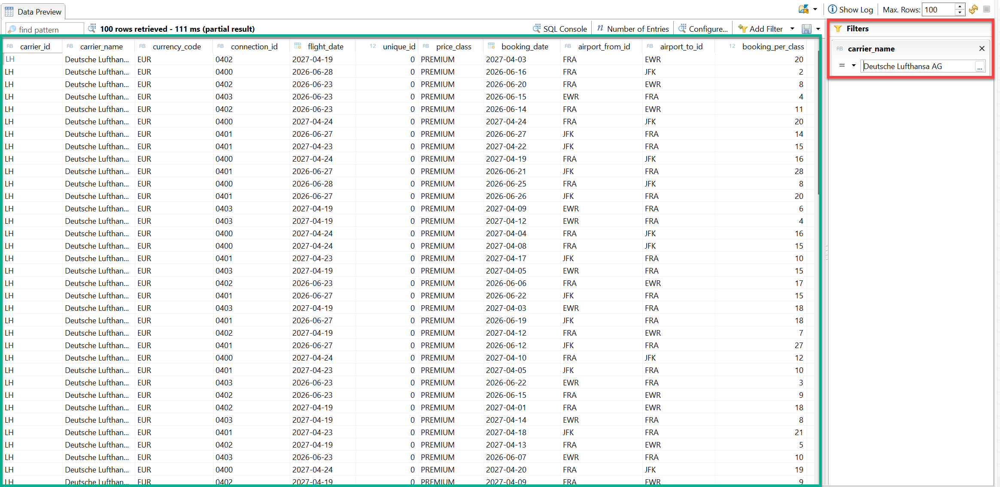

    ---

    **Preview for the UI service**

    The UI Service Preview serves as a quick validation that the Read-Only Service returns and displays data correctly. Notably, this is not the case here — despite all service creation steps having been performed completely and without error. 

    ---

3. Open the Preview for the UI service <br>

   Navigate to the **Service Binding** **`ZUI_TM268_BOOK_CON_CAR_###_O4`** visible under `...` > `Favorite Packages` > **`ZTM268_###`** > `Business Services` > **`Service Bindings`**:

   - Double-click the Service Binding **`ZUI_TM268_BOOK_CON_CAR_###_O4`** 
   - Select **`ZTM268_C_BOOKING_CONN_CARR_###`** from the Entity Sets and Associations list and 
   - Click **`Preview`**:

     <kbd>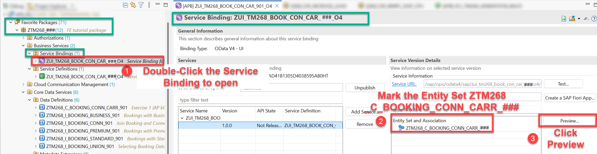</kbd> 
 
   - The UI opens in the browser, but if you click on `Go` **no result is shown** — although a result set was returned for the same filter criteria in the **Data Preview** above: 

     <kbd></kbd>

    ---

4. Issues visible in the Preview

   Clicking the `Go` button immediately reveals two issues:
   - No results are displayed
   - The response takes approximately 2 to 3 seconds <br>

   The first indicates a functional defect; the second points to an underlying performance problem. <br>
   For both issues, you will
   - identify the location of the issues, e.g., if in the database layer or in the service layer
   - resolve them before you integrate this view as a custom extension into a RAP application ([Exercise 6](../exercise-06/readme.md)). <br> 
   The objective is full functional correctness and a response time well under one second prior to consumption in other applications. 

---

> 🟠 **Remarks:** <br>
> - The steps to create a Read-Only UI service on top of a CDS view are summarized at the end of this [Exercise 1.1](#background-information-already-completed--do-not-re-execute-how-to-expose-a-cds-view-as-an-odata-ui-service).
> - The functional issues of the Read-Only OData Service are analyzed in [Exercise 1.2](#exercise-12-analyze-the-gateway-trace-performed-with-the-abap-cross-trace) to [Exercise 1.4](#exercise-14-fix-the-issue). 
> - By the end of [Exercise 1.4](#exercise-14-fix-the-issue), the data set shown in the **Data Preview** will also be correctly displayed in the Read-Only OData Service:

| Data Preview in ABAP Development Tools (ADT) | Read-Only OData Service at the End of Exercise 1.4 |
|---|---|
|<kbd></kbd>|<kbd>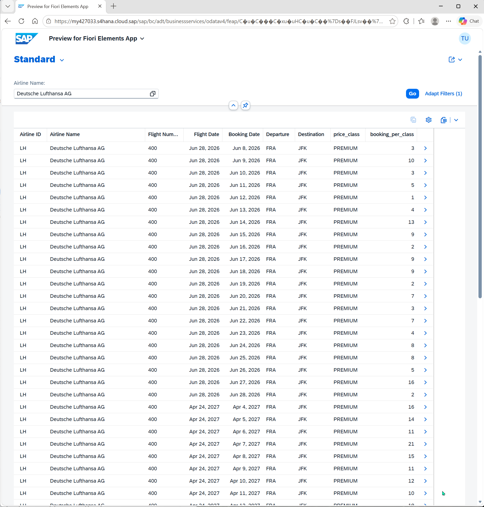</kbd>|

---

#### Background Information (Already completed — Do not re-execute): How to expose a CDS view as an OData UI Service
<details>
  <summary>ℹ️ Click to expand</summary>

<br>

**To save time during this session, all necessary steps to create the Read-Only Service have been performed in advance:**
- Publishing a service is time-consuming, taking up to 3 minutes per Publish request
  - With up to 40 simultaneous Publish requests expected during the TechEd session, wait times would increase significantly.
  - This avoids blocking participants while waiting for the Publish to complete.

**All required artifacts have been generated on top of the Consumption View `ZTM268_C_BOOKING_CONN_CARR_###`:**
  - A **Service Definition** **`ZUI_TM268_BOOK_CON_CAR_###_O4`** has been created and activated, exposing the Consumption View **`ZTM268_C_BOOKING_CONN_CARR_###`**: <br>
  <kbd>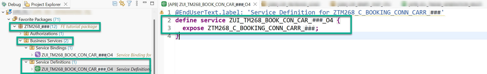</kbd> <br>
  - A **Service Binding** **`ZUI_TM268_BOOK_CON_CAR_###_O4`** has been created, activated, and published, binding the **Service Definition** to the client-server communication protocol `OData V4 UI`. 
  - A **Metadata Extension `ZC_TM268_BOOK_CONN_CARR_###`** has been created and activated, enriching the **Consumption View `ZTM268_C_BOOKING_CONN_CARR_###`** with UI annotations — such as field labels, line item definitions, and selection field configurations — without modifying the underlying CDS view itself.

 <details>
  <summary>ℹ️ Detailed pre-executed steps. Do not execute them again, please.</summary>

   1. How to create a **Service Definition**:

      | Service Definition Creation | Details |
      |---|---|
      | <kbd>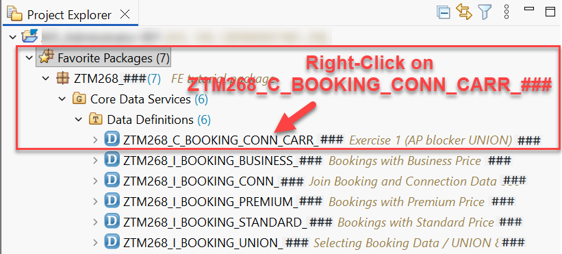</kbd>| Navigate to `...` > `Favorite Packages` > **`ZTM268_###`** <br> (**`###`** = your suffix) <br> > `Core Data Services` > **`Data Definitions`**. <br> <br> Right-click **`ZTM268_C_BOOKING_CONN_CARR_###`**. |
      | <kbd>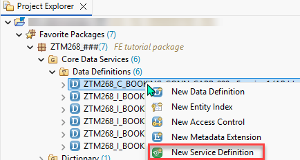</kbd> | Select **`New Service Definition`** |
      | <kbd>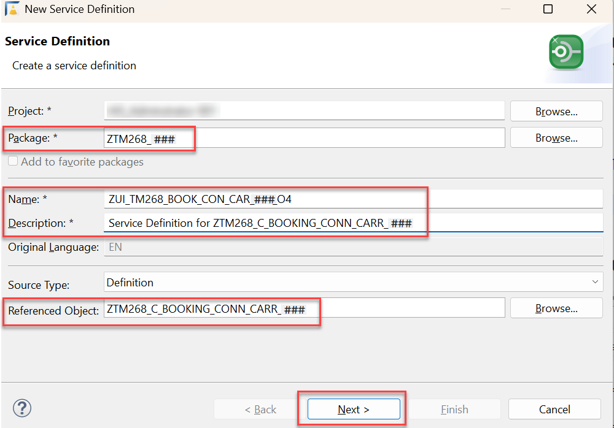</kbd> | Enter the following details: <br> - **Name:** <pre><code>`ZUI_TM268_BOOK_CON_CAR_###_O4`</code></pre> - **Description:** <pre><code>`Service Definition for ZTM268_C_BOOKING_CONN_CARR_###`</code></pre> <br> - Click **`Next`** to navigate to the Selection of Transport Request <br> - Click **`Finish`** |

      The Service Definition **`ZUI_TM268_BOOK_CON_CAR_###_O4`** is now visible under `...` > `Favorite Packages` > **`ZTM268_###`** > `Business Services` > **`Service Definitions`**, exposing the CDS View **`ZTM268_C_BOOKING_CONN_CARR_###`**:
      
      <kbd>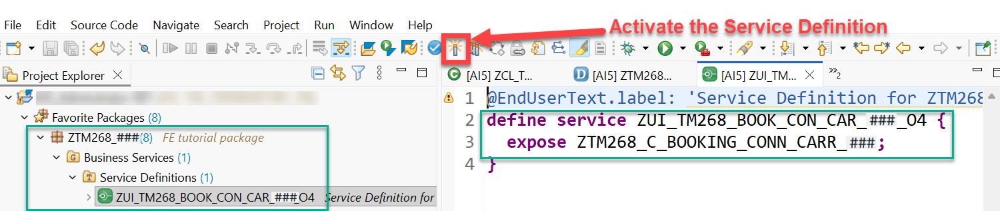</kbd> 
      
      The Service Definition was activated by pressing `Ctrl+F3` or clicking the activate icon .

   2. How to create a **Service Binding**:

      | Service Binding Creation | Details |
      |---|---|
      | <kbd>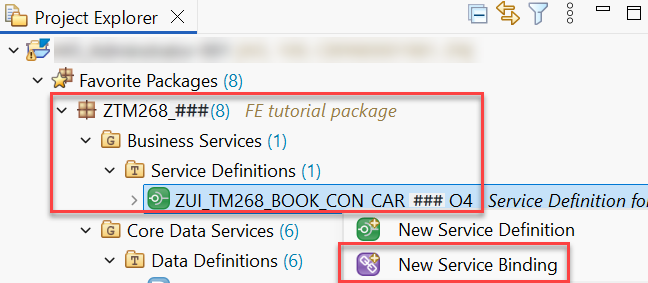</kbd>| Navigate to `...` > `Favorite Packages` > **`ZTM268_###`** <br> (**`###`** = your suffix) <br> > `Business Services` > **`Service Definitions`**. <br> <br> Right-click **`ZUI_TM268_BOOK_CON_CAR_###_O4`** <br> and select **`New Service Binding`**. |
      | <kbd>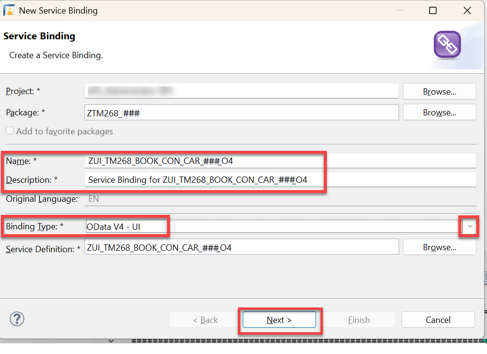</kbd> | Enter the following details: <br> - **Name:** <pre><code>`ZUI_TM268_BOOK_CON_CAR_###_O4`</code></pre> - **Description:** <pre><code>`Service Binding for ZUI_TM268_BOOK_CON_CAR_###_O4`</code></pre> <br> - **Binding Type:** Choose `OData V4 - UI` <br> - Click **`Next`** to navigate to the Selection of Transport Request <br> - Click **`Finish`** |

      The Service Binding **`ZUI_TM268_BOOK_CON_CAR_###_O4`** is now visible under `...` > `Favorite Packages` > **`ZTM268_###`** > `Business Services` > **`Service Bindings`**:
      
      <kbd>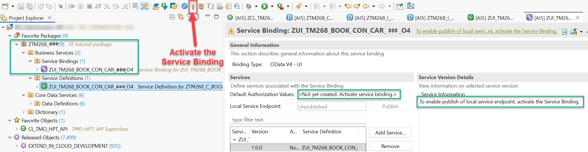</kbd> 
      
      The Service Binding was activated by pressing `Ctrl+F3` or clicking the activate icon .

   3. **Publish** the Service

      The Service was published by double-clicking the Service Binding **`ZUI_TM268_BOOK_CON_CAR_###_O4`** under `...` > `Favorite Packages` > **`ZTM268_###`** > `Business Services` > **`Service Bindings`** to open it, then click **`Publish`**:

      <kbd>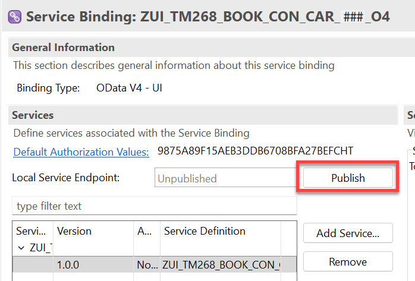</kbd> 

   4. How to create a **Metadata Extension**

      | Metadata Extension Creation | Details |
      |---|---|
      | <kbd>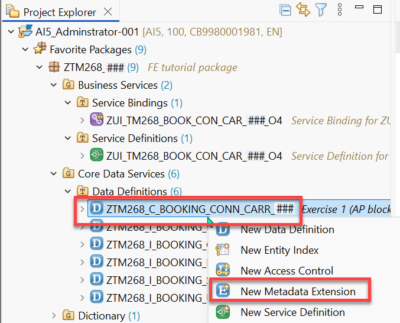</kbd>| Navigate to `...` > `Favorite Packages` > **`ZTM268_###`** <br> (**`###`** = your suffix) <br> > `Core Data Services` > **`Data Definitions`**. <br> <br> Right-click **`ZTM268_C_BOOKING_CONN_CARR_###`** <br> and select **`New Metadata Extension`**. |
      | <kbd>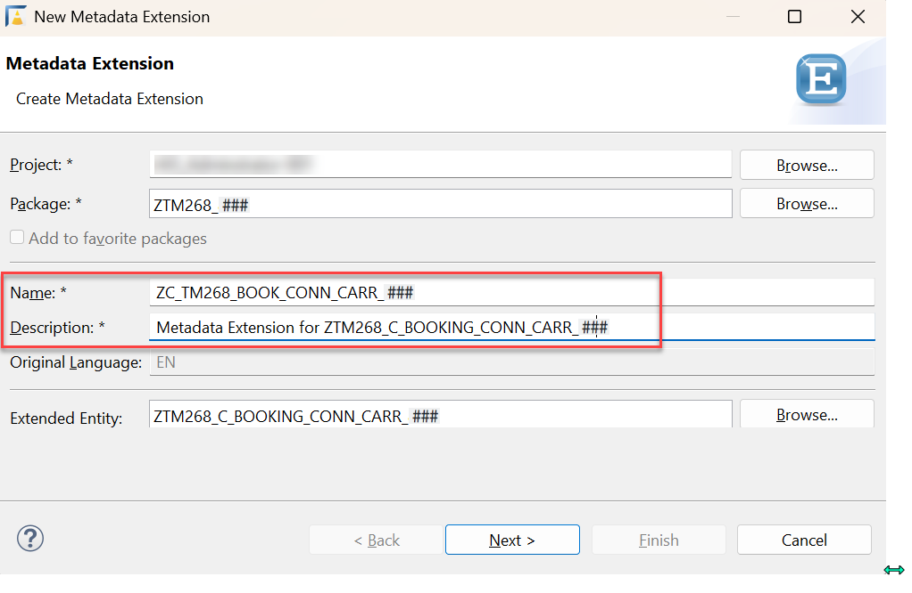</kbd> | Enter the following details: <br> - **Name:** <pre><code>`ZC_TM268_BOOK_CONN_CARR_###`</code></pre> - **Description:** <pre><code>`Metadata Extension for ZTM268_C_BOOKING_CONN_CARR_###`</code></pre> <br> - Click **`Next`** to navigate to the Selection of Transport Request <br> - Click **`Finish`** |
      
      ℹ️ Activate the Metadata Extension by pressing `Ctrl+F3` or clicking the activate icon .

  <details>
      <summary>🔵 Click to expand the Content of the Metadata Extension!</summary>

```abap
@Metadata.layer: #CORE
@UI.headerInfo.title.type: #STANDARD
@UI.headerInfo.title.value: 'carrier_id'
@UI.headerInfo.description.type: #STANDARD
@UI.headerInfo.description.value: 'carrier_id'
annotate entity ZTM268_C_BOOKING_CONN_CARR_###
  with 
{
 @UI.facet: [ { 
    label: 'General Information', 
    id: 'GeneralInfo', 
    purpose: #STANDARD, 
    position: 10 , 
    type: #IDENTIFICATION_REFERENCE 
  } ] 
  @UI.identification: [ { 
    position: 10 
  } ] 
  @UI.lineItem: [ { 
    position: 10 
  } ] 
  carrier_id; 
    @UI.identification: [ { 
    position: 20 
  } ] 
  @UI.lineItem: [ { 
    position: 20 
  } ] 
  @UI.selectionField: [ { 
    position: 20 
  } ]
  @Consumption.filter.defaultValue: 'Deutsche Lufthansa AG'
 carrier_name;
  @UI.identification: [ { 
    position: 30 
  } ] 
  @UI.lineItem: [ { 
    position: 30 
  } ] 
 connection_id;
  @UI.identification: [ { 
    position: 40 
  } ] 
  @UI.lineItem: [ { 
    position: 40 
  } ]   
 flight_date; 
    @UI.identification: [ { 
    position: 50 
  } ] 
  @UI.lineItem: [ { 
    position: 50 
  } ] 
 booking_date;
      @UI.identification: [ { 
    position: 60 
  } ] 
  @UI.lineItem: [ { 
    position: 60 
  } ] 
 airport_from_id; 
       @UI.identification: [ { 
    position: 80 
  } ] 
  @UI.lineItem: [ { 
    position: 80 
  } ]  
 airport_to_id; 
      @UI.identification: [ { 
    position: 100 
  } ] 
  @UI.lineItem: [ { 
    position: 100 
  } ] 
 price_class;
      @UI.identification: [ { 
    position: 110
  } ] 
  @UI.lineItem: [ { 
    position: 110
  } ] 
 booking_per_class; 
}
```

  </details>

 </details>

 </details>
 </details> 

---

## Exercise 1.2: Analyze the Gateway Trace Performed with the ABAP Cross Trace
[^Top of page](#)

To understand and analyze different ABAP Cloud components at runtime — including RAP BO implementations and Read-Only Services — the **ABAP Cross Trace** is the appropriate tool. The **ABAP Cross Trace** is a performance and analysis tool in S/4HANA that allows you to trace and analyze end-to-end processing across multiple system components and technology layers — all in a single, correlated trace session. Among others, it provides an SAP Gateway trace covering OData consumption and provisioning, showing the request details sent to the backend and the full response content returned to the frontend. It also captures the runtime of the traced request.

> In this step, you learn how to configure and execute a Gateway trace using the **ABAP Cross Trace**:
> 1. Open the **ABAP Cross Trace** tool in ABAP Development Tools (ADT)
> 2. Understand and configure a trace configuration
> 3. Set up an **ABAP Cross Trace** configuration that auto-deactivates after the first captured request
> 4. Execute a trace and confirm that a request reaches the backend and a response is returned to the UI
> 5. Identify that duplicate records would occur in the absence of the `booking_date` field

 <details>
  <summary>🔵 Click to expand!</summary>
  
   1. Open the **ABAP Cross Trace** in ABAP Development Tools (ADT)
      
      Access the tool via **`Window`** -> **`Show View`** -> **`Other...`** or press `Ctrl+3` and search for _Cross Trace_ in both cases:

      <table>
       <tr>
           <td>
            <td> 
            <kbd>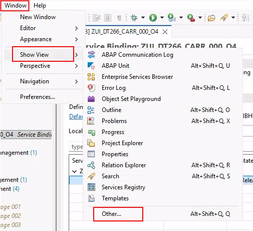
            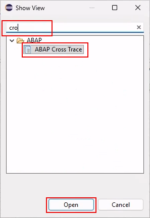 </kbd>
            </td>
           </td>
           <td><kbd>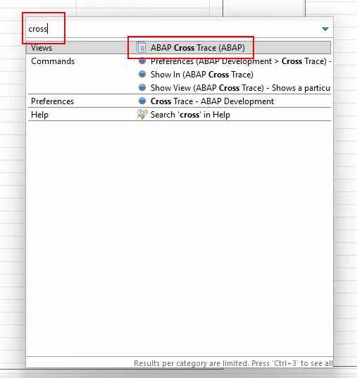</kbd></td>
       </tr>
      </table>
---
   2. Create a Trace Configuration 
      
      A new tab **`ABAP Cross Trace`** opens at the bottom of your ADT perspective. In the **`Trace Configurations`** tab, right-click and select **`Create...`**: 
      <kbd>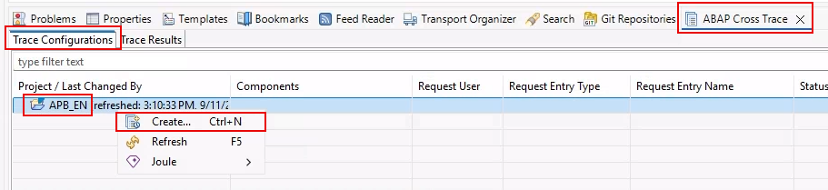</kbd>
---      
   3. Configure the Trace 

      | Setting | Value |
      |---|---|
      | `Activate Trace` | **Uncheck.** You can always activate when appropriate.|
      | `Deactivate at Number of Traces` | **Change to 1** for automatic deactivation of the trace when one trace is recorded. Because of too many **ABAP Cross Traces** performed in parallel by all participants, we want to limit the Trace Data Accumulation to a minimum.| 
      | `Deletion At` | Leave as default. Traces are automatically deleted after a few days.|
      | `Description` | **Enter** `ZTM268_Original_###` (replace `###` with your suffix). This prefix is applied to all traces from this configuration, allowing you to identify them later.|
      | `User` (under `Request Filters`) | Defaults to your logon user. No change required. |
      | `Request Entry Type` | **Select** `OData V4`, since the interaction is based on an OData V4 Service Binding.|
      
      <kbd>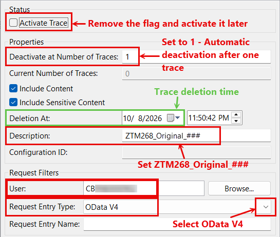</kbd>

      On the right-hand side, select the components to trace:
      - Click the top-level entry `SAP` twice to deselect all components.
      - Then select `SAP Gateway` only. Sub-components are selected automatically.
  
      <kbd>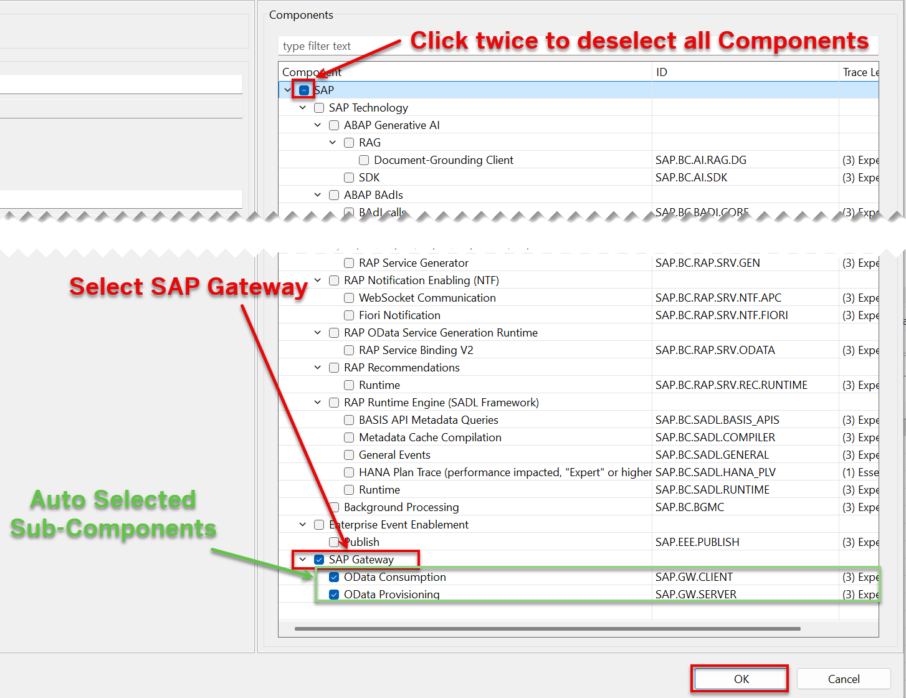</kbd>
      
      This completes the **ABAP Cross Trace** configuration. The screenshot below shows the final configuration.

      <kbd>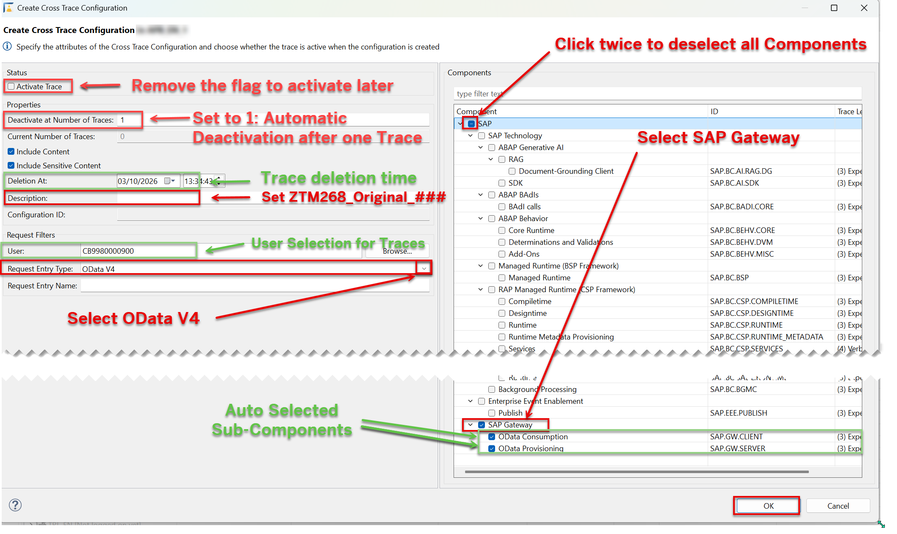</kbd>

      Click **`OK`** to save. The configuration appears as a new entry in the **`Trace Configurations`** tab. <br>
      
      ---

      🟠 **Automatic Deactivation of the Trace:** <br>
      By configuring the **ABAP Cross Trace** to deactivate after recording a single trace request:

      <kbd>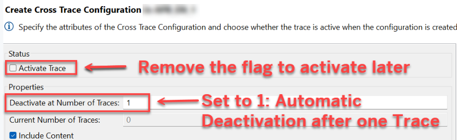</kbd> 

      the trace is automatically deactivated once the first frontend request has been traced.
      
      **Re-activation is not possible until the existing trace results are deleted:**

      <kbd>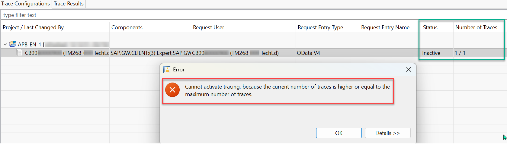</kbd> 

      To delete the associated trace results, right-click the configuration and select **Delete Associated Trace Results**:

      <kbd>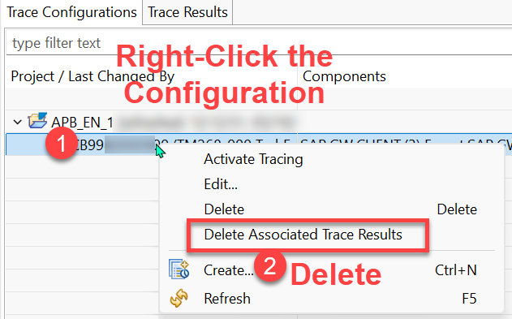</kbd> 
      
      Once the old traces are removed, a new **ABAP Cross Trace** can be activated: <br>
      <kbd>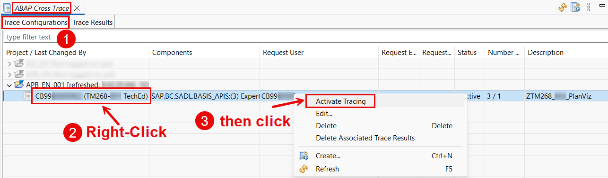</kbd> 
---
   4. Execute the **ABAP Cross Trace**

      If not still open, open the Preview again: <br>
      <kbd></kbd> 

      Activate the trace in the **`Trace Configuration`** tab by right-clicking the entry and selecting **`Activate Tracing`**.

      <kbd></kbd>
      
      Now the trace is active and the next OData request to the backend will be recorded.
      
      Next, go back to the preview of the Fiori application and click the **`Go`** button in the UI to record this step. Only the `POST` requests of the `Go` button should be traced.
      Do not refresh the page as this will trigger many other requests, which should not be part of the trace:

      <kbd></kbd>

      Navigate to the **`Trace Results`** tab to inspect the recorded trace: 
      - One trace entry was created per click on **`Go`**. 
      - If the latest trace is not visible, right-click the project and select **`Refresh (F5)`**. 

      <kbd>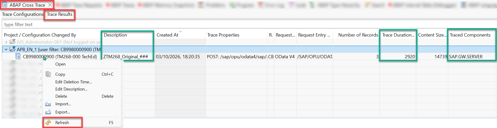</kbd>

      The overview shows the trace duration — approximately 2 to 3 seconds in this example — confirming a significant performance issue even though the result set is not displayed in the UI.
---
   5. Analyze the recorded trace

      Double-click the trace entry to open the detailed view showing detailed information grouped into different columns:
  
      <kbd>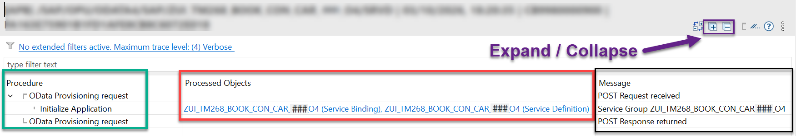</kbd> 

      The controls in the upper-right corner expand and collapse sections of the trace.

      Scrolling to the right reveals additional columns:

      <kbd>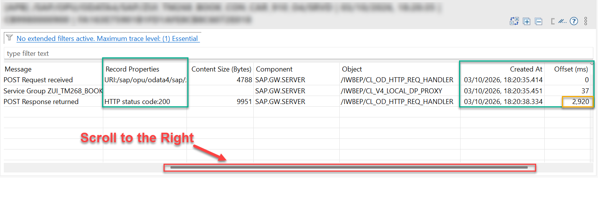</kbd> 

      Explanation of the Columns shown:

      | Column | Description |
      |---|---|
      |Procedure |	The processing step and its nesting in the call hierarchy.|
      | Processed Objects |	ABAP objects processed during the step (e.g. Service Definition, Service Binding). `Ctrl+click` navigates directly to the object.|
      |Message |	A brief description of what occurred during the step. |
      |Record Properties	| Additional details such as the HTTP status code. A value of `200` confirms successful processing.|
      | Created At / Offset (ms) |	Timing data — confirms that processing in Service Group **`ZUI_TM268_BOOK_CON_CAR_###_O4`** took about 2 to 3 seconds in this trace.|
---
   6. Analyze the Content

      Right-click the **OData Provisioning** entry with **POST Response returned** and select **`Open Content`**:
      - The response content shows results for `carrier_name = "Deutsche Lufthansa AG"`, confirming that the **`Go`** button does trigger a backend request and that data is successfully retrieved — it is simply not displayed in the UI.

        <kbd>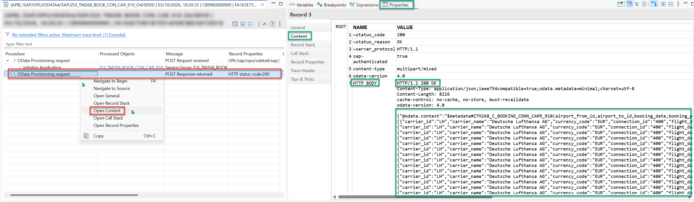</kbd> 
      
      - The response content contains groups of rows that share identical values for `carrier_id`, `carrier_name`, `currency_code`, `connection_id`, `flight_date`, `unique_id`, `airport_from_id`, `airport_to_id`, and `price_class` but differ only in the field **`booking_date`**:

        <kbd>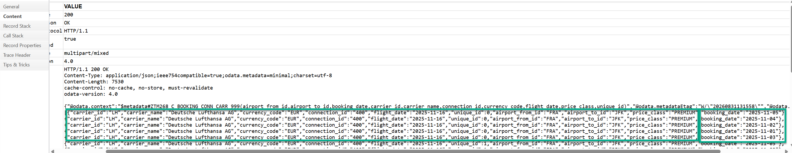</kbd>

 </details>

## Exercise 1.3: Use F12 Developer Tools in the Browser for further Root Cause Analysis
[^Top of page](#)

The **ABAP Cross Trace** confirmed that the request was successfully processed by the backend and that the response — including the booking list — was returned to the UI. Yet nothing is displayed in the browser.
Let us investigate if the processing (rendering) of the server response is causing any errors.

Modern browsers such as Edge and Chrome provide Developer Tools (DevTools) with a **`Console`** tab that displays error messages from request and response processing. Press `F12` to open DevTools.

> In this step, you use the **F12 Developer Tools** Console to investigate why the UI fails to render the received data:
> 1. Open the **F12 Developer Tools** and switch to the Console tab
> 2. Clear the Console output and reproduce the issue
> 3. Correlate the Console output with the findings from the **ABAP Cross Trace**

 <details>
  <summary>🔵 Click to expand!</summary>
  
  1. Open the **F12 Developer Tools** 

     Click anywhere in the browser window of your app:

     <kbd>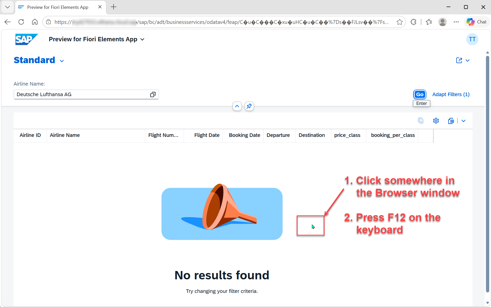</kbd>

     Press `F12` on the keyboard to open DevTools and switch to the **`Console`** tab:

     <kbd>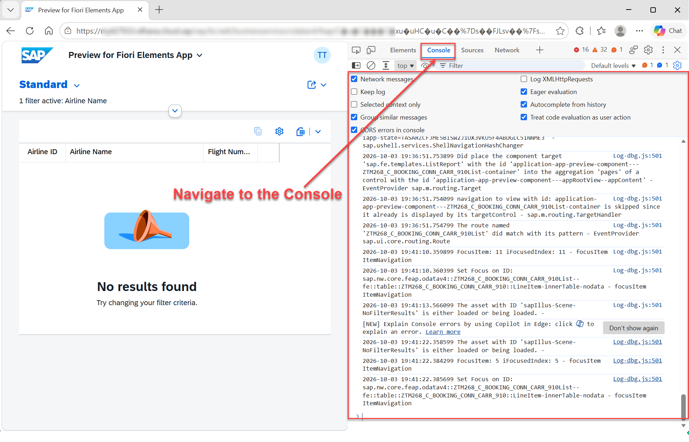</kbd>
  
  ---

  2. Clear the Console and execute the query again
     
     - Clear the Console by pressing the clear button or press `Ctrl+L`:
     
       <kbd>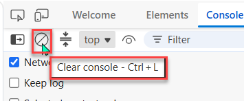</kbd>

     - Click **`Go`** in your app.
       
       <kbd></kbd>
  
  ---

  3. Correlate the Console output with the findings from the **ABAP Cross Trace**

     The Console now reports the following error message due to `Duplicate key predicate`: 

     <kbd>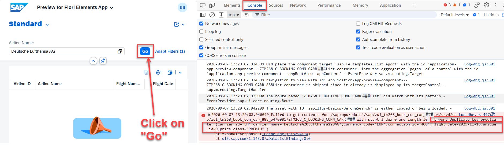</kbd>

     Observations:
     - In the console as `key predicates` only the following fields are listed (with their values): <br> `carrier_id`, `carrier_name`, `currency_code`, `connection_id`, `flight_date`, `unique_id`, `airport_from_id`, `airport_to_id`, and `price_class` 
     - According to the error message `Error: Duplicate key predicate: ...` with those given `key predicates` there are duplicates.

     Comparison with the **ABAP Cross Trace**:
     - Recheck the **ABAP Cross Trace** result above showing that the response content contains groups of rows that share identical values for `carrier_id`, `carrier_name`, `currency_code`, `connection_id`, `flight_date`, `unique_id`, `airport_from_id`, `airport_to_id`, and `price_class` but differ only in the field **`booking_date`**. <br>
       <kbd></kbd>

     - In the console error message the **`booking_date`** field is not in the list of key predicates, only the other fields.
     - The **ABAP Cross Trace** confirms that those same fields, used as `key predicates` contain duplicates.
  
     - But the UI refuses to render this list of duplicates: **`booking_date`** is a field that differentiates records in the backend but is somehow not exposed as part of the OData entity key. Accordingly, the key predicate constructed from the remaining key fields is identical for multiple rows. The model cannot reconcile this and signals the violation as a duplicate key predicate error.
   
     The error leads to the conclusion that the field **`booking_date`** was not correctly declared as a `key predicate`. The next step is to locate the ABAP artifact (Service Definitions, Data Definitions, …) that has to be corrected.

 </details>

## Exercise 1.4: Fix the Issue
[^Top of page](#)

The **F12 DevTools** reported that key predicates are not unique. The **ABAP Cross Trace** confirmed that the backend response contains duplicate rows for the affected key predicates — causing the UI framework to reject the payload and render no data. The field **`booking_date`** must be declared as an additional `key predicate` to ensure row uniqueness.

> In this step, you identify and resolve the root cause:
> 1. Locate the ABAP artifact — such as a CDS view or data definition — in which **`booking_date`** is not declared as a key field
> 2. Add the missing key declaration and verify the result

<details>
<summary>🔵 Click to expand!</summary>

1. Locate the ABAP artifact in which **`booking_date`** is not declared as a key field

    | Sources | Analysis |
    |---|---|
    |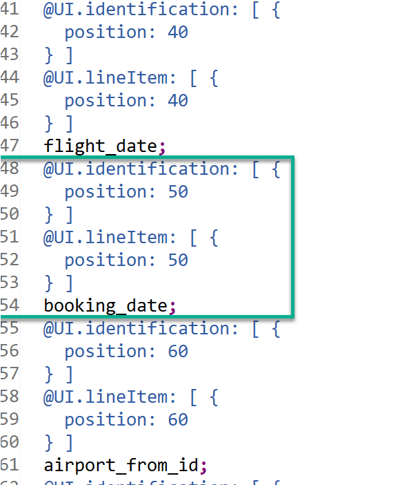| Checking the Metadata Extension **`ZC_TM268_BOOK_CONN_CARR_###`** confirms that `booking_date` is annotated consistently with the other fields — it is not the source of the problem. |
    |<kbd>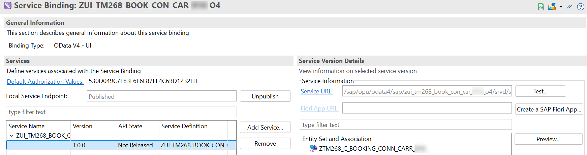</kbd>| The **Service Binding** contains no field-level information either, so it can be ruled out |
    |<kbd>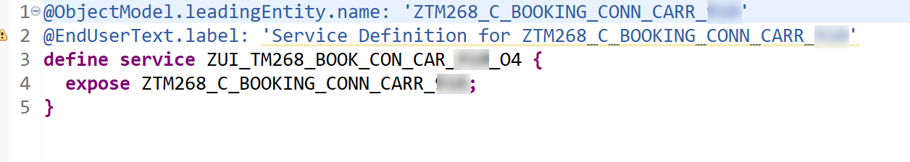</kbd>| The **Service Definition** contains no field-level information either, so it can be ruled out. It only refers to the exposed Consumption View **`ZTM268_C_BOOKING_CONN_CARR_###`** |
    |<kbd>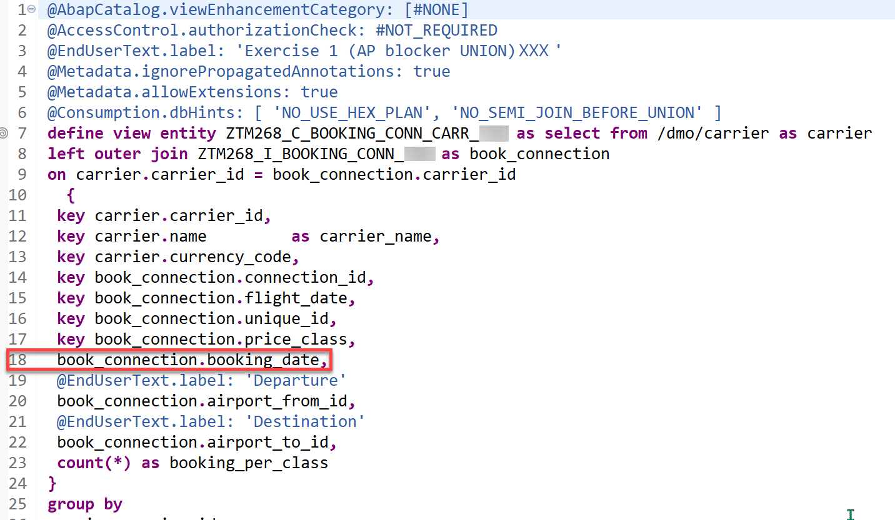</kbd>| Opening the Consumption View **`ZTM268_C_BOOKING_CONN_CARR_###`** reveals the actual cause: <br> the `booking_date` is not declared as a key field, unlike all other fields |

2. Fix the Issue — Declare `booking_date` as a Key Field

    Fix the issue by adding the `key` keyword to the `booking_date` field in line 18 of the Consumption View **`ZTM268_C_BOOKING_CONN_CARR_###`**:

    | Before the Fix | After the Fix |
    |---|---|
    |<kbd></kbd>|<kbd>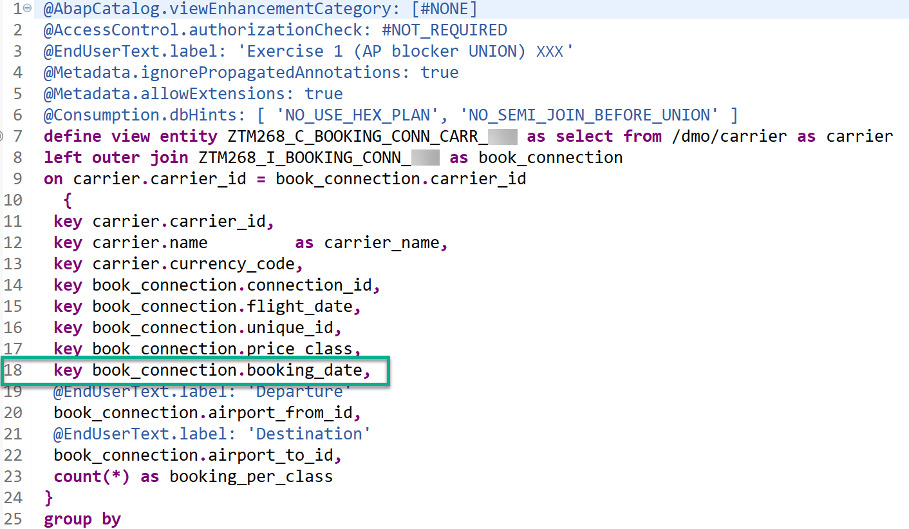</kbd>|
    
    <details>
    <summary>CDS View definition</summary>
    
    Below the fixed CDS View definition of `ZTM268_C_BOOKING_CONN_CARR_###`. Copy the entire code block and replace the complete CDS View definition in ADT.

    > ⚠️ Replace **`###`** with your personal suffix.

      ```abap
      @AbapCatalog.viewEnhancementCategory: [#NONE] 
      @AccessControl.authorizationCheck: #NOT_REQUIRED 
      @EndUserText.label: 'Exercise 1 (AP blocker UNION) ###' 
      @Metadata.ignorePropagatedAnnotations: true 
      @Metadata.allowExtensions: true 
      @Consumption.dbHints: [ 'NO_USE_HEX_PLAN', 'NO_SEMI_JOIN_BEFORE_UNION' ] 
      define view entity ZTM268_C_BOOKING_CONN_CARR_### as select from /dmo/carrier as carrier 
      left outer join ZTM268_I_BOOKING_CONN_### as book_connection 
      on carrier.carrier_id = book_connection.carrier_id
        { 
        key carrier.carrier_id, 
        key carrier.name         as carrier_name, 
        key carrier.currency_code, 
        key book_connection.connection_id, 
        key book_connection.flight_date, 
        key book_connection.unique_id, 
        key book_connection.price_class, 
        key book_connection.booking_date, 
        @EndUserText.label: 'Departure'
        book_connection.airport_from_id, 
        @EndUserText.label: 'Destination'
        book_connection.airport_to_id, 
        count(*) as booking_per_class 
      }  
      group by  
      carrier.carrier_id, 
      carrier.name, 
      carrier.currency_code, 
      book_connection.connection_id, 
      book_connection.flight_date, 
      book_connection.booking_date, 
      book_connection.unique_id, 
      book_connection.airport_from_id, 
      book_connection.airport_to_id, 
      book_connection.price_class 
      ```
    </details>

    Activate the changes by pressing `Ctrl+F3` or clicking the activate icon .
    
    The Read-Only List Reporting App now returns correct results when you 
    - refresh the page 
    - and then click **`Go`**:

    <kbd></kbd> 

</details>

## Summary & Next Exercise
[^Top of page](#)

You have completed Exercise 1. You systematically diagnosed and resolved a functional issue:
- The missing key field `booking_date` in the CDS View **`ZTM268_C_BOOKING_CONN_CARR_###`** caused the OData response to contain duplicate key predicates, which the UI rejected.

Along the way, you learned to use the **ABAP Cross Trace** and the **F12 Developer Tools** Console as complementary diagnostic tools for analyzing the data flow between backend and frontend.

Congratulations! 🎉

You can now ...
- continue with the next exercise ► **[Exercise 2: Performance Analysis Using the ABAP Cross Trace](../exercise-02/readme.md)** where you trace and analyze the performance of the app 
- or **[↑ Back to Tutorial Home - TM268](/README.md#-exercises)**.

## License

Copyright (c) 2026 SAP SE or an SAP affiliate company. All rights reserved. This project is licensed under the Apache Software License, version 2.0 except as noted otherwise in the [LICENSE](/LICENSE) file.