[Home - TM268](/README.md#-exercises)

# Exercise 2: Performance Analysis using the ABAP Cross Trace

## Introduction

The Read-Only List Reporting App created in [Exercise 1](../exercise-01/readme.md) recorded a runtime of approximately 2 to 3 seconds, as measured in the **Gateway Trace** within the **ABAP Cross Trace**.

<kbd>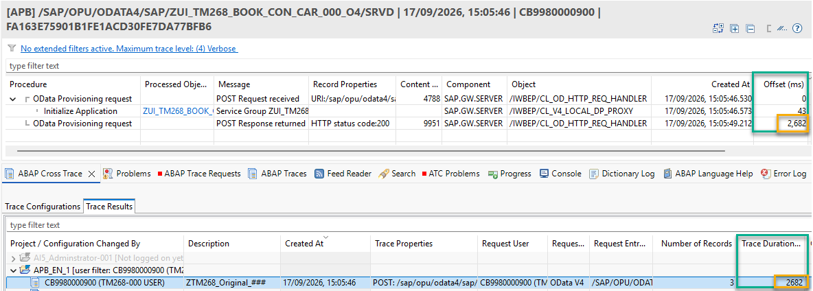</kbd>

A target runtime of under one second is considered acceptable. The overall runtime of such OData queries is typically driven by the `SELECT` operations on the CDS Views and the underlying SAP HANA database execution.

To optimize performance and resource utilization, it is necessary to analyze CPU and memory consumption on the SAP HANA database side, as well as the precise SQL execution plan, in order to identify optimization opportunities.

This exercise shows how to extend the **ABAP Cross Trace** to capture diagnostic data from the **SADL Framework** — specifically the `SELECT` execution against the SAP HANA database — and how to retrieve and visualize the corresponding execution plan (**PlanViz**) using the **SAP HANA SQL Analyzer** for VS Code.

The **ABAP Cross Trace** is the starting point for the performance analysis conducted in this exercise and in the subsequent Exercises 3 through 4.

---

Start by configuring and analyzing the corresponding performance trace in the **ABAP Cross Trace**.

### What you will learn

In this exercise, you will:

1. Learn how to extend an existing **ABAP Cross Trace** configuration with the **SADL Framework**
   and **HANA Plan Trace** components to capture SQL-level diagnostics
2. Understand what the **SADL Framework** trace component reveals about SQL execution —
   including query parameters, applied filters, row counts, CPU time, and peak memory consumption
3. Explore how switching between trace levels reveals different depths of diagnostic information
4. Learn how to access and download the **PlanViz** file from the **HANA Plan Trace**, open
   Visual Studio Code, verify the **SAP HANA SQL Analyzer** extension is installed, and open
   the **PlanViz** file in the **SAP HANA SQL Analyzer**

> [!NOTE]
> Throughout this exercise, use package **`ZTM268_###`** , where **`###`** is your personal suffix.  

### Exercises

- [Exercise 2: Performance Analysis using the ABAP Cross Trace](#exercise-2-performance-analysis-using-the-abap-cross-trace)
  - [Exercise 2.1: Extending the ABAP Cross Trace with SADL Framework and HANA Plan Trace](#exercise-21-extending-the-abap-cross-trace-with-sadl-framework-and-hana-plan-trace)
  - [Exercise 2.2: Analyzing the SADL Framework Trace Results](#exercise-22-analyzing-the-sadl-framework-trace-results)
  - [Exercise 2.3: Download the HANA Execution Plan and Upload to SAP HANA SQL Analyzer for Visual Studio Code](#exercise-23-download-the-hana-execution-plan-and-upload-to-sap-hana-sql-analyzer-for-visual-studio-code)

### Summary & Next Exercise

- [Summary & Next Exercise](#summary--next-exercise-1)

## Exercise 2.1: Extending the ABAP Cross Trace with SADL Framework and HANA Plan Trace
[^Top of page](#)

The trace configuration from Exercise 1 captured the Gateway layer only. To also capture the SQL execution against the SAP HANA database, it needs to be extended with the `RAP Runtime Engine (SADL Framework)` component — which includes the `HANA Plan Trace` sub-component that generates the **PlanViz** file for execution plan analysis.

> **In this step, you:**
> 1. Reconfigure the trace: add the SADL Framework component, set the HANA Plan Trace level to Verbose, and limit execution to one trace.
> 2. Activate and run the trace
> 3. Perform an initial analysis of the trace results.

 <details>
  <summary>🔵 Click to expand!</summary>


1. Reconfigure the **ABAP Cross Trace**

   Right-click the existing trace configuration from Exercise 1 and select `Edit`:

   <kbd>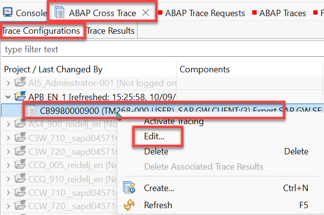</kbd>

   Apply the following changes:
   - **`Activate Trace`**: Uncheck — the trace will be activated manually in the next step.
   - **`Deactivate at Number of Traces`**: Set to **1** — the trace deactivates automatically after one request.
   - **`Description`**: Update to `ZTM268_###_with_PlanViz` to distinguish this configuration from the previous one.

      <kbd>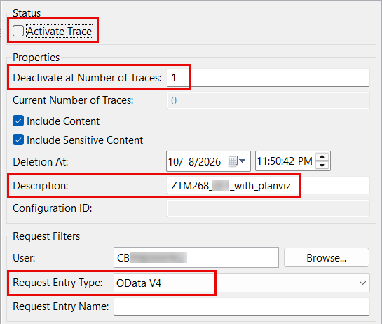</kbd>

   - **`Components`**: In addition to `SAP Gateway`, enable `RAP Runtime Engine (SADL Framework)`. The following sub-components are selected automatically:
     | Sub-Component | Purpose |
     |---|---|
     | BASIS API Metadata Queries | Traces resolution of CDS View definitions, entity types, and OData metadata |
     | Metadata Cache Compilation | Records compilation and caching of CDS and OData metadata structures |
     | General Events | Captures lifecycle events and processing milestones within the SADL layer | 
     | HANA Plan Trace | Captures the SQL execution plan generated by SAP HANA for `SELECT` statements issued by SADL |
     | Runtime | Traces `SELECT` statement generation, parameter binding, and query delegation to HANA |

      <kbd>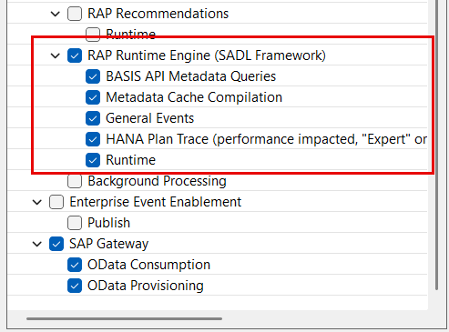</kbd>

   - ❗ **`HANA Plan Trace` — Trace Level**: Change from **(1) Essential** to **(4) Verbose** in the last column.

      <kbd>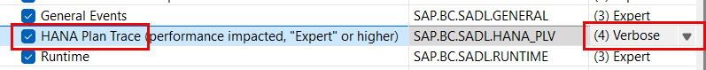</kbd>

      This completes the Cross Trace configurations. The screenshot below shows the final configuration.

      <kbd>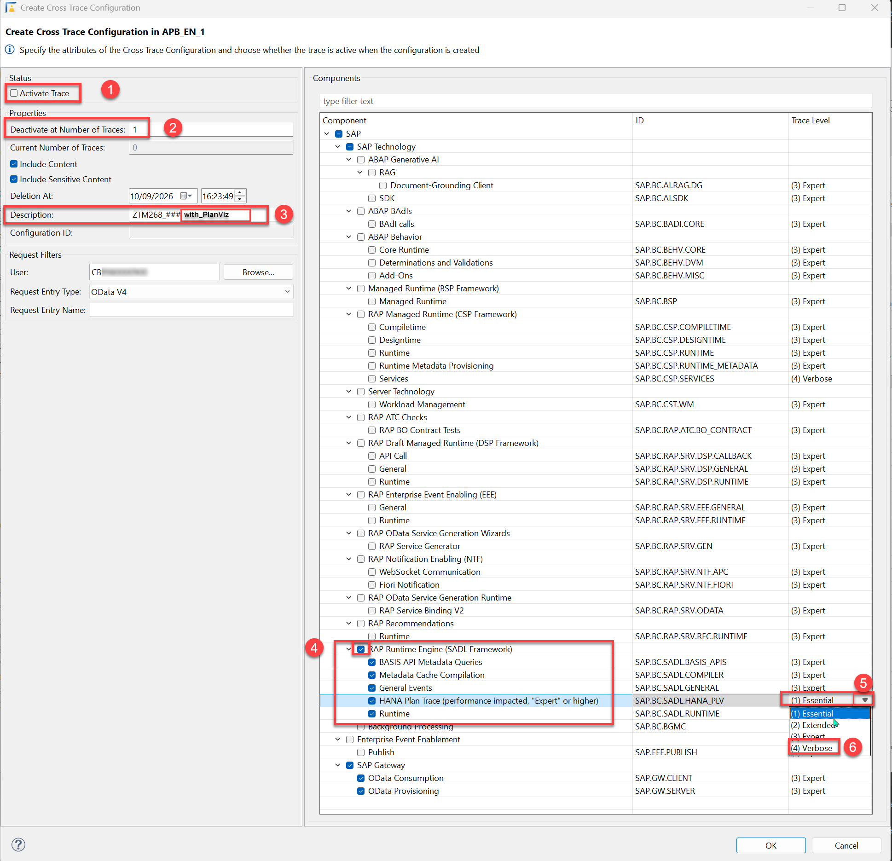</kbd>

   Click **`OK`** to save the configuration.

    ---

2. Activate and run the trace

    In the **`Trace Configuration`** tab, right-click the configuration entry and delete all previously associated trace results so that a new trace can be activated:

    <kbd>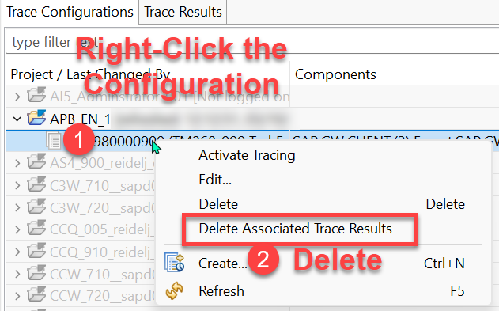</kbd>
    
    Then right-click the configuration entry again and select **`Activate Tracing`**.

    <kbd></kbd>

    Then click **`Go`** in the app to trigger the request:

    <kbd>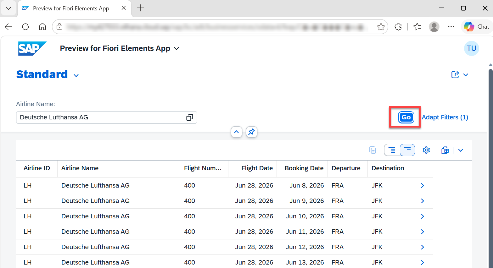</kbd>

    Once processing completes, the trace is automatically deactivated and the trace count shows 1 of 1 (otherwise click **`Refresh`**):

    <kbd>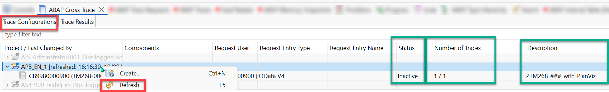</kbd>

    ---

3. Perform an initial analysis of the trace results

   Navigate to the **`Trace Results`** tab and click **`Refresh`**. The trace list shows entries from **all participants** - you must select your own. 
   
   > ℹ️
   > Use the **`Changed By`** column to identify your entry - it shows your user ID starting with `CB998`. Your entry will also have `TM268_###` in the **`Description`** column.<br>
   > Selecting another participant's trace will give incorrect results in the following steps.

   <kbd>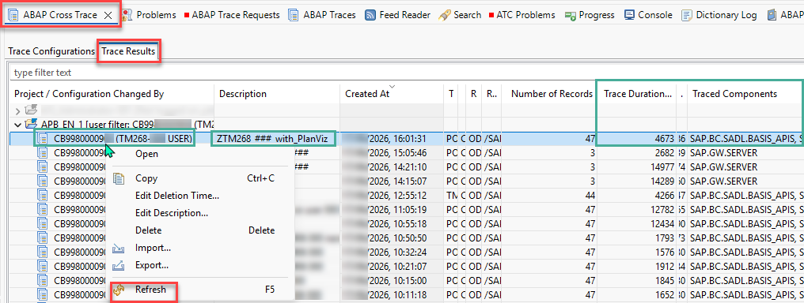</kbd>

   You will see a `POST` request listed in your `Trace Results`:
   
   <kbd>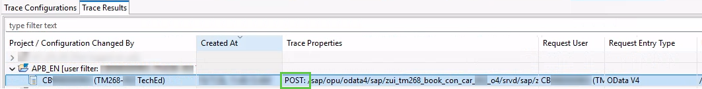</kbd>

   Double-click **your** trace entry to open the trace detail view:

   <kbd>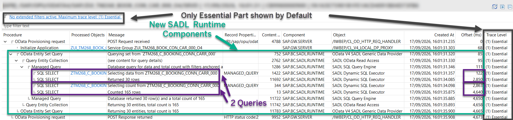</kbd>

   At the default trace level `(1) Essential`, the view shows:
   - An additional section (highlighted in green) contributed by the `RAP Runtime Engine (SADL Framework)` component.
   - Two queries visible in the violet-framed sections: one `SELECT` against the CDS View **`ZTM268_C_BOOKING_CONN_CARR_###`** that returns the actual data, the first page of 30 rows (paging is active by default), and one `COUNT` query returning a total of 165 available items.
   - A data selection runtime of approximately 2.7 seconds and an additional 1.78 seconds for the count query.

 </details>

## Exercise 2.2: Analyzing the SADL Framework Trace Results
[^Top of page](#)

With the SADL Framework component included in the trace, a detailed view of the SQL execution becomes available — covering the exact SQL statements, applied filters, SAP HANA hints, row counts, as well as CPU time and peak memory consumption on the SAP HANA database.

---

> [!WARNING]
> **PlanViz File Creation May Fail During Tracing**<br>
><br>ℹ️ Under the circumstances described below, you may not be able to capture a **PlanViz** file and may encounter the following error in the **ABAP Cross Trace**: <br> 
>`Creation of PlanViz File failed`  <br><br>
><kbd>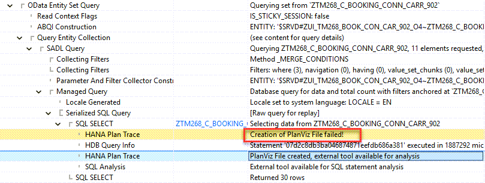</kbd>
><details>
>  <summary> 🔵 Why this error occurs & what to do about it</summary>
>
> The **HANA Plan Trace** is limited to one active user at a time:
> - In this TechEd session — with up to 80 participants across 40 clients and 2 ABAP instances — contention in tracing the SAP HANA execution plan is a real possibility. In real life there are no situations with so many concurrent performance trace activations on the same system.
> - The **ABAP Cross Trace** uses a minimal trace window: this specific trace to get the execution plan is activated immediately before the SADL Framework executes the SELECT statement and deactivated immediately after — reducing the risk of contention to a minimum. <br>
> - If another user's **HANA Plan Trace** is already active when you trigger the ABAP Cross Trace, no trace or **PlanViz** file will be generated, and you will see the following message `Creation of PlanViz File failed!`: <br><br>
>   <kbd></kbd> <br>
> - In that case, simply retry. If the issue persists, note that Exercises 3–5 include pre-attached **PlanViz** files that can be used directly for analysis.
> 
></details>

---

> **In this step, you:**
> 1. Analyze the trace at level `(1) Essential`
> 2. Switch to trace level `(4) Verbose` and update the Preferences to make this setting persistent
> 3. Analyze the trace at level `(4) Verbose` 

 <details>
  <summary>🔵 Click to expand!</summary>


1. Analyze the Trace at Level `(1) Essential` 

   When you right-click the rows marked in red and select **`Open Content`**, the following trace records are visible:

   - `Query Parameter Settings` — the requested fields, paging configuration (first 30 rows, subsequent rows are loaded on scroll), and the active filter (`CARRIER_NAME = 'Deutsche Lufthansa AG'`): <br>
     <kbd>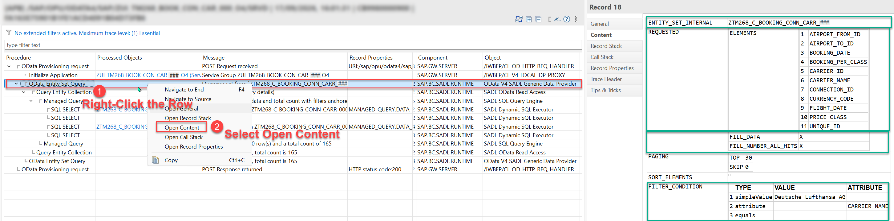</kbd>

   - `Query Entity Collection (Begin)` — all query options including applied HANA database hints:<br>
     <kbd>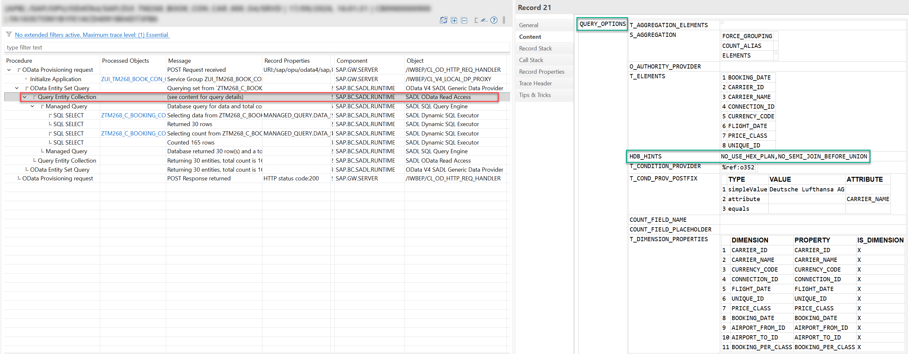</kbd>
   
   - `Query Entity Collection (End)` — the result of the query, including all returned field values: <br>
     <kbd>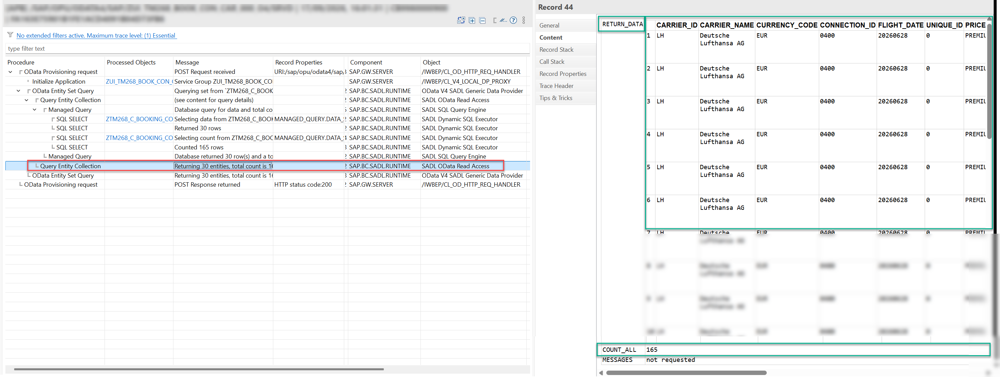</kbd>
     - All returned field values are visible

   - `SQL SELECT` — two queries with the corresponding SQL statements 
     - one for the data selection:<br>
       <kbd>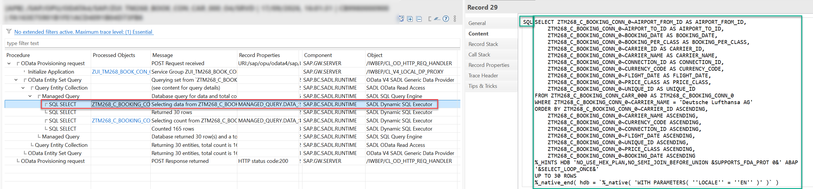</kbd>
     - and one for the count query: <br>
       <kbd>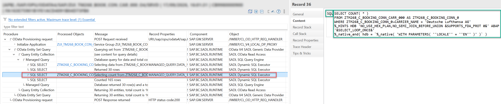</kbd>
        
    ---

2. Switch to Trace Level `(4) Verbose`
   
   To change the trace level for the current view:
   - Click the filter icon above the trace results
   - In the pop-up, set **`Maximum Trace Level`** to **`(4) Verbose`**
   - Click **`OK`** to confirm

   <kbd>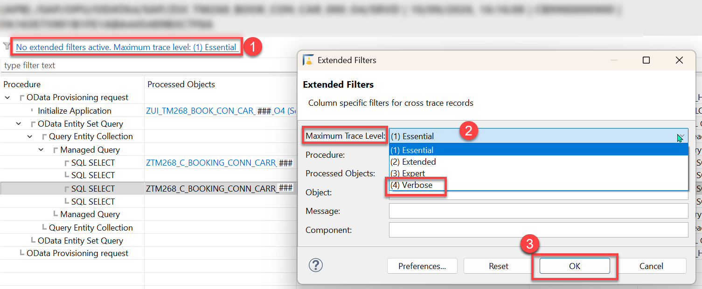</kbd>
   
   To make this setting persistent, update the Preferences:
   - Click the filter icon again and select **`Preferences...`**
   - In the subsequent pop-up, set **`Maximum Trace Level Filter Default`** to **`(4) Verbose`** and click **`Apply and Close`**  

   <kbd>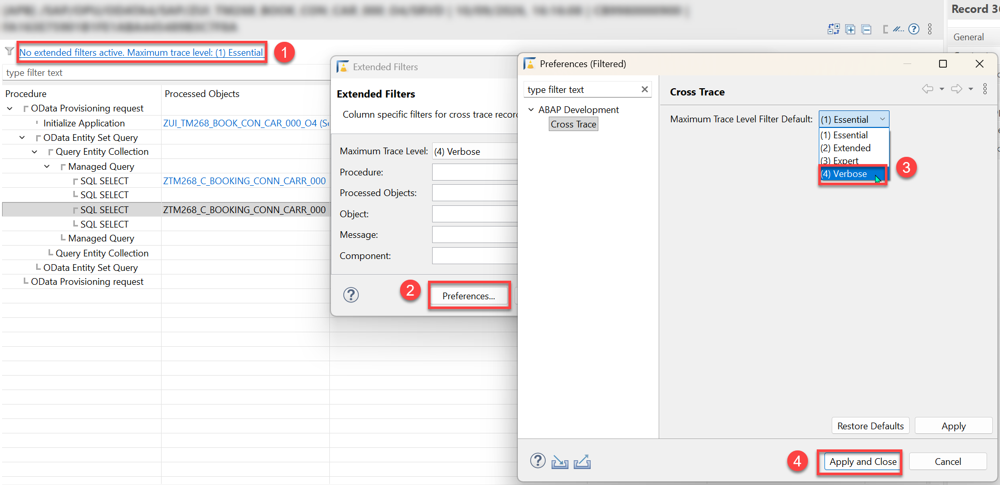</kbd>

   Expand the result to display the full trace:

   <kbd>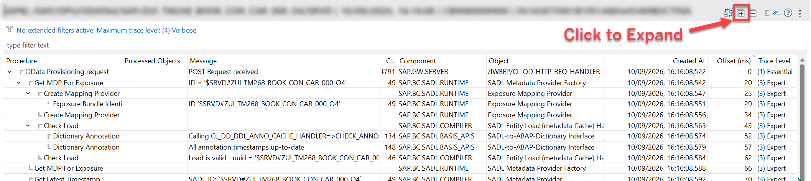</kbd>

    ---

3. Analyze the trace at level `(4) Verbose` 
   
   In the expanded trace at level `(4) Verbose`, focus on the `SQL SELECT` section:

   <kbd>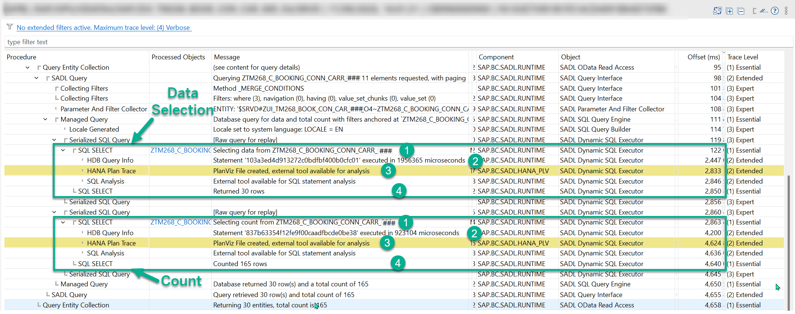</kbd>

   This section contains two separate blocks — one for the **Data Selection** and one for the **Count**. 

   Each block consists of the following entries:

   | Entry | Description / Content|
   |---|---|
   | SQL SELECT (Begin) | Indicates the operation: data selection from or count of **`ZTM268_C_BOOKING_CONN_CARR_###`** |
   | HDB Query Info | Provides the statement hash and execution time in microseconds |
   | HANA Plan Trace | Confirms that a PlanViz file was generated and provides a direct link to it |
   | SQL SELECT (End) | Reports the number of rows returned or the count result |

   Right-click each entry (marked 1 to 4 in the screenshot) and select `Open Content` to inspect the details:

   <kbd>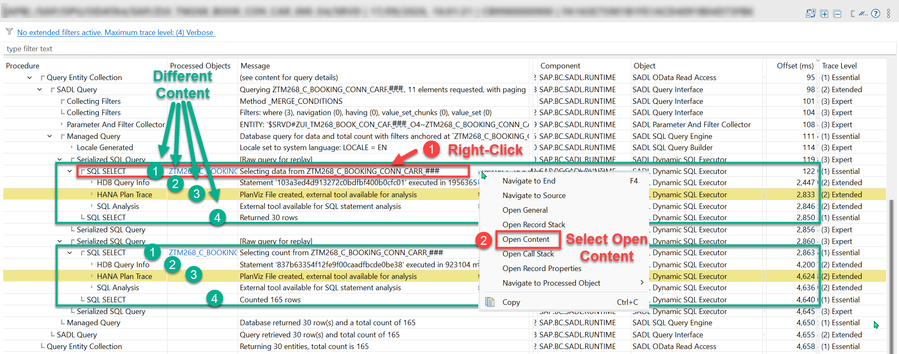</kbd>

   The content of each entry is as follows:
   - _SQL SELECT (Begin)_ — the full SQL statement: <br>
     |Data Selection | Count |
     |---|---|
     |<kbd>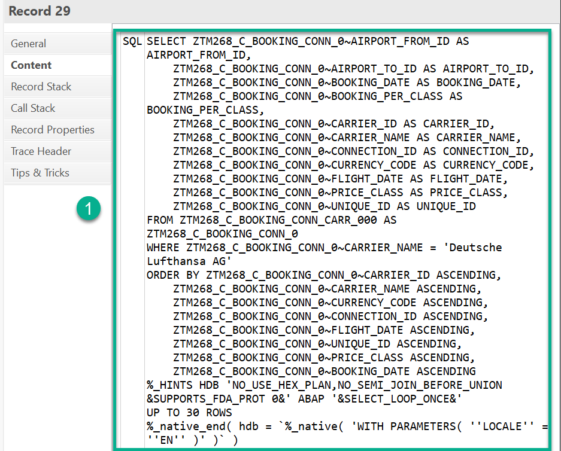</kbd>|<kbd>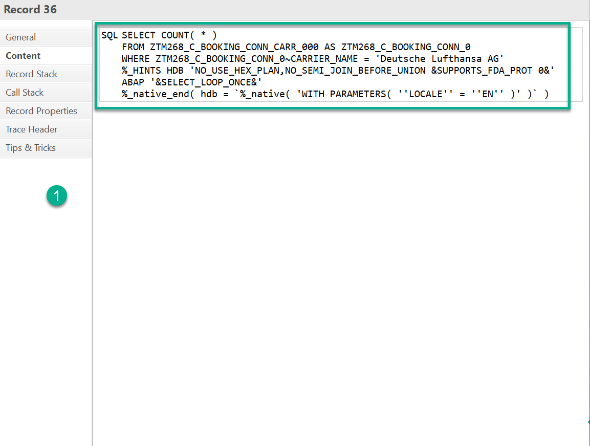</kbd>|
   - _HDB Query Info_ — HANA processing time, CPU time, and peak memory consumption: <br>
     |Data Selection | Count |
     |---|---|
     |<kbd>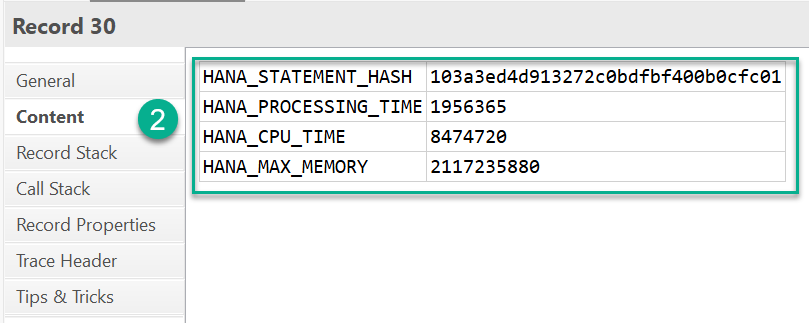</kbd>|<kbd>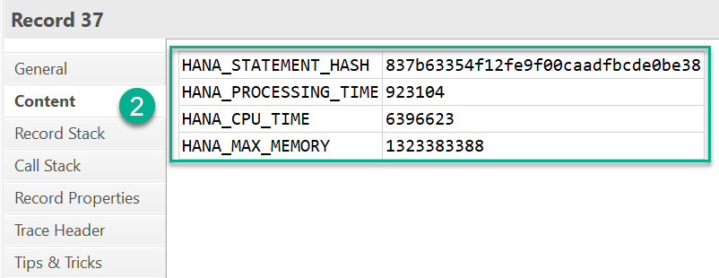</kbd>|
   - _HANA Plan Trace_ — direct links to the **PlanViz** files: <br>
     |Data Selection | Count |
     |---|---|
     |<kbd>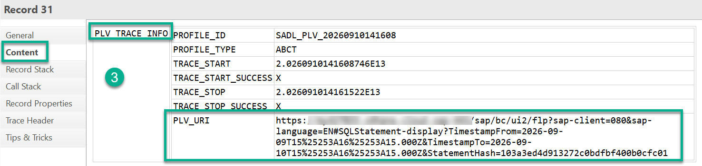</kbd>|<kbd>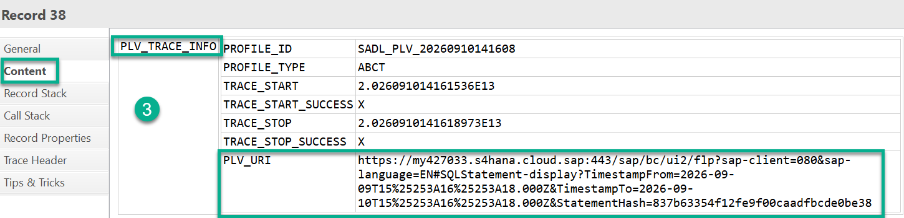</kbd>|
   - _SQL SELECT (End)_ — rows returned or count result: <br>
     |Data Selection | Count |
     |---|---|
     |<kbd>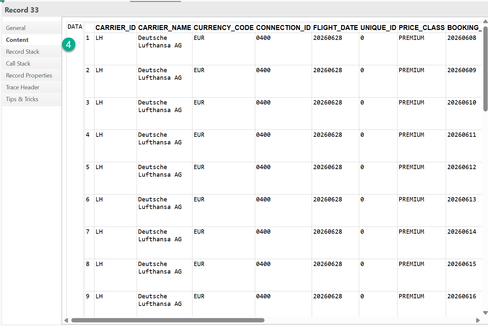</kbd>|<kbd>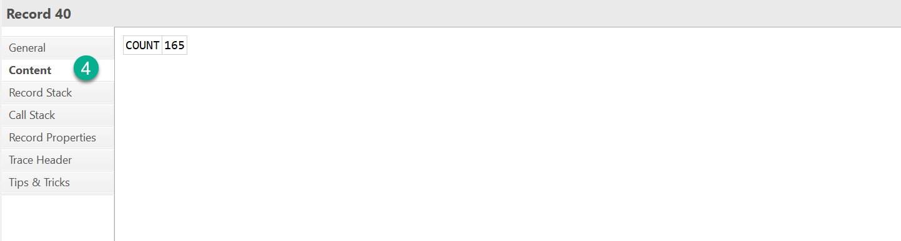</kbd>|

   This provides a comprehensive picture of the executed queries — including applied filters, HANA hints, field selection, row counts, CPU time, and peak memory consumption. 
   
   In the subsequent exercises, the CDS Views will be modified to improve performance, and new ABAP Cross Traces will be recorded after each change to measure the effect.

 </details>

## Exercise 2.3: Download the HANA Execution Plan and Upload to SAP HANA SQL Analyzer for Visual Studio Code
[^Top of page](#)

The **HANA Plan Trace** entry provides a direct link to the **PlanViz** file — the visual representation of the HANA SQL execution plan. Loading this file into the **SAP HANA SQL Analyzer** for Visual Studio Code enables a detailed inspection of the execution plan and helps identify the structural causes of the poor performance.

> **In this step, you:**
> 1. Open the link from the **HANA Plan Trace** entry and access the **Single SQL Statement Analysis** in the Technical Monitoring Cockpit (TMC) Fiori App 
> 2. Download and rename the **PlanViz** file
> 3. Open VS Code and verify that the **SAP HANA SQL Analyzer** extension is installed
> 4. Open the **PlanViz** file in the **SAP HANA SQL Analyzer**

 <details>
  <summary>🔵 Click to expand!</summary>

1. Open the HANA Plan Trace Link

   - In the trace detail view, select the **HANA Plan Trace** entry for the Data Selection, right-click, and choose `Open Content`. In the content view, select the full URL in the PLV_URI row, right-click, and copy it:
     <kbd>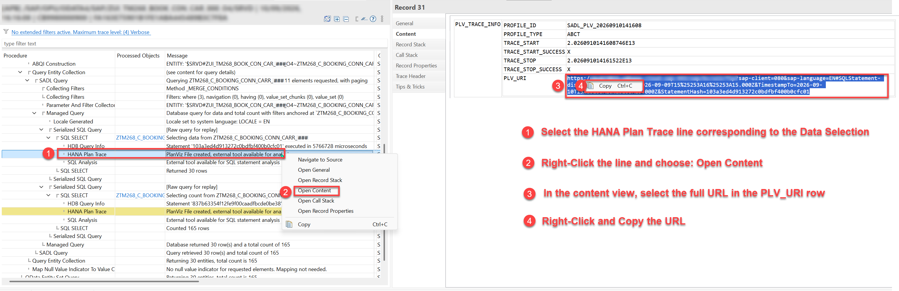</kbd>

      > ℹ️
      > In case you can't see the full path/URL to the **HANA Plan Trace**, press `Ctrl+M` while focusing the trace detail view to maximize it, which allows you to use the entire screen and see the full path to copy. Then press `Ctrl+M` again to revert the view back to its normal size.

   - Open a new browser window or tab and paste the copied URL to open the **Single SQL Statement Analysis** app:
     <kbd>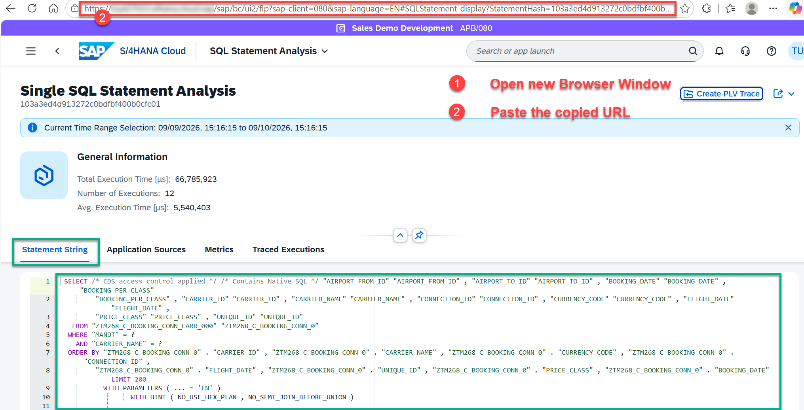</kbd>

    ---

2. Download and Rename the **PlanViz** file

   - Navigate to the **`Traced Executions`** tab and download the Plan:
     <kbd>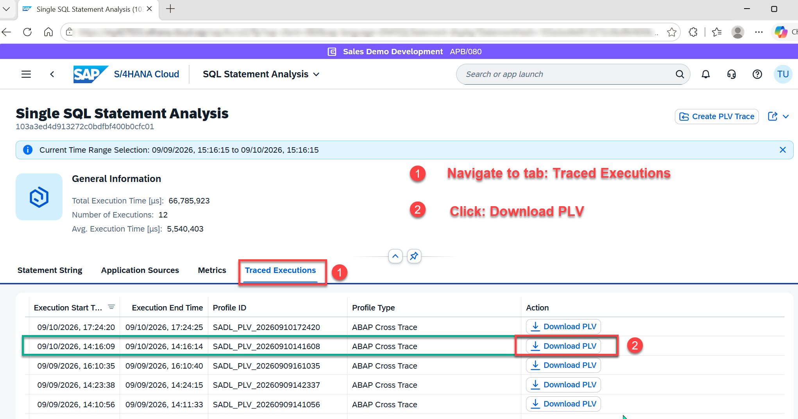</kbd>

   - Open File Explorer and navigate to the Downloads folder to locate the newly downloaded **PlanViz** file:
     <kbd>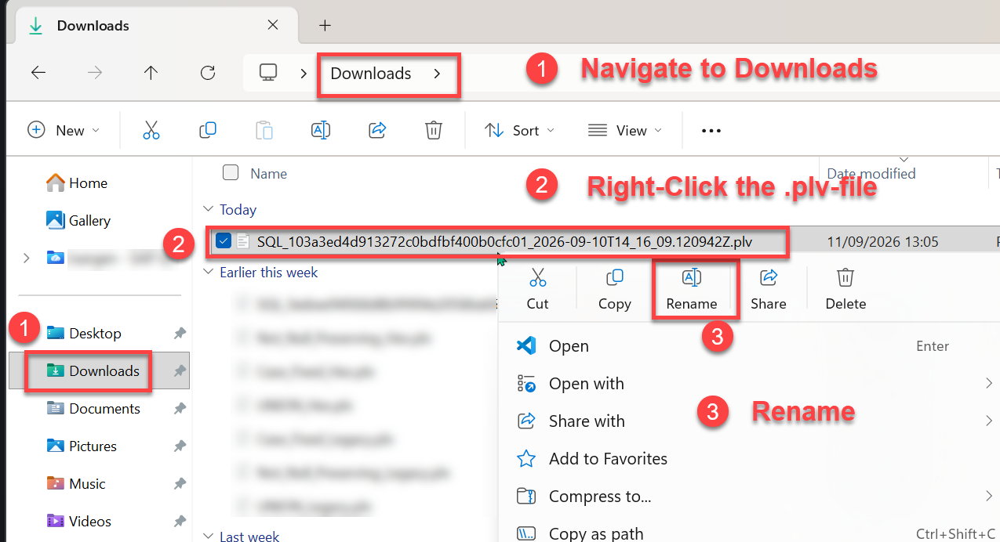</kbd>
   - Rename the file to: <pre><code> UNION_Legacy.plv </code></pre> 

    ---

3. Open VS Code and verify that the **SAP HANA SQL Analyzer** extension is installed

   1. **Launch VS Code.**

      Start VS Code. Once it loads, check the left sidebar — you should see the **SAP HANA SQL Analyzer** icon alongside other extensions, confirming the extension is installed and active. The Welcome tab or your last workspace appears in the editor area.

      <table>
        <tr>
          <th>VS Code sidebar with SQL Analyzer</th>
          <th>VS Code Welcome Screen</th>
        </tr>
        <tr>
          <td><kbd></kbd></td>
          <td><kbd>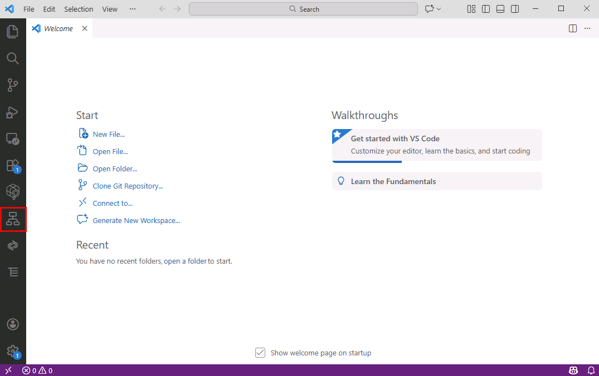</kbd></td>
        </tr>
      </table>
    ---
   2. **Verify the SQL Analyzer extension is installed.**

      Click on the **Extensions** icon  in the left sidebar (or press `Ctrl+Shift+X`) to open the `Extension Manager` of VS Code and search for **SAP HANA SQL Analyzer**.

      <kbd>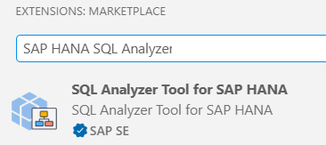</kbd>

      The extension should appear as **installed and enabled** (no `Install` button visible, no warning icon) in the `Extension Manager` of VS Code, as shown below.

      <kbd>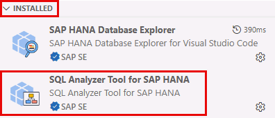</kbd>

      <details>
      <summary>Install the SAP HANA SQL Analyzer extension (optional)</summary>

         > ❗
         > If the extension is **not** installed, click **`Install`** and wait for the installation to complete before continuing.

         <kbd>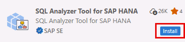</kbd>

         Once the installation is completed, you can continue with this exercise.
      </details>
    ---
4. Open the **PlanViz** file in the **SAP HANA SQL Analyzer**

   You have four options to open a `.plv` file for the **SAP HANA SQL Analyzer**:
   - double-click on the `.plv` file in the Windows File Explorer panel

   - open the **SAP HANA SQL Analyzer** and hover over the `PLAN GRAPHS` view in the sidebar on the left side and use the plus sign 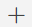 (`Add Plan File`)

   - drag and drop the plan file into the analysis view of VS Code

   - use the menu item **`File`** → **`Open Folder…`** and select your `plv` file

   For this exercise, use the menu item **`File`** → **`Open Folder…`** (`Ctrl+K Ctrl+O`) and navigate to the folder **`planviz_files`** provided in the folder for this exercise that contains the [PLV file](planviz_files/UNION_Legacy.plv), or open the **PlanViz** file that you downloaded above.

   <kbd>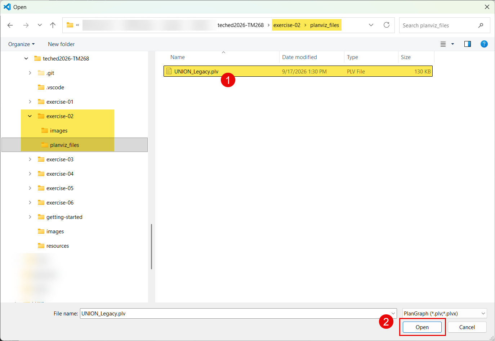</kbd>

   After opening, you should see the folder content in the **Explorer** panel on the left, including the following file:

   ```
   📁 exercise-02
      └── 📁 planviz_files
             └── UNION_Legacy.plv
   ```

   VS Code will now open the **PlanViz** in the **SAP HANA SQL Analyzer**. This can take a few seconds depending on the file size. You might see the following screen while the execution plan is being processed.

   <kbd>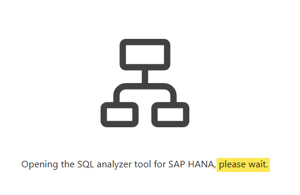</kbd>

   > ℹ️
   > If the file opens as raw JSON text instead of the graphical view, right-click the file → **`Open With…`** → **SAP HANA SQL Analyzer**.

   The **PlanViz** file `UNION_Legacy.plv` will then appear in the `PLAN GRAPHS` view on the left side. From this list, the PlanViz can be re-opened in case the tab has been closed.

   <kbd>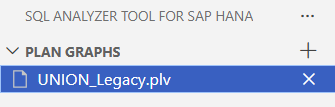</kbd>

   You have now successfully opened the **PlanViz** file in **SAP HANA SQL Analyzer**. You are now ready to inspect it. In [Exercise 3](../exercise-03/readme.md), you will get an introduction to **SAP HANA SQL Analyzer** and start analyzing the execution plan by investigating your first CDS anti-pattern to understand why `UNION ALL` prevents SAP HANA from pushing filters down to the base table. You will learn how to identify the root cause directly in the graphical execution plan.

</details>

## Summary & Next Exercise
[^Top of page](#)
 
In this exercise, you:

- extended the **ABAP Cross Trace** configuration with the **SADL Framework** and **HANA Plan Trace** components to capture SQL-level diagnostics,
- analyzed the trace at the levels `(1) Essential` and `(4) Verbose` and understood what each level reveals,
- identified the SQL statements, applied filters, HANA hints, row counts, CPU time, and peak memory consumption from the SADL Framework trace,
- downloaded the **PlanViz** file from the **HANA Plan Trace**, opened Visual Studio Code, verified that the **SAP HANA SQL Analyzer** extension is installed, and opened the **PlanViz** file in the **SAP HANA SQL Analyzer** for Visual Studio Code.
 
Congratulations! 🎉
 
You can now ...
- continue with the next exercise ► **[Exercise 3: Execution Plan Analysis using SAP HANA SQL Analyzer](../exercise-03/readme.md)** where you analyze the execution plan
- or **[↑ Back to Tutorial Home - TM268](/README.md#-exercises)**.
 
## License
 
Copyright (c) 2026 SAP SE or an SAP affiliate company. All rights reserved. This project is licensed under the Apache Software License, version 2.0 except as noted otherwise in the [LICENSE](/LICENSE) file.