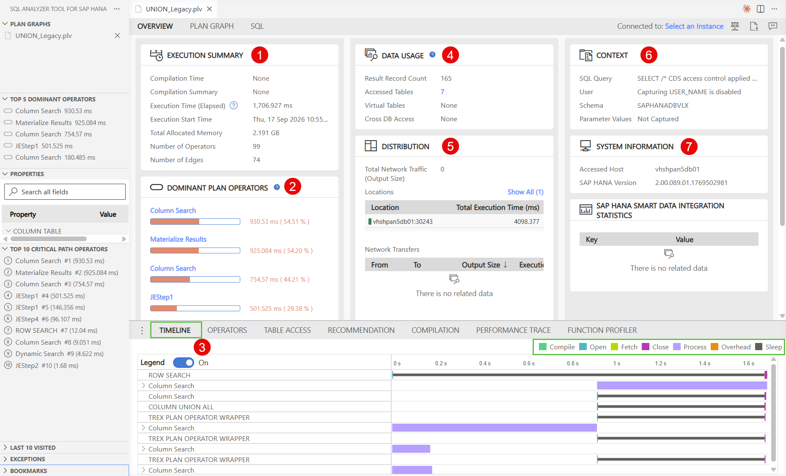
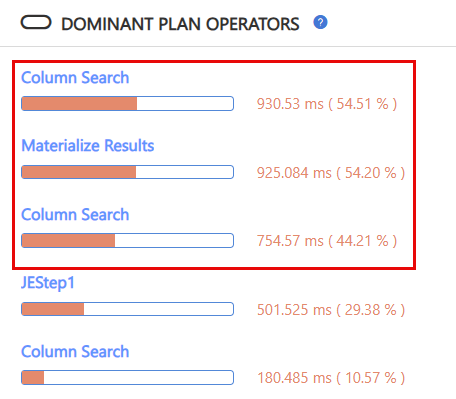
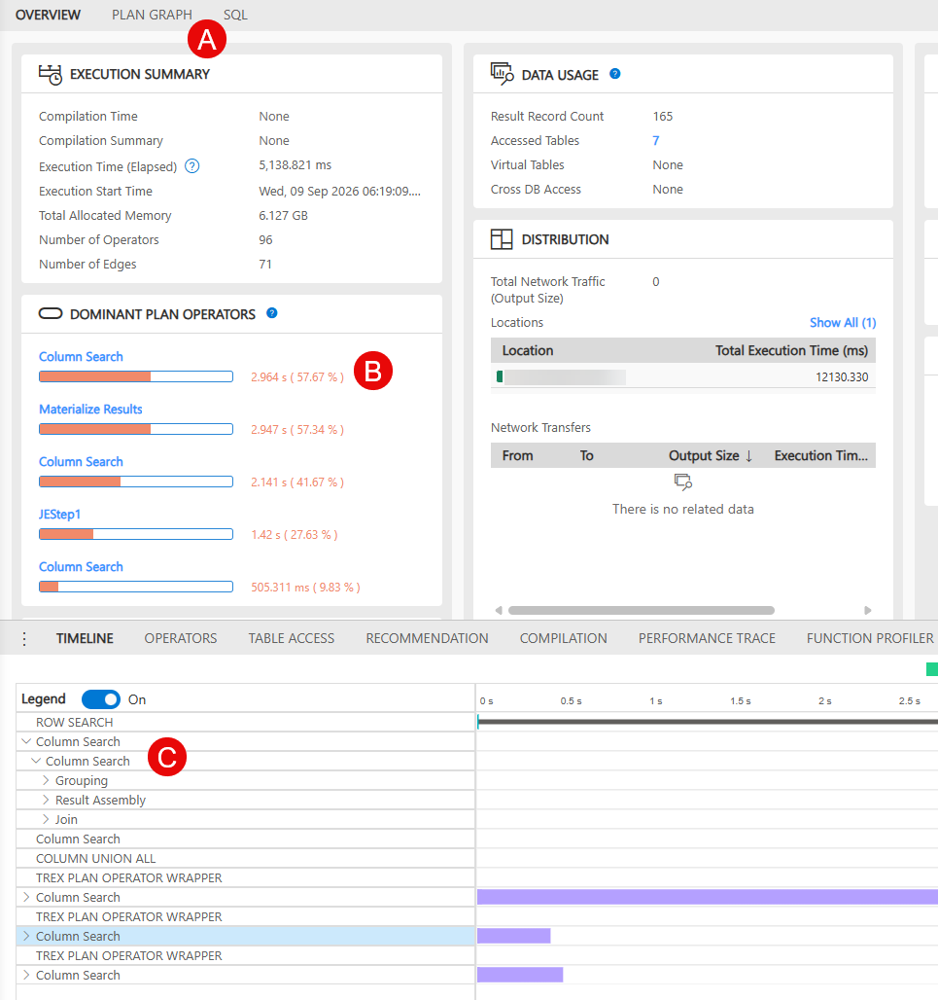
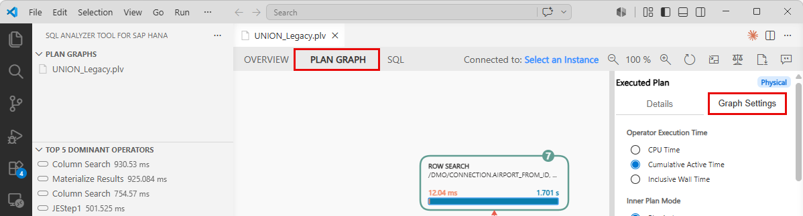
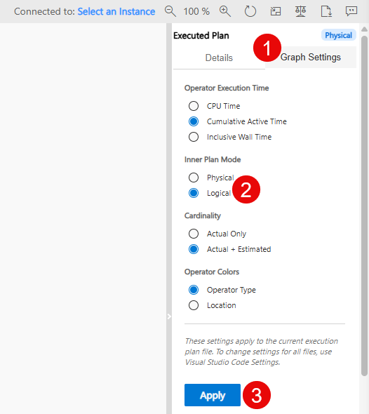
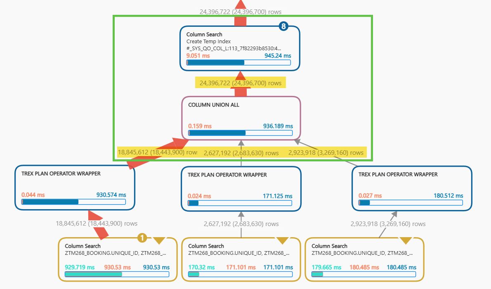
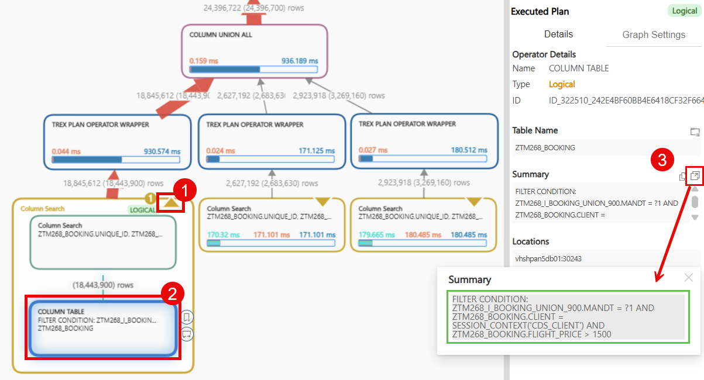
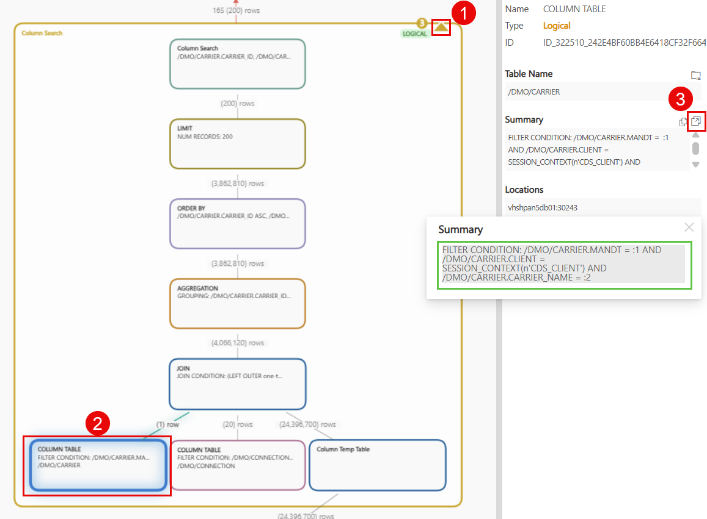

[Home - TM268](/README.md#-exercises)

# Exercise 3: Execution Plan Analysis using SAP HANA SQL Analyzer

## Introduction

In the previous exercises, you used the **ABAP Cross Trace** to analyze functional issues and to generate the SAP HANA **PlanViz** trace. In this exercise, the focus shifts to **performance analysis** and you will learn how to read and analyze SAP HANA execution plans with the **SAP HANA SQL Analyzer** extension for Visual Studio Code.

You will investigate the first CDS anti-pattern of this workshop — **Anti-pattern: UNION in a LEFT OUTER JOIN** — and understand why a seemingly innocent `UNION ALL` in a view definition can prevent SAP HANA from pushing filters down to the base table.

### What you will learn

In this exercise, you will:

1. Load a **PlanViz file** (`.plv`) for the anti-pattern analysis
2. Navigate within the graphical execution plan and identify the UNION ALL bottleneck
3. Understand why the filter `CARRIER_NAME = 'Deutsche Lufthansa AG'` cannot be pushed through the `UNION ALL` boundary
4. Compare key plan operators: `COLUMN UNION ALL`, `#_SYS_QO_...` temp objects, and full table scans

### Exercises

- [Exercise 3: Execution Plan Analysis using SAP HANA SQL Analyzer](#exercise-3-execution-plan-analysis-using-sap-hana-sql-analyzer)
  - [Exercise 3.1: Introduction to the SAP HANA SQL Analyzer — Explore the UNION PlanViz File](#exercise-31-introduction-to-the-sap-hana-sql-analyzer--explore-the-union-planviz-file)
  - [Exercise 3.2: Analyze the Execution Plan and Identify the Bottleneck](#exercise-32-analyze-the-execution-plan-and-identify-the-bottleneck)

### Summary

- [Summary & Next Exercise](#summary--next-exercise)

---

## Exercise 3.1: Introduction to the SAP HANA SQL Analyzer — Explore the UNION PlanViz File
[^Top of page](#)

> **In this step you:**
> 1. Explore the `OVERVIEW` page of the SQL Analyzer
> 2. Understand the view that produced this plan
> 3. Navigate from the `OVERVIEW` page to the Plan Graph

<details>
  <summary>🔵 Click to expand!</summary>


1. **Explore the Overview page.**

   When the **PlanViz** file [UNION_Legacy.plv](planviz_files/UNION_Legacy.plv) opens, the **SAP HANA SQL Analyzer** first shows the `OVERVIEW` tab in the `Analysis View`. It has three different tabs in total:
   * `OVERVIEW`
   * `PLAN GRAPH`
   * `SQL`
  
   The `OVERVIEW` tab gives you a high-level summary of the entire execution plan before you dive into the details.

   <kbd></kbd>

   The `OVERVIEW` tab contains the following areas:

   | Area | What you see | What to look for |
   |---|---|---|
   | **Execution Summary** | Key metrics of the query execution:<br>`Compilation Time` — time to compile the SQL plan<br>`Compilation Summary` — summary of the compilation result<br>`Execution Time (elapsed)` — total elapsed time for the query<br>`Execution Start Time` — timestamp when the execution was captured<br>`Total Allocated Memory` — peak memory used during execution<br>`Number of Operators` — total plan operations in the execution graph<br>`Number of Edges` — connections between operators in the graph | **Compilation time** should always be smaller than the **Execution Time**. <br>The **Execution Time (elapsed)**: A value in the seconds range directly signals a performance problem<br>**Total Allocated Memory**: A large value (GB range) indicates intermediate materialization — a direct consequence of the `UNION`<br>**Number of Operators**: A high count reflects model complexity and increases the risk that the optimizer skips certain plan alternatives |
   | **Dominant Plan Operators** | Bar chart of top operators by execution time — e.g.<br> `Column Search` (57.67%), <br>`Materialize Results` (57.34%), <br>`Column Search` (41.67%) | `Materialize Results` **in the top list**: an intermediate result had to be fully written to a temp table before the JOIN could proceed<br>**Multiple `Column Search` entries with high percentages**: Confirms SAP HANA scanned the full **`ZTM268_BOOKING`** table for each UNION branch without applying the carrier filter |
   | **Timeline** | Horizontal chart listing all executed operators (e.g. `ROW SEARCH`, `Column Search`, `COLUMN UNION ALL`, `Grouping`) with color-coded phase bars: Compile, Open, Fetch, Close, Process, Overhead | **Long `Column Search` bars**: Indicate full scans of **`ZTM268_BOOKING`** — confirm the carrier filter was not pushed down to the base relation<br>`COLUMN UNION ALL` bar: Marks where all three `UNION` branches merge — a wide bar here means the materialization step is expensive<br>Check for a long `COMPILE` bar at the top of the timeline — this indicates that the execution plan was compiled during this capture. High compilation time should only happen on the first execution, when SAP HANA generates and stores the plan in the SQL Plan Cache |
   | **Data Usage** | The total result count is 165 and 7 tables were accessed during the query processing | **Result vs. processed rows**: Only 165 rows returned, but millions from **`ZTM268_BOOKING`** were processed — the clearest sign of inefficient execution |
   | **Distribution** | Network-related data transfer between SAP HANA instances | Not relevant for this exercise — only important for SAP HANA Scale-Out systems where data is spread across multiple nodes |
   | **Context** | Displays the actual executed SQL statement and its session context: user, schema, and parameter values (not captured) | **SQL Query text**: Shows the full SQL statement that was analyzed<br>**Parameter values not captured**: Parameter values are not captured by default for security reasons |
   | **System Information** | Accessed host, SAP HANA version, and SAP HANA Smart Data Integration statistics | Useful for reproducibility — SAP HANA version affects optimizer behavior and available plan alternatives |

   > 💡
   > The parameter values can be captured by enabling the SAP HANA configuration `plan_cache_parameter_enabled` in the `indexserver.ini` file by the SAP HANA administrator.
   
   > ℹ️
   > Look at the **Dominant Plan Operators** bar chart **(2)**. You should see `Materialize Results` and `Column Search` as the top cost drivers — the `Materialize Results` entry is the direct consequence of the `UNION ALL` boundary forcing a full materialization of **`ZTM268_BOOKING`**.

   <kbd></kbd>

---

2. **Understand the view that produced this plan.**

   The execution plan was generated by querying the Consumption View **`ZTM268_C_BOOKING_CONN_CARR_###`** with a filter on a single airline (`CARRIER_NAME = 'Deutsche Lufthansa AG'`). The underlying view stack looks like this:

   ```
   ZTM268_C_BOOKING_CONN_CARR_###
   |
   └── /dmo/carrier                                   ← Level 5 | Consumer
   |
   └── LEFT OUTER JOIN ZTM268_I_BOOKING_CONN_###      ← Level 4 | Enrichment
       |
       └── ZTM268_I_BOOKING_UNION_###                 ← Level 3 | UNION layer (main focus)
       |    |
       |    ├── ZTM268_I_PREMIUM_###                  ← Level 2 | Price class: Premium
       |    |   | 
       |    |   └── ZTM268_BOOKING                    ← Level 1 | Base data (fact table)
       |    |
       |    ├── ZTM268_I_BUSINESS_###                 ← Level 2 | Price class: Business 
       |    |   | 
       |    |   └── ZTM268_BOOKING                    ← Level 1 | Base data (fact table)           
       |    | 
       |    └── ZTM268_I_STANDARD_###                 ← Level 2 | Price class: Standard 
       |        | 
       |        └── ZTM268_BOOKING                    ← Level 1 | Base data (fact table)
       |
       └── LEFT OUTER JOIN /dmo/connection            ← Level 4 | Enrichment
   ```

   The `UNION ALL` at Level 3 combines three separate views at Level 2 — one for each price class (`PREMIUM`, `BUSINESS`, `STANDARD`).

---

3. **Navigate to the Plan Graph.**

   To move from the `OVERVIEW` page to the detailed execution plan, you have three options:

   - Click on the `PLAN GRAPH` tab **(Option A)** at the top of the **SAP HANA SQL Analyzer** window.
   - Click on any operator in the `Dominant Plan Operators` bar chart **(Option B)** — the **SAP HANA SQL Analyzer** opens the `PLAN GRAPH` and jumps directly to the selected operator.
   - Click on any operator in the `Timeline` **(Option C)** — the **SAP HANA SQL Analyzer** opens the `PLAN GRAPH` and highlights the corresponding operator.

   <kbd></kbd>

   All three options bring you to the same `PLAN GRAPH` view that you will analyze in the next step.

</details>

---

## Exercise 3.2: Analyze the Execution Plan and Identify the Bottleneck
[^Top of page](#)

> **In this step you:**
> 1. Switch from the Physical to the Logical Execution Plan
> 2. Locate the `COLUMN UNION ALL` operator and observe the large row count
> 3. Navigate downwards to inspect the filters on **`ZTM268_BOOKING`**
> 4. Navigate upwards to find the JOIN with **`/dmo/carrier`** and observe the row count reduction
> 5. Understand why the `UNION ALL` blocks the `semi-join-reduction`

<details>
  <summary>🔵 Click to expand!</summary><br>

   When the `PLAN GRAPH` opens, it shows the **Physical Execution Plan** by default. The **Physical Execution Plan** shows the low-level SAP HANA engine operators, which are very technical and detailed. To get an overview and better understand the structure of the CDS View stack, switch to the **Logical Execution Plan**. This can be achieved by navigating to the `PLAN GRAPH` tab and opening the `Graph Settings` on the right side of VS Code.

   <kbd></kbd>   

1. **Switch from Physical to Logical Execution Plan**

   In the **`Graph Settings`** tab, select the radio button **`Logical`** and press the **`Apply`** button. A popup will appear where you have to press **`Apply`** again.

   <kbd></kbd>

   > ℹ️
   > The **Logical Plan** is engine-independent and shows the operators closer to the CDS View definition. At the same time, it is closer to the relational algebra (e.g. JOIN, UNION ALL, PROJECTION). This makes it easier to trace the anti-pattern back to the CDS model. <br><br>
   > The **Physical Plan** shows the engine (HEX, Calculation Engine, Join Engine, etc.) specific details, such as concrete operator implementations (Table Scan, Hash Join, Index Lookup etc.). It corresponds to the actual execution plan stored in the SQL Plan Cache.<br><br>
   > You continue to use the **Logical Plan** because it is easier to read and closer to the data model.

---

2. **Locate the COLUMN UNION ALL operator and observe the row count**

   In the plan graph, locate the node labeled **`COLUMN UNION ALL`**. SAP HANA is reading 24 million rows from the objects below the `UNION`. 
   > ℹ️ 
   > There are two numbers displayed. The number of rows **without brackets** represents the actual number of rows that have been processed. The number **in brackets** represents the row count estimated by the optimizer.

   <kbd></kbd>

   > ℹ️
   > The output row count of the `UNION ALL` node represents the combined rows from **all three** UNION branches (PREMIUM, BUSINESS, STANDARD). This number equals the **total number of rows in `ZTM268_BOOKING`** — millions of rows — because no carrier filter has been applied up to this point.

   > ❗
   > The root cause of the performance problem is the selection of a very large number of rows from the table `ZTM268_BOOKING` which has to be processed further in the subsequent operators.

---

3. **Navigate downwards: inspect the filters on `ZTM268_BOOKING`.**

   Follow the plan tree downwards from the `UNION ALL` node to the leaf nodes — the `Column Search` on **`ZTM268_BOOKING`**. Click on the triangle (1) at the top-right corner of the operator, then click on the `COLUMN TABLE` nodes (2) and inspect the **filters** in the summary section of the operator details on the right side. By clicking on the icon (3) , the full details will expand and be shown as a separate popup.

   <kbd></kbd>

   You will find the following filters applied to the table scan, which are hard-coded filters in the CDS View model:

   | Filter | Source |
   |---|---|
   | `MANDT = <current client>` | Implicit ABAP client filter |
   | `CLIENT = <current client>` | Implicit ABAP client filter |
   | `FLIGHT_PRICE` condition | Filter defined in the corresponding CDS Views (`ZTM268_I_PREMIUM_###`, `ZTM268_I_BUSINESS_###`, `ZTM268_I_STANDARD_###`) |

   > ⚠️
   > You will **not** find a filter on `CARRIER_ID` here. The carrier filter is set by the user in the UI via `CARRIER_NAME`. This filter is applied in table **`/dmo/carrier`** to find the `CARRIER_ID`. The `CARRIER_ID` is then used as a join condition on table **`ZTM268_BOOKING`**. This join cannot cross the `UNION ALL` boundary — the filter on `CARRIER_ID` is therefore missing from the table column search, causing SAP HANA to read the rows for all carriers from the table **`ZTM268_BOOKING`**. This anti-pattern will be described in more detail in the following [Step 5](#why-union-in-left-outer-join).

---

4. **Navigate upwards: find the JOIN with `CARRIER_ID` and observe the row count reduction**

   Now follow the plan tree upwards from the `UNION ALL` node to the **Column Search** operator that contains the `JOIN` operator and connects the table **`ZTM268_BOOKING`** with the **`/dmo/carrier`** table.

   Open the `Column Search` on **`/dmo/carrier`** by clicking on the small triangle (1) at the top-right corner of the operator. Look at the `JOIN` node and compare the row estimates that flow into and out of the `JOIN` operator:

   <kbd></kbd>

   | Side | Row Count | What it means |
   |---|---|---|
   | Left input (**`/dmo/carrier`** table) | 1 row — only the rows matching the carrier filter | The carrier filter is very selective |
   | Right input (`UNION ALL` result (Column Temp Table)) | 24 million rows | All bookings, unfiltered |
   | JOIN output | 4 million rows | The join with the selective left side finally reduces the result |

   > 💡
   > The `Column Temp Table` indicates that the result of the `UNION ALL` has been materialized. This means that all 24 million rows as an intermediate result of the `UNION ALL` had to be written to a temporary table for further processing. This step is visible as a `Column Search - Create Temp. Index` with a table name that starts with `#_SYS_QO_COL_L`...

   Click on the `COLUMN TABLE` node of **`/dmo/carrier`** and analyze the summary on the right side of the screen.

   > 💡
   > In the summary of the operator you will **not** see `CARRIER_NAME = 'Deutsche Lufthansa AG'` as a literal value. Instead, the filter appears as a **bind variable** (e.g. `CARRIER_NAME = ?` or `CARRIER_NAME = :2`). This is because the ABAP server sends the query as a **prepared statement**: the SQL structure is compiled once, and the input value (e.g. "Deutsche Lufthansa AG") is passed separately at runtime as a parameter. This allows SAP HANA to **reuse the compiled execution plan** for any airline the user selects — no additional compile step is needed for each new input value.

---

5. <a id="why-union-in-left-outer-join"></a>**Why is a UNION in a LEFT OUTER JOIN a problem?**

   A `LEFT OUTER JOIN` cannot be moved before (pushed down through) a `UNION` because doing so changes the logic of the query, which could produce wrong results. Because query optimizers must ensure that optimized query plans produce identical results to unoptimized ones across all datasets, SAP HANA prevents automatic pushdown of `LEFT OUTER JOIN` through `UNION`.

   <details> 
   <summary> Example for wrong results when the <b>LEFT OUTER JOIN</b> is pushed down through the UNION</summary>

   **Given these tables (user filters on Lufthansa):**

   `/dmo/carrier` (filtered to `LH`):

   | CARRIER_ID | NAME |
   |---|---|
   | `LH` | Lufthansa |

   `premium_booking` — There is 1 entry for `LH` in the premium booking table:

   | CARRIER_ID | PRICE |
   |---|---|
   | `LH` | 2000 |
   | `BA` | 1600 |

   `standard_booking` — There is **no** entry for `LH` in the standard booking table:

   | CARRIER_ID | PRICE |
   |---|---|
   | `EK` | 900 |

   ---

   **Correct execution — `UNION ALL` first, then `LEFT OUTER JOIN`:**

   `UNION ALL` produces 3 rows. The `LEFT OUTER JOIN` with `carriers (LH)` then reduces to only matching rows:

   | NAME | PRICE | |
   |---|---|---|
   | Lufthansa | 2000 | ✅ |

   **1 row — correct.**

   ---

   **Wrong result — if `LEFT OUTER JOIN` were pushed into each branch first:**

   `/dmo/carrier (LH)` LEFT OUTER JOIN `premium_booking`:

   | NAME | PRICE |
   |---|---|
   | Lufthansa | 2000 |

   `/dmo/carrier (LH)` LEFT OUTER JOIN `standard_booking`:

   | NAME | PRICE |
   |---|---|
   | Lufthansa | `NULL` | ← `LH` has no standard booking — but LEFT OUTER JOIN still produces this row

   `UNION ALL` of both results:

   | NAME | PRICE | |
   |---|---|---|
   | Lufthansa | 2000 | ✅ |
   | Lufthansa | `NULL` | ❌ wrong! ➡️ `LH` has a booking — ghost row from the standard branch where `LH` has no data |

   **2 rows instead of 1.** Lufthansa appears twice — the `LEFT OUTER JOIN` on the standard branch produces a spurious `NULL` row because `LH` has no standard booking, even though `LH` *does* have booking data in the other branch.

   </details>

   However, there is an optimization which is called `semi-join-reduction`. This technique is used to achieve the performance gains of pushdown without changing the semantics that may produce different results.

   <details>
   <summary> Example and explanation for <b>semi-join-reduction</b></summary>

   The following example uses the same tables and `LH` filter as above.

   A semi-join pre-filter asks only: **"does this row's `carrier_id` exist on the left side?"**
   It does **not** produce `NULL` rows for non-matches — it simply removes rows that could never contribute to the result. The actual `LEFT OUTER JOIN` is still applied correctly *after* the `UNION ALL`.

   **Semi-join pre-filter applied to each branch independently:**

   `premium_booking` — keep only rows where `carrier_id` exists in `carriers (LH)`:

   | CARRIER_ID | PRICE | |
   |---|---|---|
   | `LH` | 2000 | ✅ kept |
   | ~~`BA`~~ | ~~1600~~ | removed — BA not in filter |

   `standard_booking` — keep only rows where `carrier_id` exists in `carriers (LH)`:

   | CARRIER_ID | PRICE | |
   |---|---|---|
   | ~~`EK`~~ | ~~900~~ | removed — EK not in filter |

   `UNION ALL` now produces only **1 row**. The `LEFT OUTER JOIN` is applied afterwards with full correct semantics:

   | NAME | PRICE | |
   |---|---|---|
   | Lufthansa | 2000 | ✅ |

   **1 row — correct result, and only 1 row read from the booking tables instead of 3 rows.**

   The semi-join achieves the performance benefit of pushdown without producing the ghost `NULL` row seen in the wrong-result example — because it never joins, it only filters.

   </details>
   
   > 💡
   > This anti-pattern will be added as part of the CDS View performance anti-pattern blog series published at the SAP Community. [Read the full blog post](https://community.sap.com/t5/enterprise-resource-planning-blog-posts-by-sap/cds-view-performance-best-practices/ba-p/13559714)

   **Why is the optimization `semi-join-reduction` not always applied?**

   In principle, SAP HANA can use the `semi-join-reduction`: it pre-filters the right side of a `LEFT OUTER JOIN` using the keys from the selective left side — effectively pushing the carrier filter down through the `UNION ALL` into the table access on **`ZTM268_BOOKING`**. This would make the execution efficient regardless of the `UNION ALL`.

   However, the `UNION ALL` boundary **may block this optimization**. The hint `NO_SEMI_JOIN_BEFORE_UNION` was used to explicitly reproduce this behavior in this **PlanViz**. In [Exercise 5](../exercise-05/readme.md) you will see how SAP HANA processes the query without any hints.

   > ℹ️
   > In SAP HANA, the UNION is **not a hard blocker**. Whether the optimizer applies `semi-join-reduction` across a `UNION` depends on several factors:
   > - **Heuristics** — heuristics like returned rows from the right side and the number of modeled UNIONs
   > - **Model complexity** — the deeper and wider the CDS View stack, the less likely the optimizer explores this path
   > - **Cost estimation accuracy** — if SAP HANA underestimates the row count on either side, it may not consider the semi-join worthwhile
   > - **Optimizer iteration thresholds** — SAP HANA limits the number of plan alternatives it evaluates; complex models may exhaust these limits before reaching the optimal plan
   >
   > This means the anti-pattern may not always cause a visible performance problem in test systems with small data volumes, but will reliably appear under more realistic scenarios (production load, large volume, complex models, ...)

   Since the `UNION` can be a problem in a `LEFT OUTER JOIN` (anti-pattern), a possible fix is to avoid the `UNION`. In this example, the `UNION ALL` can be replaced with a `CASE`. This fix for the anti-pattern will be shown and analyzed in the next [Exercise 4](../exercise-04/readme.md).

</details>

---

## Summary & Next Exercise
[^Top of page](#)

In this exercise, you:

- learned how to use the **SAP HANA SQL Analyzer** tool in Visual Studio Code to open and analyze a **PlanViz** file,
- switched between the Physical and Logical Execution Plans in the SQL Analyzer,
- identified the actual root cause of the performance problem — full table scan on **`ZTM268_BOOKING`** and no filter pushdown,
- located the `COLUMN UNION ALL` operator and observed that millions of rows from **`ZTM268_BOOKING`** pass through it unfiltered,
- inspected the predicates on the **`ZTM268_BOOKING`** table scan and confirmed that the `CARRIER_ID` filter is **missing**,
- found the JOIN with the **`/dmo/carrier`** table and observed that the row count reduction only happens **after** the full UNION materialization,
- learned why the `UNION ALL` can be a performance problem if SAP HANA does not automatically apply a `semi-join-reduction` and why this depends on various factors.

Congratulations! 🎉

You can now:
- continue with the next exercise ► **[Exercise 4: Rewrite with CASE and Execution Plan Analysis using SAP HANA SQL Analyzer](../exercise-04/readme.md)**
- or **[↑ Back to Tutorial Home - TM268](/README.md#-exercises)**.

---

## License

Copyright (c) 2026 SAP SE or an SAP affiliate company. All rights reserved. This project is licensed under the Apache Software License, version 2.0 except as noted otherwise in the [LICENSE](/LICENSE) file.
