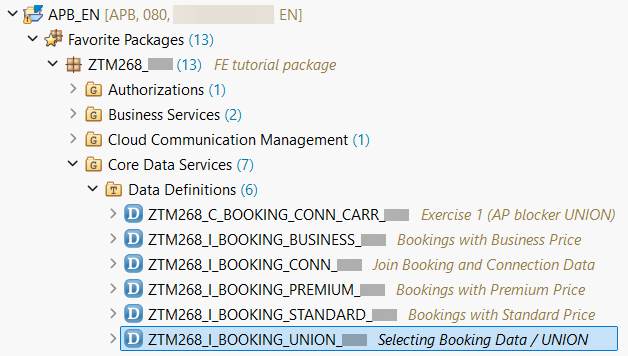
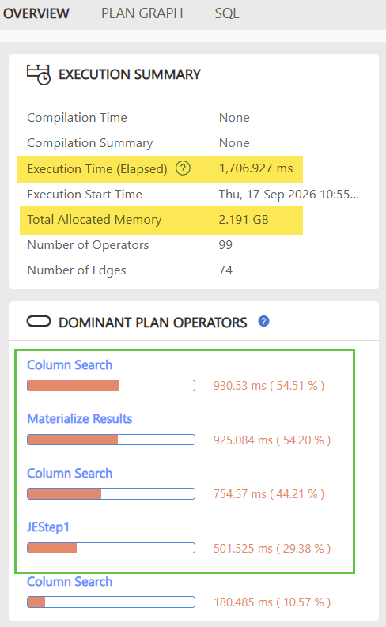
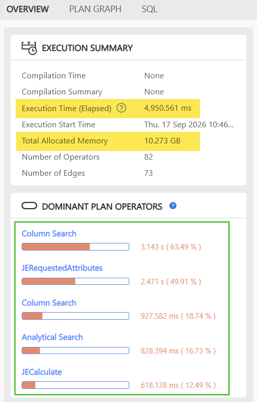
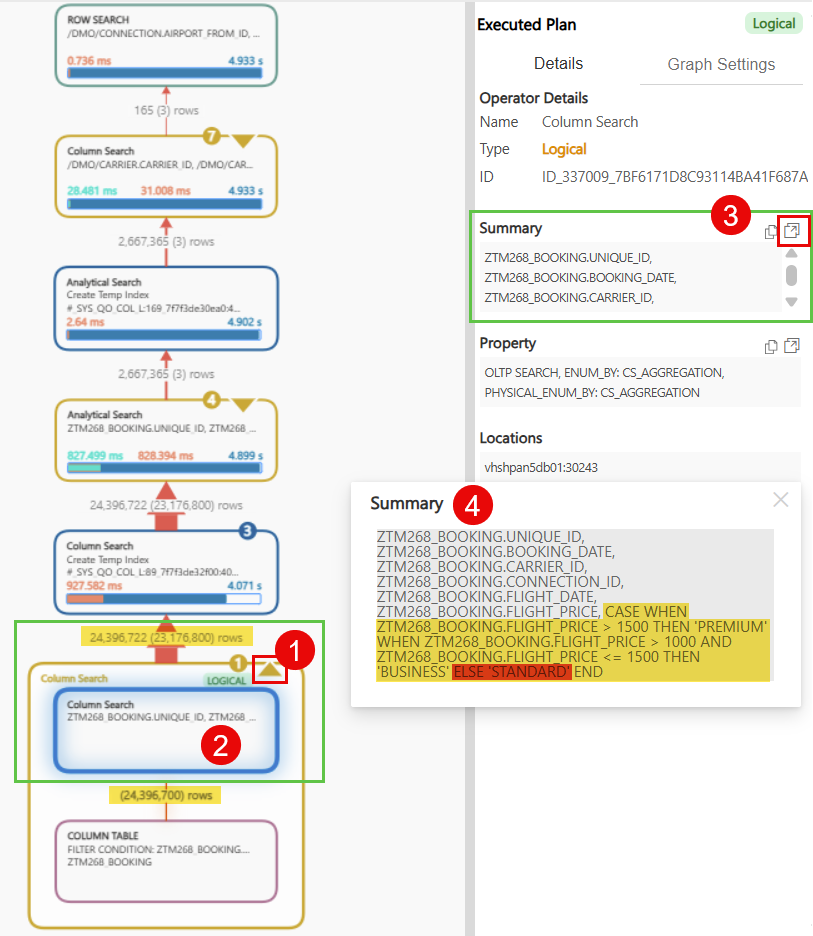
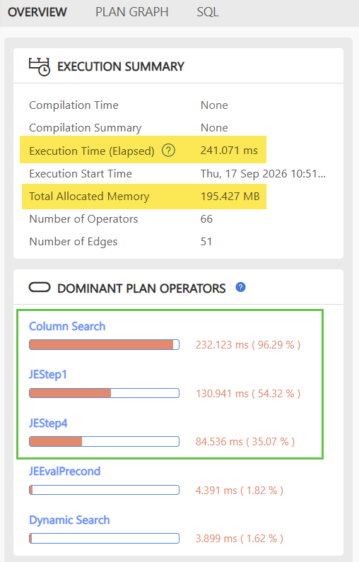
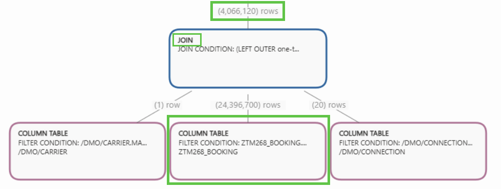
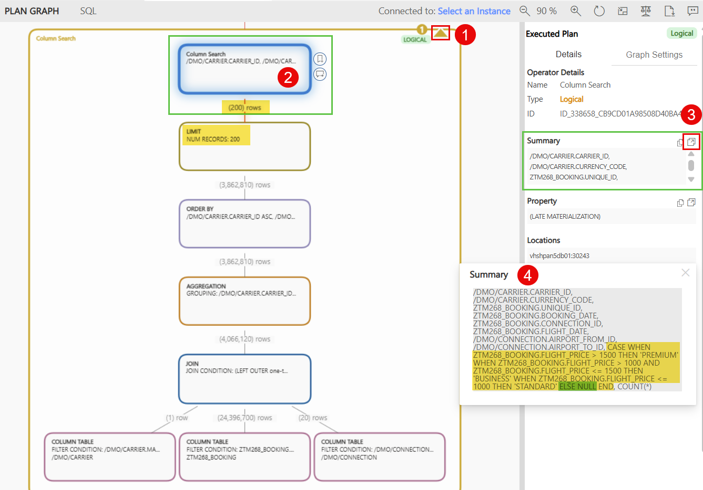

[Home - TM268](/README.md#-exercises)

# Exercise 4: Rewrite with CASE and Execution Plan Analysis using SAP HANA SQL Analyzer

## Introduction
[^Top of page](#)

In the previous exercises, you learned how to read SAP HANA execution plans with the **SAP HANA SQL Analyzer** extension for Visual Studio Code. You have identified the root cause of a performance problem with the `UNION ALL` in a `LEFT OUTER JOIN`.

You will continue to analyze the fix for this problem by using a `CASE` expression instead of the `UNION ALL` in the CDS View. 

> [!NOTE]
> This solution works here because all `SELECT` statements in the `UNION` read from the same table (`ZTM268_BOOKING`). If the `UNION` branches read from different tables, replacing them with a single `CASE` expression may not be possible — the CDS View would need a different structural approach instead.

> ℹ️ 
> For this exercise, you need Visual Studio Code with the **SAP HANA SQL Analyzer** extension installed.
> Please verify your setup in the [Getting Started](../getting-started/readme.md) section before continuing.

### What you will learn

In this exercise, you will:

1. Rewrite the CDS View `ZTM268_I_BOOKING_UNION_###` by using a `CASE` expression instead of the `UNION ALL`
2. Use the **ABAP Cross Trace** to download the **PlanViz** file from the **HANA Plan Trace** and load it into the **SAP HANA SQL Analyzer** for VS Code
3. Load the **PlanViz** file (`.plv`) for the analysis of the optimization
4. Check the `OVERVIEW` tab, then analyze and compare the change of the implementation 
5. Open the `PLAN GRAPH` tab to identify the changed operators of the execution plan

### Exercises

- [Exercise 4: Rewrite with CASE and Execution Plan Analysis using SAP HANA SQL Analyzer](#exercise-4-rewrite-with-case-and-execution-plan-analysis-using-sap-hana-sql-analyzer)
  - [Exercise 4.1: Rewrite the CDS View using a CASE expression](#exercise-41-rewrite-the-cds-view-using-a-case-expression)
  - [Exercise 4.2: Run the ABAP Cross Trace and Compare the Execution Plan](#exercise-42-run-the-abap-cross-trace-and-compare-the-execution-plan)
  - [Exercise 4.3: Optimize implementation and analyze the Execution Plan](#exercise-43-optimize-implementation-and-analyze-the-execution-plan)

### Summary

- [Summary & Next Exercise](#summary--next-exercise)

---

## Exercise 4.1: Rewrite the CDS View using a CASE expression
[^Top of page](#)

> **In this step you:**
> 1. Open the CDS View using ADT and rewrite the definition using a `CASE` expression
> 2. Activate the changed CDS View and verify the app is still working correctly

<details>
  <summary>🔵 Click to expand!</summary>


1. **Open CDS View in ADT.**

  Double-click and open the `Interface` CDS View definition `ZTM268_I_BOOKING_UNION_###` which contains the `UNION` operator.
  <kbd></kbd>

  Replace the entire CDS definition with the following code snippet, which replaces the `UNION ALL` with a `CASE` expression:

  💡 Make use of the _Copy Raw Content_ () function to copy the provided code snippets.

  > ⚠️
  > Replace **`###`** with your personal suffix e.g. _ZTM268_I_BOOKING_UNION_123_

  ```abap
  @AbapCatalog.viewEnhancementCategory: [#NONE]
  @AccessControl.authorizationCheck: #NOT_REQUIRED
  @EndUserText.label: 'Selecting Booking Data / UNION ###'
  @Metadata.ignorePropagatedAnnotations: true
  define view entity ZTM268_I_BOOKING_UNION_###
  as select from ztm268_booking
    { 
    carrier_id, connection_id, flight_date, booking_id, id as unique_id,
    booking_date, customer_id,
      case
        when flight_price > 1500 then 'PREMIUM'
        when flight_price > 1000 and flight_price <= 1500 then 'BUSINESS'
        else 'STANDARD'
      end as price_class
  }
  ```

  The field `price_class` is now defined solely by a `CASE` expression with three different conditions for price classes `PREMIUM`, `BUSINESS`, and `STANDARD`.
  ```abap
        case
          when flight_price > 1500 then 'PREMIUM'
          when flight_price > 1000 and flight_price <= 1500 then 'BUSINESS'
          else 'STANDARD'
        end as price_class
  ```
  
  ---

2. **Activate the changed CDS View.**

  > ℹ️ 
  > Activate the CDS View by pressing `Ctrl+F3` or clicking the activate icon 

  Open the SAP Fiori app again (as explained in [Exercise 1.1](../exercise-01/readme.md#exercise-11-display-the-data-preview-and-test-the-read-only-service)) and verify that data is still properly displayed — the `price_class` column should still show `PREMIUM`, `BUSINESS`, and `STANDARD` values for the booking records, identical to what the previous `UNION` implementation produced.

  > ⚠️ <br>
  > Be aware that for the airline `Deutsche Lufthansa AG` only `PREMIUM` bookings are available. To see other price classes for `BUSINESS` or `STANDARD` you have to select another airline in the filter.

  This confirms that the `CASE` expression is **semantically equivalent** to the original `UNION ALL` — both produce the same result, but using a fundamentally different approach. The CDS View now reads from `ZTM268_BOOKING` **only once** instead of three times.

  In [Exercise 4.2](#exercise-42-run-the-abap-cross-trace-and-compare-the-execution-plan), you will measure the performance impact using the **ABAP Cross Trace**.
  </details>

## Exercise 4.2: Run the ABAP Cross Trace and Compare the Execution Plan
[^Top of page](#)

> **In this step you:**
> 1. Use the **ABAP Cross Trace** to generate and download the **PlanViz** file for the `CASE` expression
> 2. Open the **PlanViz** in the **SAP HANA SQL Analyzer** and compare the `OVERVIEW` metrics with the previous `UNION` execution plan

<details>
  <summary>🔵 Click to expand!</summary>

  The CDS View has been rewritten — now it is time to measure the impact. Using the **ABAP Cross Trace** and the SAP HANA **PlanViz**, you will capture a new execution plan with the `CASE` expression and load the `.plv` file into the **SAP HANA SQL Analyzer**. Comparing the `OVERVIEW` metrics side by side with the previous `UNION_Legacy.plv` will reveal whether the rewrite improved the performance — or not.

  Use the **ABAP Cross Trace** to analyze the performance of the fix as explained in [Exercise 2.1](../exercise-02/readme.md#exercise-21-extending-the-abap-cross-trace-with-sadl-framework-and-hana-plan-trace) and download the generated SAP HANA **PlanViz**. Save the **PlanViz** with the name `CASE_Legacy.plv`.

  Then open the `CASE_Legacy.plv` with the **SAP HANA SQL Analyzer** in VS Code. As a first step, compare the metrics on the `OVERVIEW` tab with the previous **PlanViz** file `UNION_Legacy.plv`.

  > ⚠️
  > The **PlanViz** file has already been captured and the file [CASE_Legacy.plv](planviz_files/CASE_Legacy.plv) can be downloaded from this package in the folder `planviz_files`.

  Did the execution time decrease as expected? Did you also check the other metrics `Total Allocated Memory` and `Accessed Tables` in the `OVERVIEW` tab?

  <details>
    <summary>🔵 Click to see comparison!</summary>

  When opening the **PlanViz** file `CASE_Legacy.plv`, navigate to the `OVERVIEW` tab and compare the key metrics side by side with the previous `UNION_Legacy.plv`. Unfortunately, you can see that the execution time increased instead of the expected decrease. 

  | PlanViz with UNION ALL | PlanViz with CASE |
  |---|---|
  | <kbd></kbd> | <kbd></kbd> |
  | **Execution Time**: 1.7 seconds<br>**Total Allocated Memory**: 2.1 GB | **Execution Time**: 🔴 4.9 seconds<br>**Total Allocated Memory**: 🔴⬆️ 10.2 GB |

  Let's go into the details of why this happened and what caused the increased runtime and high memory consumption.

  <details>
    <summary>🔵 Click for detailed analysis!</summary>

  The execution time increased to **4.9 seconds** and memory consumption to **10.2 GB**.

  The expectation was clear that the three separate `SELECT` statements on `ZTM268_BOOKING` would be unified with a single table `SELECT` and a `CASE` expression would eliminate the materialization overhead. The single table access is executed by SAP HANA, but the `CASE` expression is quite expensive because it needs to be executed on the entire dataset.

  <kbd></kbd>

  In the `PLAN GRAPH` above, it is visible that a large amount of data (~ 24 million rows) is read from the table `ZTM268_BOOKING`. On top, in the same `COLUMN SEARCH` plan operator the calculation for the `price_class` is executed as shown in the `SUMMARY` box on the right side of the panel after selecting this `COLUMN SEARCH` operator.

  The `CASE` expression consolidates the three separate `SELECT` branches of the previous `UNION ALL` into a single calculation applied to every row of `ZTM268_BOOKING`.

  **Conditions**
  * `flight_price > 1500` → `PREMIUM`
  * `flight_price > 1000 AND flight_price <= 1500` → `BUSINESS`
  * `ELSE` → `STANDARD` - catch-all for remaining possible values for each row

  ```sql
    case
      when flight_price > 1500 then 'PREMIUM'
      when flight_price > 1000 and flight_price <= 1500 then 'BUSINESS'
      else 'STANDARD'
    end as price_class
  ```
  Review the following examples and results of the `CASE` expression to understand the `NULL` handling.

  | flight_price | Matched Condition | price_class |
  |---|---|---|
  | `2000` | `flight_price > 1500` | `'PREMIUM'` |
  | `1200` | `flight_price > 1000 AND flight_price <= 1500` | `'BUSINESS'` |
  | `800` | `ELSE` | `'STANDARD'` |
  | `NULL` | `ELSE` | `'STANDARD'` |

  The `NULL` case is the interesting one: because `NULL` does not satisfy either explicit condition, it falls through to the `ELSE` branch and returns `'STANDARD'` instead of `NULL`. The `ELSE` branch acts as a defensive fallback: it covers any row that does not match the two explicit conditions — including rows with a low price, but also rows where `flight_price` is `NULL`. This means the `CASE` expression **never produces a `NULL` result**. 
  
  The semantic meaning of `NULL` needs to be defined by the implementation according to the business requirement.

  By itself, a `CASE` expression that never returns `NULL` is not a problem — but in our case, `ZTM268_I_BOOKING_UNION_###` is used as the **right side of a `LEFT OUTER JOIN`** in the Consumption View:

  > ℹ️ The relevant portion of **`ZTM268_C_BOOKING_CONN_CARR_###`** (for reference — no changes needed):

  ```abap
  define view entity ZTM268_C_BOOKING_CONN_CARR_###
    as select from /dmo/carrier as carrier
      left outer join ZTM268_I_BOOKING_UNION_### as booking
        on carrier.carrier_id = booking.carrier_id
  ```

  **The problem:** 
  The SAP HANA optimizer always aims to generate the most efficient execution plan for optimal performance. It tries to apply the carrier filter **first** by pushing it down through the `CASE` expression to reduce the amount of data as early as possible — before the `CASE` expression is evaluated. 
  However, this optimization cannot be applied, because the `CASE` expression is **not null-preserving**. Reordering the operators produces an incorrect result set. The optimizer is therefore forced to evaluate the `CASE` expression against the entire `ZTM268_BOOKING` table (~24 million rows) and fully materialize the result before the `LEFT OUTER JOIN` is executed and the data volume is reduced to the ~4 million matching rows.

  <details>
    <summary>🔵 Why is the result wrong if the filter would be applied first?</summary>

  In a `LEFT OUTER JOIN`, every row from the **left side** (`/dmo/carrier`) is always included in the result. If a carrier has **no matching bookings**, all columns from the right side — including `flight_price` — are `NULL` for that row.

  | carrier_id (left) | flight_price (right) |
  |---|---|
  | `LH` | `2000` |
  | `LH` | `1200` |
  | `LH` | `800` |
  | `ZZ` | `NULL` — no booking match |

  After the calculation, the result would look like the following:

  | carrier_id (left) | price_class (CASE with ELSE) | Expected |
  |---|---|---|
  | `LH` | `'PREMIUM'` | ✅ correct |
  | `LH` | `'BUSINESS'` | ✅ correct |
  | `LH` | `'STANDARD'` | ✅ correct |
  | `ZZ` | `'STANDARD'` | ❌ wrong! ➡️ should be `NULL` (no booking!) |

  The `ZZ` row is wrong: it has no bookings. The `LEFT OUTER JOIN` produces `NULL` for `flight_price`, which is replaced with `'STANDARD'` by the `ELSE` branch of the `CASE` expression. **But**, the correct result for `price_class` should be `NULL` — indicating that there is no booking data to classify.
  
  As you have seen before, the `ELSE` condition would result in the `'STANDARD'` classification. Now, it's not clear anymore whether carrier `ZZ` has bookings with a low price or no bookings at all. The correct result is `NULL`, indicating that carrier `ZZ` has no bookings.

  </details>

  Because the `ELSE` branch always returns a non-`NULL` "value", the `CASE` expression is guaranteed to never produce `NULL` as a result for any row in `ZTM268_BOOKING`. This is called **not null-preserving**.

  This means the optimizer is forced into the following execution order:

  1. **Evaluate the `CASE` expression on every row of `ZTM268_BOOKING`** — all rows, regardless of carrier, must be processed to compute `price_class`. This forces a **full materialization** of the base table before the join is even executed — which explains the dramatic increase in memory consumption to **10.2 GB**.
  2. **Then execute the `LEFT OUTER JOIN`** — only now can the result be joined to `/dmo/carrier` and the carrier filter applied.
 
   SAP HANA's query optimizer cannot safely reorder these steps: the `ELSE` branch does not preserve `NULL` — SAP HANA can't push down the join with the filter through the `CASE` expression. Therefore the calculation must run on every row in `ZTM268_BOOKING`.

   > 💡
   > **Did you know?** This anti-pattern **NOT NULL preserving in a LEFT OUTER JOIN** is explained in detail as part of the CDS View performance anti-pattern blog series on SAP Community. Learn more about this and other anti-patterns — including how to fix them — in the full series. [Read the full blog post](https://community.sap.com/t5/enterprise-resource-planning-blog-posts-by-sap/cds-view-performance-best-practice-not-null-preserving-left-outer-join/ba-p/13579510)

  </details>

  </details> 

</details>
    
## Exercise 4.3: Optimize implementation and analyze the Execution Plan
[^Top of page](#)

> **In this step you:**
> 1. Open the CDS View again and apply another change for performance optimization
> 2. Activate the changed CDS View and verify the app is still working correctly
> 3. Run another **ABAP Cross Trace** and save the **PlanViz**
> 4. Analyze the trace results and verify the performance improvement

<details>
  <summary>🔵 Click to expand!</summary>

  In [Exercise 4.2](#exercise-42-run-the-abap-cross-trace-and-compare-the-execution-plan), the `CASE` expression used an `ELSE` branch as a catch-all, which made it **not null-preserving**. Every row — including rows with `NULL` in `flight_price` — always returned a non-`NULL` result. This prevented SAP HANA from pushing the join filter down to the base table.

  To fix this, the `CASE` expression must become **null-preserving**: when `flight_price` is `NULL`, the result should also be `NULL`. In general there are multiple ways to achieve this for a `CASE` expression:

  | Option | How | Effect |
  |---|---|---|
  | **Remove** `ELSE` branch | Simply omit the `ELSE` clause | Any row not matched by a `WHEN` condition returns `NULL`. |
  | **Add** explicit condition | Replace `ELSE` with `WHEN flight_price <= 1000 THEN 'STANDARD'` | `NULL` inputs skip all `WHEN` branches and return `NULL` |
  | **Invert** the `ELSE` | Rewrite conditions so that `NULL` is excluded from the final branch | `NULL` no longer falls into the catch-all |

  In this exercise, the code below uses the **add explicit condition** approach, replacing `ELSE` with a precise condition for `STANDARD`. This makes the `ELSE` branch obsolete. Simply removing the `ELSE` branch from the original code, without adding the explicit `WHEN` condition would be wrong, because the `STANDARD` classification would be lost. This `CASE` expression is now **null-preserving**: it returns `NULL` for non-existent flight prices.

  > ⚠️
  > Replace **`###`** with your personal suffix e.g. _ZTM268_I_BOOKING_UNION_123_

  ```abap
    @AbapCatalog.viewEnhancementCategory: [#NONE]
    @AccessControl.authorizationCheck: #NOT_REQUIRED
    @EndUserText.label: 'Selecting Booking Data / UNION ###'
    @Metadata.ignorePropagatedAnnotations: true
    define view entity ZTM268_I_BOOKING_UNION_###
    as select from ztm268_booking
      { 
      carrier_id, connection_id, flight_date, booking_id, id as unique_id,
      booking_date, customer_id,
        case
          when flight_price > 1500 then 'PREMIUM'
          when flight_price > 1000 and flight_price <= 1500 then 'BUSINESS'
          when flight_price <= 1000 then 'STANDARD'
        end as price_class
    }
  ```

  > ℹ️ 
  > Activate the CDS View by pressing `Ctrl+F3` or clicking the activate icon .

  Run another **ABAP Cross Trace** for the updated `CASE` expression and save the **PlanViz** with the name `CASE_Fixed_Legacy.plv`.

  Open `CASE_Fixed_Legacy.plv`, navigate to the `OVERVIEW` tab and compare the metrics again with the previous **PlanViz** `CASE_Legacy.plv`. 
  
  Alternatively, you can download the **PlanViz** file [CASE_Fixed_Legacy.plv](planviz_files/CASE_Fixed_Legacy.plv) from the `planviz_files` folder.
  
  <details>
    <summary>🔵 Click to see comparison!</summary>

  Comparing with `CASE_Legacy.plv` reveals a dramatic improvement — the execution time dropped from 4.9 seconds to **240 ms (0.2 seconds)** and memory consumption from 10.2 GB to **195 MB (0.2 GB)**. 

  | PlanViz with CASE | PlanViz with CASE without ELSE |
  |---|---|
  | <kbd></kbd> | <kbd></kbd> |
  | **Execution Time**: 4.9 seconds<br>**Total Allocated Memory**: 10.2 GB | **Execution Time**: 🟢🚀 240 ms<br>**Total Allocated Memory**: 🟢⬇️ 195 MB |

  > ℹ️ 
  > Overview of all three implementations in increasing order of optimization.

  | 1. PlanViz with UNION ALL | 2. PlanViz with CASE | 3. PlanViz with CASE without ELSE |
  |---|---|---|
  | <kbd></kbd> | <kbd></kbd> | <kbd></kbd> |
  | **Execution Time**: 1.7 seconds<br>**Total Allocated Memory**: 2.1 GB | **Execution Time**: 4.9 seconds<br>**Total Allocated Memory**: 10.2 GB | **Execution Time**: 🟢 240 ms<br>**Total Allocated Memory**: 🟢 195 MB |

  The plan graphs below show how the execution plan operators changed. By making the `CASE` expression null-preserving, the SAP HANA optimizer is able to reorder the joins and use a single `COLUMN SEARCH` plan operator to filter the result of `ZTM268_BOOKING` much earlier. This reduces the required amount of resources during processing. As a consequence, no full materialization plan operation is required anymore, which reduces the expected memory consumption.
  
  <kbd></kbd>

  Instead, the table `/dmo/carrier` is filtered first and then directly joined with the data from the table `ZTM268_BOOKING` within a single `COLUMN SEARCH` operator. The calculation is executed almost at the end after the data have been filtered by the `LIMIT` operator.

  <kbd></kbd>

  </details>

</details>

---

## Summary & Next Exercise
[^Top of page](#)

In this exercise, you:

- rewrote the CDS View `ZTM268_I_BOOKING_UNION_###` to replace the `UNION ALL` with a single `CASE` expression — a semantically equivalent rewrite that reads from `ZTM268_BOOKING` only once instead of multiple times,
- observed that the initial `CASE` rewrite with an `ELSE` branch unexpectedly increased execution time from 1.7 to 4.9 seconds and memory consumption from 2.1 GB to 10.2 GB,
- identified the root cause: with an `ELSE` branch present, SAP HANA cannot push the carrier filter down to the base table and instead evaluates the `CASE` expression against the full `ZTM268_BOOKING` dataset, which requires a large amount of memory,
- removed the `ELSE` branch and replaced it with an explicit condition — making the `CASE` expression null-preserving — which allowed SAP HANA to apply the filter early and reduced execution time to 240 ms and memory to 195 MB.

Congratulations! 🎉

You can now:
- continue with the next exercise ► **[Exercise 5: Analyze the anti-patterns in the HEX engine](../exercise-05/readme.md)**
- or **[↑ Back to Tutorial Home - TM268](/README.md#-exercises)**.

---

## License

Copyright (c) 2026 SAP SE or an SAP affiliate company. All rights reserved. This project is licensed under the Apache Software License, version 2.0 except as noted otherwise in the [LICENSE](/LICENSE) file.