[Home - TM268](/README.md#-exercises)

# Exercise 5: Analyze the anti-patterns in the HEX engine

## Introduction

While you analyzed the `UNION` in a `LEFT OUTER JOIN` anti-pattern in [Exercise 3](../exercise-03/readme.md) and the `NOT NULL PRESERVING CASE` anti-pattern in [Exercise 4](../exercise-04/readme.md), you noticed that **hints** were used to demonstrate the anti-patterns. In this exercise, you will learn what **hints** are and where they were applied, and then remove them.

You will get three **PlanViz** files that each contain an execution of the three test cases below without any **hints** applied:

- UNION in a LEFT OUTER JOIN
- NOT NULL PRESERVING CASE
- CASE fixed

You don't have to re-execute all three test cases. The goal of this exercise is to analyze the **PlanViz** files that have been recorded without the hints in order to understand the differences. You will look at the anti-patterns once more in the so-called **HEX engine** (SAP HANA Execution Engine) where workarounds may have been applied by SAP HANA to mitigate the effects of the anti-patterns.

### What you will learn

In this exercise, you will:

1. Remove the **hints** that have been applied and learn what the effects of the hints are
2. Analyze the **PlanViz** file `HEX_UNION.plv` with the `UNION` in `LEFT OUTER JOIN` anti-pattern executed in the **HEX engine**
3. Analyze the **PlanViz** file `HEX_NOT_NULL_PRESERVING.plv` with the `NOT NULL PRESERVING CASE` anti-pattern executed in the **HEX engine**
4. Analyze the **PlanViz** file `HEX_CASE_FIXED.plv` with the optimized `CASE` without any anti-pattern executed in the **HEX engine**
5. Compare the three executions above

### Exercises

- [Exercise 5: Analyze the anti-patterns in the HEX engine](#exercise-5-analyze-the-anti-patterns-in-the-hex-engine)
  - [Exercise 5.1: Remove the hints that have been applied and learn what the effects of the hints are](#exercise-51-remove-the-hints-that-have-been-applied-and-learn-what-the-effects-of-the-hints-are)
  - [Exercise 5.2: Analyze the PlanViz file with the UNION in a LEFT OUTER JOIN anti-pattern executed in the HEX engine](#exercise-52-analyze-the-planviz-file-with-the-union-in-a-left-outer-join-anti-pattern-executed-in-the-hex-engine)
  - [Exercise 5.3: Analyze the PlanViz file with the NOT NULL PRESERVING CASE anti-pattern executed in the HEX engine](#exercise-53-analyze-the-planviz-file-with-the-not-null-preserving-case-anti-pattern-executed-in-the-hex-engine)
  - [Exercise 5.4: Analyze the PlanViz file with the optimized CASE without any anti-pattern executed in the HEX engine](#exercise-54-analyze-the-planviz-file-with-the-optimized-case-without-any-anti-pattern-executed-in-the-hex-engine)
  - [Exercise 5.5: Compare the 3 executions above which used the HEX engine](#exercise-55-compare-the-3-executions-above-which-used-the-hex-engine)

### Summary

- [Summary & Next Exercise](#summary--next-exercise)

---

## Exercise 5.1: Remove the hints that have been applied and learn what the effects of the hints are
[^Top of page](#)

The hints are applied in the top-level view (e.g., the Consumption View) — that is where you will remove them.

> **In this step you:**
> 1. Remove the hints that have been applied
> 2. Learn more about the removed hints and the effects they have

  
🔵 Click to expand!

1. **Remove the hints that have been applied**

Before you remove the hint, you will learn what a database hint is:

In ABAP CDS (Core Data Services), a database hint is an annotation that instructs the underlying database (typically SAP HANA) on how to execute queries against the CDS View.

Now you will remove the hint from the CDS View definition.

Open the CDS View `ZTM268_C_BOOKING_CONN_CARR_###` in ADT by double-clicking it in the **Project Explorer** (or press `Ctrl+Shift+A` to open it by name) and remove the following line:

<pre lang="ABAP CDS">
  @Consumption.dbHints: [ 'NO_USE_HEX_PLAN', 'NO_SEMI_JOIN_BEFORE_UNION' ]
</pre>

> ℹ️ Activate the Consumption View by pressing `Ctrl+F3` or clicking the activate icon .  

> ℹ️ In CDS View definitions, hints have to be applied with the annotation **@Consumption.dbHints**. This annotation has to be specified in the top-level view, which is typically the Consumption View. If this annotation is applied in lower levels of the view stack, it will not be evaluated during the execution.

> ⚠️ This annotation is only evaluated by specific frameworks (such as the SADL framework used in SAP Fiori or RAP applications); it will be ignored by other frameworks such as the ADT data preview.

---

2. **Learn more about the removed hints and the effects they have**

There were two different hints applied:

`NO_USE_HEX_PLAN`

This hint is used to prevent SAP HANA from using the so-called HEX engine for the execution. It was used to better demonstrate the effects of the anti-pattern because the HEX engine has some optimizations to mitigate the impact of such anti-patterns. Whether SAP HANA uses the HEX engine automatically depends on the version of SAP HANA and the configuration. In SAP HANA Cloud, the HEX engine is the default. In SAP HANA 2, it depends on the configuration of the database. With the hint `USE_HEX_PLAN` you can achieve the opposite and execute a query in the HEX engine if this is possible and not chosen automatically. Below you will find an overview of the HEX engine compared to the older engines that have been used in Exercises 3 and 4.

> ℹ️ The old engines (legacy) optimize individual operators in separate execution engines and exchange materialized intermediate results. These engines are highly specialized and can be very fast if the query execution runs within one engine. The HEX engine runs the whole query inside a single pipelined, massively parallel execution engine, reducing memory consumption and execution time. The HEX engine is the strategic future architecture for SAP HANA. Most SQL queries can make use of the HEX engine, but currently not all SQL features are supported in HEX. Complete coverage of all features in HEX is in development.

| Aspect | Old Engines | HEX engine |
|---|---|---|
| Architecture | Multiple specialized engines | Single unified engine |
| Execution model | Materialization-based, especially if multiple engines are involved | Pipelined / streaming with the goal to avoid materialization as far as possible |
| Engine switches | Frequent | Fully eliminated |
| Parallelization and Optimization | Local engine specific | End-to-end globally applied |

  `NO_SEMI_JOIN_BEFORE_UNION`
  
  This hint is used to avoid the semi-join reduction optimization (which is valid for the old execution engines and the HEX engine). It was used to clearly demonstrate the UNION in a LEFT OUTER JOIN anti-pattern. In practice you will face situations where SAP HANA cannot apply this optimization automatically. In Exercises 3 and 4 you learned the details about this and how to avoid this anti-pattern.

  With the removal of both hints, the execution will now be done in the HEX engine. You do not need to re-run the test cases yourself after removing the hints; pre-recorded **PlanViz** files are provided for your analysis. You can download them and analyze them in [Exercise 5.2 through 5.4](#exercise-52-analyze-the-planviz-file-with-the-union-in-a-left-outer-join-anti-pattern-executed-in-the-hex-engine).

 

---

## Exercise 5.2: Analyze the PlanViz file with the UNION in a LEFT OUTER JOIN anti-pattern executed in the HEX engine
[^Top of page](#)

> **In this step you:** 
> - Download and analyze the **PlanViz** file with the UNION in a LEFT OUTER JOIN anti-pattern executed in the HEX engine

 

  
🔵 Click to expand!

Download the **PlanViz** file <a href="planviz_files/HEX_UNION.plv">HEX_UNION.plv</a> and open it in VS Code.

> ℹ️ To download the file: click the link above, then on the GitHub page that opens click `Download raw file` (top-right area) as shown below — do **not** use right-click → Save, as that saves the HTML page instead.
> <kbd>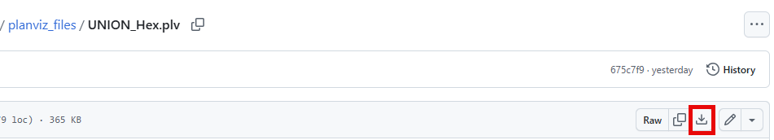</kbd>

Switch to the logical plan (as you have learned in [Exercise 3](../exercise-03/readme.md)) and start on the `OVERVIEW` tab. You can see that the time and memory consumption are reduced significantly here (milliseconds instead of seconds and MB instead of GB) compared to the executions in Exercises 3 and 4 that used the hints.

<kbd>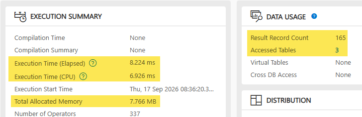</kbd>  **Execution Time**: 8.2 ms **Total Allocated Memory**: 7.7 MB 

Then click on the `PLAN GRAPH` tab to see the execution plan.

Find the operator `TABLE SCAN SEMI JOIN` right before the `UNION ALL`. When you click on this plan operator, you can see in the summary that the filter on `CARRIER_ID` is applied here. The value is taken from the table `/dmo/carrier`, which is accessed as the first step in the plan before the `TABLE SCAN SEMI JOIN`. 

The reduction of rows happens as early as possible. 
> ℹ️ Note that the number of rows in the logical plan is an optimizer estimation only, not the real number of processed rows. These estimations are quite high and are based on the heavy data skew in table `ZTM268_BOOKING` and an average estimation (you can see the data distribution at the end of the [Getting Started](../getting-started/readme.md) chapter).

The KPIs from the `OVERVIEW` tab confirm the findings from the plan. The early application of the filters leads to fast processing times and a small consumption of memory.

<kbd>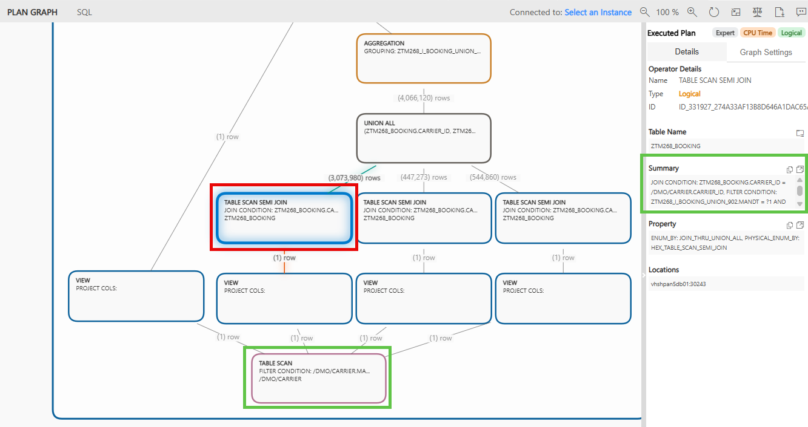</kbd>  

 

---

## Exercise 5.3: Analyze the PlanViz file with the NOT NULL PRESERVING CASE anti-pattern executed in the HEX engine
[^Top of page](#)

> **In this step you:** 
> - Download and analyze the **PlanViz** file with the NOT NULL PRESERVING CASE anti-pattern executed in the HEX engine

  
🔵 Click to expand!

Download the **PlanViz** file <a href="planviz_files/HEX_NOT_NULL_PRESERVING.plv">HEX_NOT_NULL_PRESERVING.plv</a> and open it in VS Code.

Switch to the logical plan and start on the `OVERVIEW` tab. You can see that the time and memory consumption are noticeably lower compared to the previous test case with the `UNION` in `LEFT OUTER JOIN` execution.

<kbd>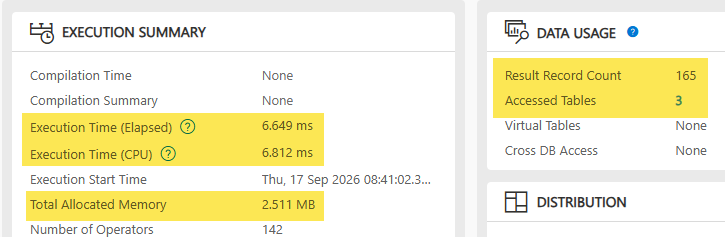</kbd>  **Execution Time**: 6.6 ms **Total Allocated Memory**: 2.5 MB 

Then click on the `PLAN GRAPH` tab to see the execution plan.

Find the `TABLE SCAN SEMI JOIN` at the bottom of the plan. When you click on this plan operator, you can see in the summary that the filter on `CARRIER_ID` is applied here. The value is taken from the table `/dmo/carrier`, which is accessed as the first step in the plan before the `TABLE SCAN SEMI JOIN`. The filter is applied as early as possible, which is confirmed by the fast run time and low resource consumption KPIs from the `OVERVIEW` tab. In the logical plan, you can see a `MATERIALIZATION` plan operator for the `NOT NULL PRESERVING CASE Expression` after the `TABLE SCAN SEMI JOIN` plan operator. This `MATERIALIZATION` plan operator is no longer required in section 5.4. 

<kbd>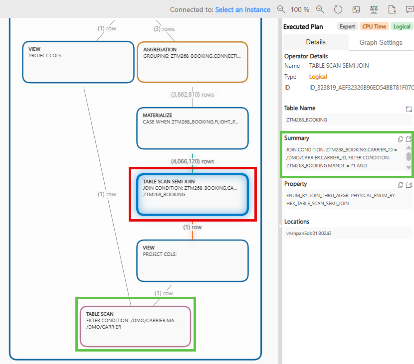</kbd>  

---

## Exercise 5.4: Analyze the PlanViz file with the optimized CASE without any anti-pattern executed in the HEX engine
[^Top of page](#)

> **In this step you:** 
> - Download and analyze the **PlanViz** file with the optimized `CASE` without any anti-pattern executed in the HEX engine

 

  
🔵 Click to expand!

Download the **PlanViz** file <a href="planviz_files/HEX_CASE_FIXED.plv">HEX_CASE_FIXED.plv</a> and open it in VS Code.

Switch to the logical plan and start on the `OVERVIEW` tab. You can see that the execution time is slightly lower than the `NOT NULL PRESERVING CASE` execution. The memory consumption is slightly higher, which is expected since the fixed `CASE` expression no longer requires a `MATERIALIZATION` plan operator but processes more data in the pipeline.

<kbd>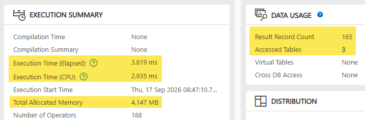</kbd>  **Execution Time**: 3.8 ms **Total Allocated Memory**: 4.1 MB  

Then click on the `PLAN GRAPH` tab to see the execution plan.

Find the `TABLE SCAN SEMI JOIN` at the bottom of the plan. When you click on this plan operator, you can see in the summary that the filter on `CARRIER_ID` is applied here. The value is taken from the table `/dmo/carrier`, which is accessed as the first step in the plan before the `TABLE SCAN SEMI JOIN`. The filter is applied as early as possible, which is confirmed by the fast run time and low resource consumption KPIs from the `OVERVIEW` tab. Notice that, unlike in the `NOT NULL PRESERVING CASE` execution, there is no `MATERIALIZATION` plan operator in this plan.

<kbd>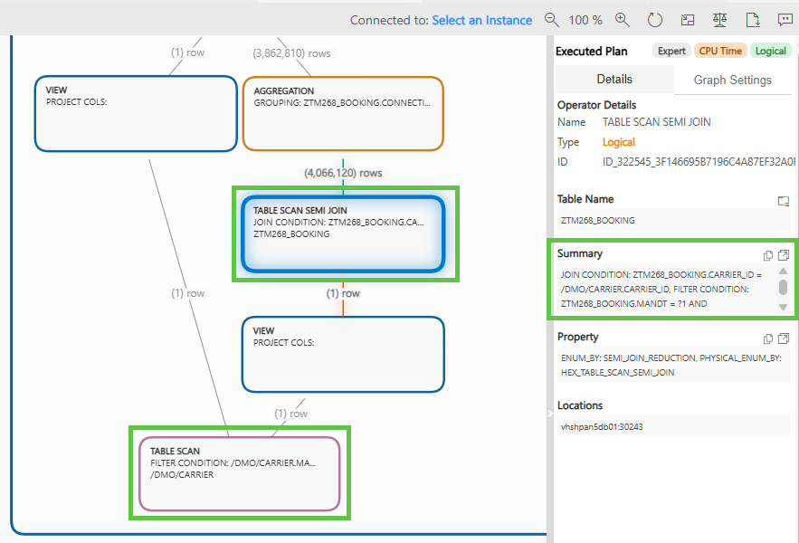</kbd>  
 

---

## Exercise 5.5: Compare the 3 executions above which used the HEX engine
[^Top of page](#)

> **In this step you:** 
> - Compare the 3 HEX engine executions above with the executions from [Exercise 3](../exercise-03/readme.md) and [Exercise 4](../exercise-04/readme.md), which used the old engines.

  

    
🔵 Click to expand!

  The anti-patterns remain anti-patterns in the **HEX engine**, although the **HEX engine** can apply the `SEMI JOIN REDUCTION` optimization. The comparison below shows that the optimal execution is still achieved with a model that does not contain the anti-pattern. The **LEGACY** row shows the results from [Exercise 3](../exercise-03/readme.md) and [Exercise 4](../exercise-04/readme.md) for comparison.
   
  |Engine | PlanViz with UNION in a LEFT OUTER JOIN | PlanViz with NOT NULL PRESERVING CASE | PlanViz with fixed CASE |
  |---|---|---|---|
  | **LEGACY** | <kbd>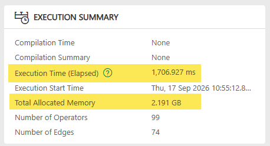</kbd>  **Execution Time**: 1.7 seconds **Total Allocated Memory**: 2.1 GB  | <kbd>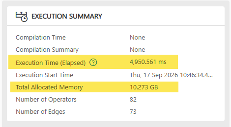</kbd>  **Execution Time**: 4.9 seconds **Total Allocated Memory**: 10.2 GB  | <kbd>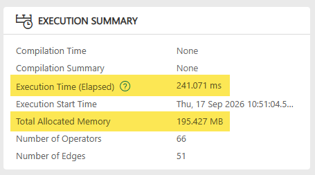</kbd>  **Execution Time**: 0.2 seconds **Total Allocated Memory**: 0.19 GB 
  | **HEX** | <kbd>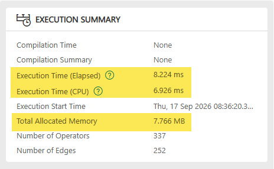</kbd>  **Execution Time**: 0.0082 seconds (8.2 ms) **Total Allocated Memory**: 0.008 GB (7.7 MB)  | <kbd>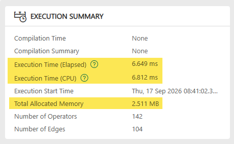</kbd>  **Execution Time**: 0.0066 seconds (6.6 ms) **Total Allocated Memory**: 0.0025 GB (2.5 MB)  | <kbd>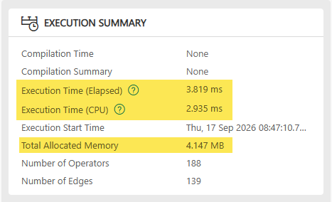</kbd>  **Execution Time**: 0.0038 seconds (3.8 ms) **Total Allocated Memory**: 0.0041 GB (4.1 MB) 

  > ℹ️ The best performance is achieved with the **HEX engine** and removed anti-pattern.

  <kbd>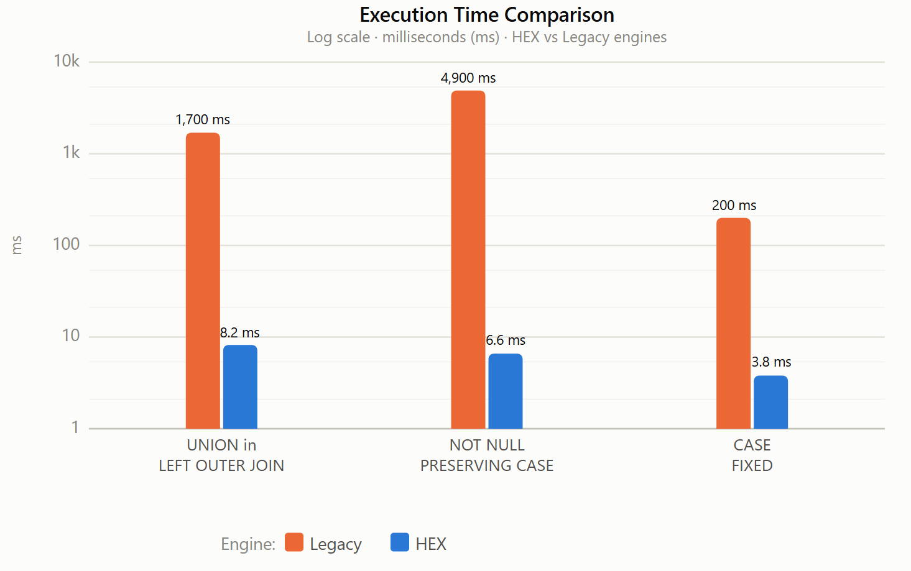</kbd>

  

    
📊 Show data table

  | Engine | UNION in a LEFT OUTER JOIN | NOT NULL PRESERVING CASE | fixed CASE |
  |---|---|---|---|
  | **LEGACY** | 1,700 ms | 4,900 ms | 200 ms |
  | **HEX** | 8.2 ms | 6.6 ms | 3.8 ms |

  

   

  > ℹ️ The **HEX engine** is mainly CPU-driven — its pipelined and streaming execution avoids materializing intermediate results between different plan operators, which is why memory consumption is reduced compared to the old engines. Additionally, no engine switches are required anymore. Only the **HEX engine** is leveraged for the entire execution. The CPU utilization is not compared in this exercise - the **PlanViz** `OVERVIEW` tab reports the `Execution Time (CPU)` next to `Execution Time (Elapsed)` for HEX PlanViz.  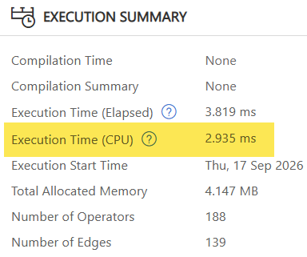
   

  The **HEX engine** significantly reduces execution time and memory by orders of magnitude compared to the old engines — but removing the anti-pattern by having a NULL preserving `CASE` expression (no `ELSE` branch) gives the best result within **HEX**.

 

---

## Summary & Next Exercise
[^Top of page](#)
 
 In this exercise, you:

 - removed the hints from the CDS View definition
 - learned more about the hints and their effects
 - analyzed the execution for the three test cases executed in the HEX engine
 - analyzed the semi-join-reduction optimization, which applied the filters early
 - compared the execution plans of the test cases and confirmed that avoiding anti-patterns is still a best practice for performance optimization

 Congratulations! 🎉

 You can now:
 - continue with the next exercise ► **[Exercise 6: Consume the Read-Only UI Service in a RAP Application](../exercise-06/readme.md)**
 - or **[↑ Back to Tutorial Home - TM268](/README.md#-exercises)**.
 
## License
 
 Copyright (c) 2026 SAP SE or an SAP affiliate company. All rights reserved. This project is licensed under the Apache Software License, version 2.0 except as noted otherwise in the [LICENSE](/LICENSE) file.
