[Home - TM268](/README.md#-exercises)

# Exercise 6: Consume the Read-Only UI Service in a RAP Application

## Introduction
In Exercise 1, you created a functionally correct Read-Only UI Service. In the subsequent exercises, you improved its runtime performance by a factor of approximately 10 (see [Exercise 4](../exercise-04/readme.md)). In Exercise 5, you created the final optimized Consumption View `ZTM268_C_BOOKING_CONN_CARR_###`, which will serve as the navigation target in this exercise.

In this optional Exercise 6, you will create a simple RAP Application and enhance it by enabling navigation to the well-tuned Read-Only UI Service.

You will first learn how to generate a RAP Application from a table with just a few clicks, then focus on the changes needed to enable navigation.

> [!IMPORTANT]
> Replace **all** occurrences of **`###`** with your personal suffix throughout all exercise steps.
> **Check the suffix `###` of your demo user (e.g. TM268-###).**

---

The table you use is **`/DMO/CARRIER`**:

<kbd>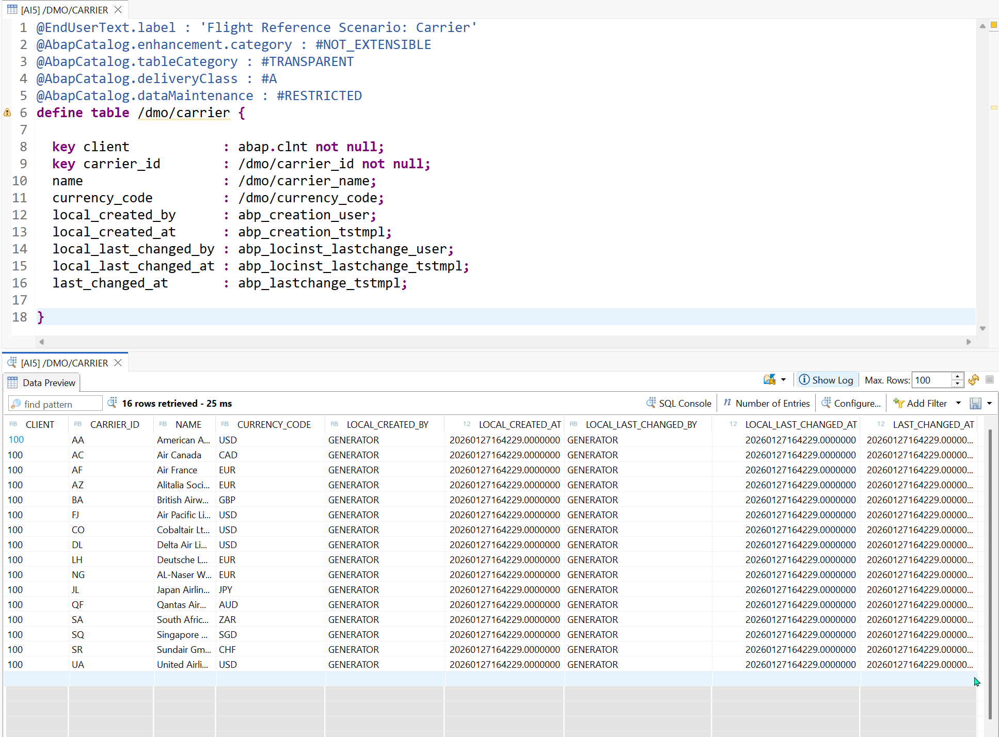</kbd>

It contains 16 airlines with `Carrier ID`, `Name`, and `Currency Code`.

> [!NOTE]
> To allow every participant to create their own RAP service without naming conflicts, the table — including its content — has been copied to **`ZTM268_CARR_###`**. No additional configuration is required.

You will create a RAP Application for this table **`ZTM268_CARR_###`**:

<kbd>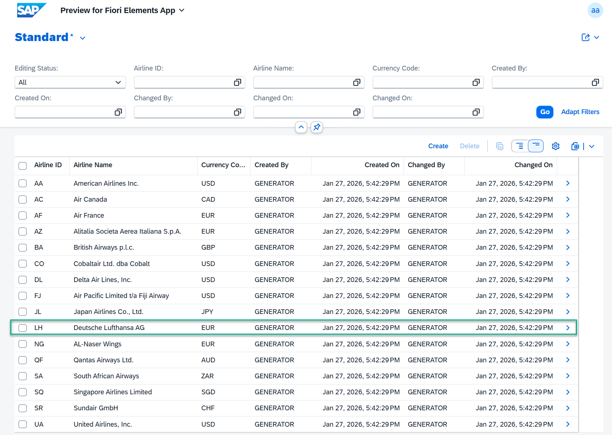</kbd>

When you select the row with **Airline ID = `LH`**, the original navigation (left) will be enhanced to display the booking overview from the read-only app (right):

| Original Navigation in RAP App | Enhanced Navigation with Reporting List |
|---|---|
| <kbd>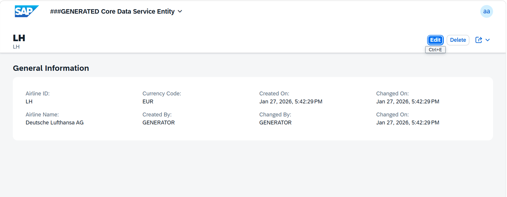</kbd> | <kbd>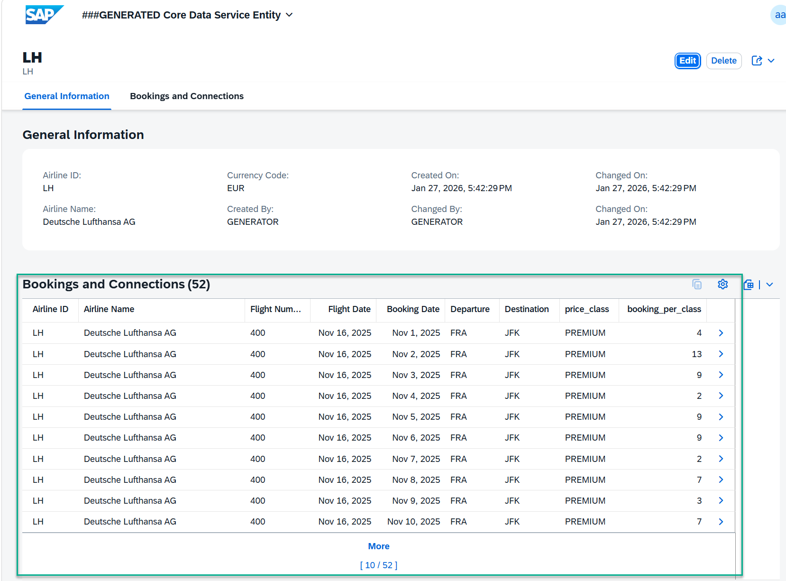</kbd> |

### What you will learn

In this exercise, you will:

1. Learn how to generate a complete RAP Application from a database table with just a few clicks
2. Learn how to create a CDS association between two Consumption Views to connect a RAP Application
   with a Read-Only UI Service
3. Learn how to extend a Service Definition to expose an additional CDS View via OData
4. Learn how to add a new UI facet in a Metadata Extension to surface data as a dedicated section
   on the object page

### Optional Exercises

- [Exercise 6: Consume the Read-Only UI Service in a RAP Application](#exercise-6-consume-the-read-only-ui-service-in-a-rap-application)
  - [Exercise 6.1: Create a RAP Application on a Table by a Right-Click](#exercise-61-create-a-rap-application-on-a-table-by-a-right-click)
  - [Exercise 6.2: Create an Association to the Consumption View of Exercise 5 in the Consumption of the RAP Application](#exercise-62-create-an-association-to-the-consumption-view-of-exercise-5-in-the-consumption-of-the-rap-application)
  - [Exercise 6.3: Adapt the Service Definition to Expose the New Associated CDS View](#exercise-63-adapt-the-service-definition-to-expose-the-new-associated-cds-view)
  - [Exercise 6.4: Adapt the Metadata Extension File to Add a New UI Facet](#exercise-64-adapt-the-metadata-extension-file-to-add-a-new-ui-facet)

### Summary
- [Summary and Back](#summary-and-back)

## Exercise 6.1: Create a RAP Application on a Table by a Right-Click

> [!NOTE]
> **THIS EXERCISE IS OPTIONAL**

The table **`ZTM268_CARR_###`** — a copy of **`/DMO/CARRIER`** with identical content — has already been prepared in your package.

> **In this step you:**
> 1. Right-click the table **`ZTM268_CARR_###`** and select **`Generate ABAP Repository Objects`**
> 2. Choose **`OData UI Service`**, confirm the package, and finish the generation wizard
> 3. Publish the Service Binding

 <details>
  <summary>🔵 Click to expand!</summary>


  | Create a RAP Application | Details |
  |---|---|
  | <kbd>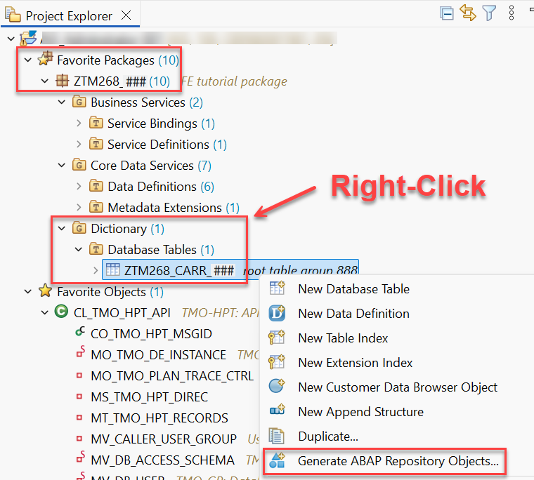</kbd>| Navigate to `...` > `Favorite Packages` > **`ZTM268_###`** <br> (**`###`** = your suffix) <br> > `Dictionary` > `Database Tables` > **`ZTM268_CARR_###`**. <br> <br> Right-click **`ZTM268_CARR_###`** <br> and select **`Generate ABAP Repository Objects`** |
  | <kbd>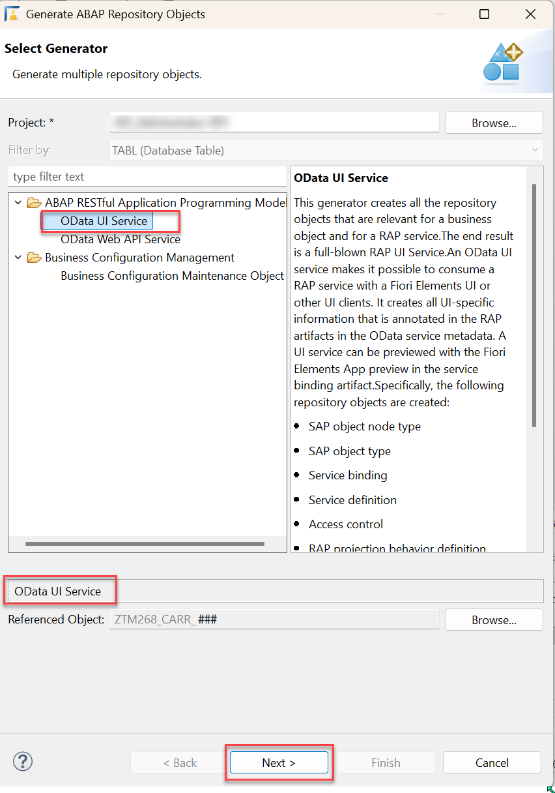</kbd> | Select **`OData UI Service`** and click **`Next`**|
  | <kbd>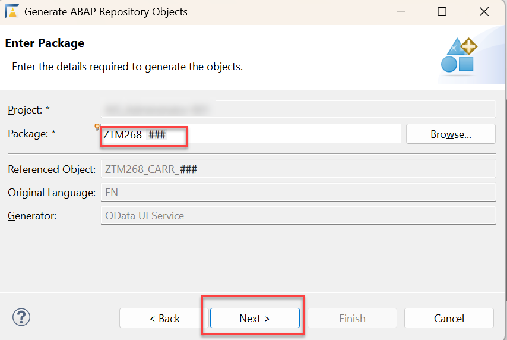</kbd> | Enter your package **`ZTM268_###`** and click **`Next`** | 
  | <kbd>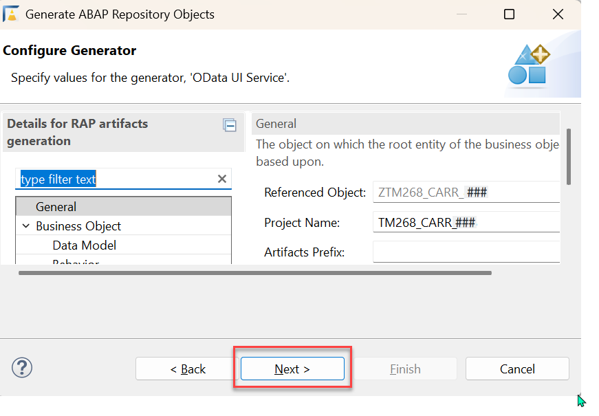</kbd> | Keep the default values and click **`Next`** | 
  | <kbd>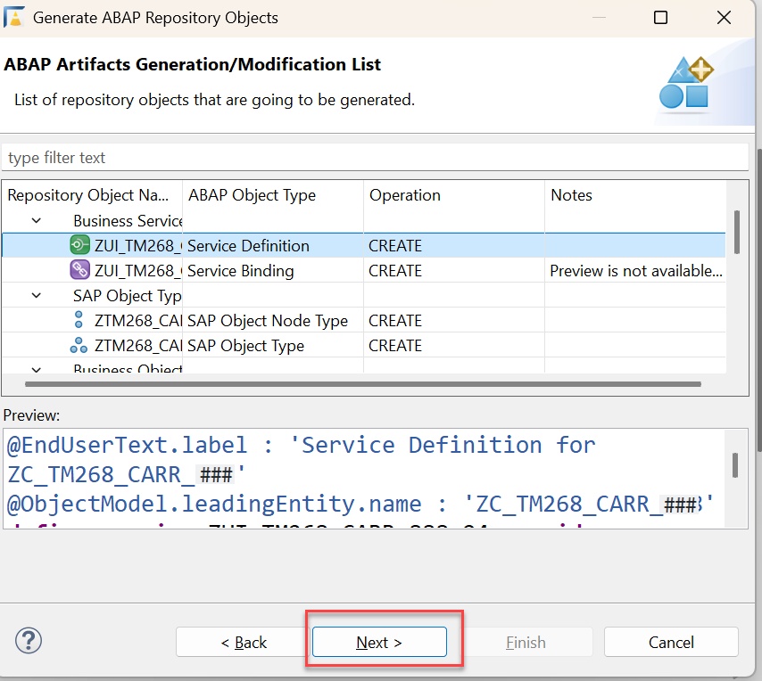</kbd> | Click **`Next`** again | 
  | <kbd>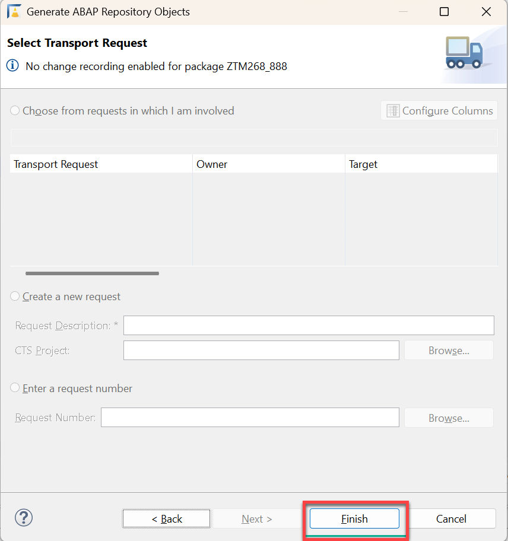</kbd> | Click **`Finish`**<br><br> The artifacts are generated in the background. This may take a few seconds. |
  | <kbd>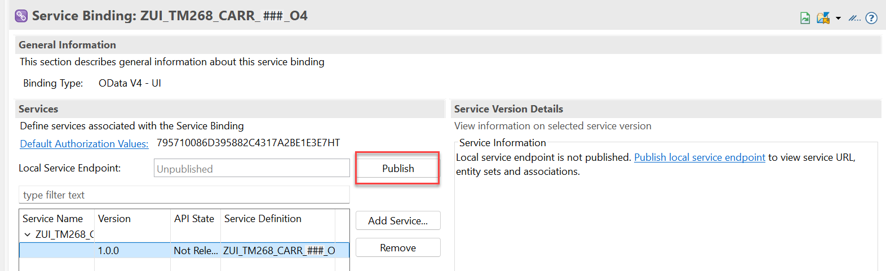</kbd> | Click **`Publish`** | 

  This creates a transactional RAP Application that exposes the field values of table **`ZTM268_CARR_###`** for viewing, editing and creating records.

 </details>

> [!NOTE]
> The **Publish** takes 2 to 3 minutes. During this time you can continue with the subsequent exercises [Exercise 6.2](#exercise-62-create-an-association-to-the-consumption-view-of-exercise-5-in-the-consumption-of-the-rap-application) through [Exercise 6.4](#exercise-64-adapt-the-metadata-extension-file-to-add-a-new-ui-facet).

## Exercise 6.2: Create an Association to the Consumption View of Exercise 5 in the Consumption of the RAP Application
[^Top of page](#)

> [!NOTE]
> **THIS EXERCISE IS OPTIONAL**

> **In this step you:**
> 1. Add an association from **`ZC_TM268_CARR_###`** to **`ZTM268_C_BOOKING_CONN_CARR_###`**
> 2. Replace **`###`** with your personal suffix
> 3. Expose the association at the end of the view and activate it

 <details>
  <summary>🔵 Click to expand!</summary>
 
 1. Make the following changes in Consumption View **`ZC_TM268_CARR_###`**:

    This step uses the CDS View `ZTM268_C_BOOKING_CONN_CARR_###` from [Exercise 4](../exercise-04/readme.md) and [Exercise 5](../exercise-05/readme.md). The performance optimizations from those exercises must already be implemented before you continue.

    1. Add the association to **`ZTM268_C_BOOKING_CONN_CARR_###`**:
    
       ```abap
         association [0..*] to ZTM268_C_BOOKING_CONN_CARR_### as _BookingConnCarr
           on $projection.Name = _BookingConnCarr.carrier_name
       ```

    2. Replace **`###`** with your personal suffix.

    3. At the end of the view add an expose of this association by replacing

       ```abap
          LastChangedAt,
          _BaseEntity
          }
       ```

       with

       ```abap
          LastChangedAt,
          _BaseEntity,
          _BookingConnCarr 
         } 
       ```

       The changes are illustrated below:

       | Before | After |
       |---|---|
       | <kbd>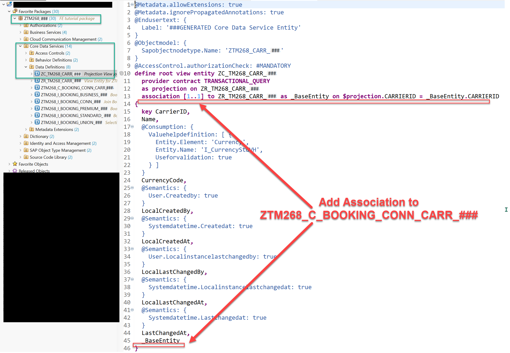</kbd> | <kbd>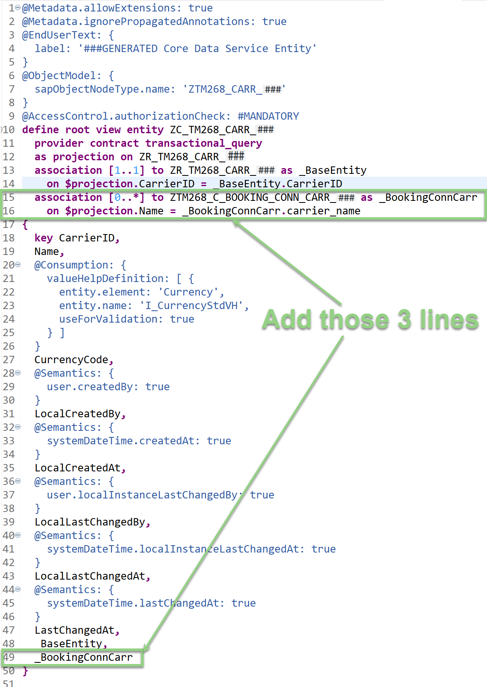</kbd> |
      
 2. ℹ️ Activate the Consumption View by pressing `Ctrl+F3` or clicking the activate icon . <br>

 ---

 > 🟠 **Remark (Optional) - Verify via Data Preview**<br>
 > Open view **`ZC_TM268_CARR_###`** and press `F8` to open the Data Preview: <br> 
 > <kbd>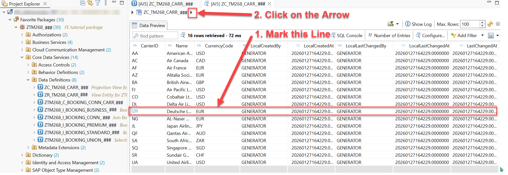</kbd> <br> <br>
 > Click the navigation arrow and select **`_BookingConnCarr`**: <br>
 > <kbd>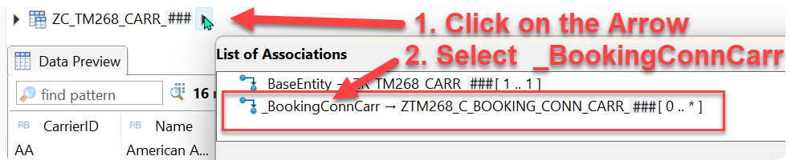</kbd> <br><br>
 > You will see the result of the query on **`ZTM268_C_BOOKING_CONN_CARR_###`** for **Deutsche Lufthansa AG**:
 > <kbd>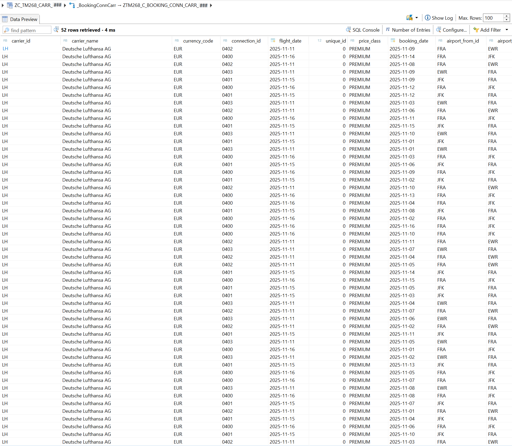</kbd> <br>

</details>

## Exercise 6.3: Adapt the Service Definition to Expose the New Associated CDS View
[^Top of page](#)

> [!NOTE]
> **THIS EXERCISE IS OPTIONAL**


> **In this step you:**
> 1. Add **`ZTM268_C_BOOKING_CONN_CARR_###`** to the Service Definition **`ZUI_TM268_CARR_###_O4`**
> 2. Replace **`###`** with your suffix and activate

 <details>
  <summary>🔵 Click to expand!</summary>

 💡 Make use of the _Copy Raw Content_ () function to copy the provided code snippets. 
 
 1. In the Service Definition **`ZUI_TM268_CARR_###_O4`** expose the association by replacing

    ```abap
      define service ZUI_TM268_CARR_###_O4
        provider contracts odata_v4_ui {
        expose ZC_TM268_CARR_###;
      }
    ```

    with

    ```abap
      define service ZUI_TM268_CARR_###_O4
        provider contracts odata_v4_ui {
         expose ZC_TM268_CARR_###;
         expose ZTM268_C_BOOKING_CONN_CARR_###;
      }
    ```

    The added line is highlighted below: 

    <kbd>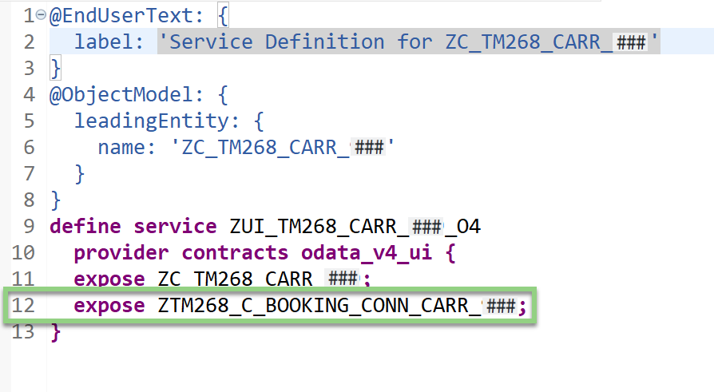</kbd>

 2. Replace **`###`** with your personal suffix.

 3. ℹ️ Activate the Service Definition by pressing `Ctrl+F3` or clicking the activate icon .


 > 🟠 **Remark:** After refreshing the Service Binding, the new association will be visible. Reopen the Service Binding tab to see the updated list of entities and associations.
 > <kbd>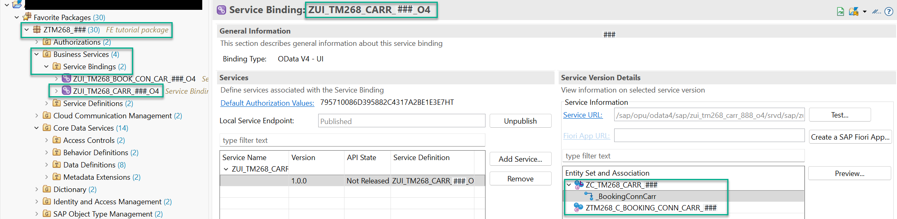</kbd> <br>
   

</details>

## Exercise 6.4: Adapt the Metadata Extension File to Add a New UI Facet
[^Top of page](#)

> [!NOTE]
> **THIS EXERCISE IS OPTIONAL**

> **In this step you:**
> 1. Add a new `#LINEITEM_REFERENCE` facet for **`_BookingConnCarr`** in **`ZC_TM268_CARR_###`**
> 2. Add a default filter value annotation for the `Name` field
> 3. Activate and verify the result


 <details>
  <summary>🔵 Click to expand!</summary>
 
 1. Make use of the _Copy Raw Content_ () function to copy the provided code snippets.

    In **`ZC_TM268_CARR_###`** replace:

    ```abap
    {
      @UI.facet: [ {
        label: 'General Information', 
        id: 'GeneralInfo', 
        purpose: #STANDARD, 
        position: 10 , 
        type: #IDENTIFICATION_REFERENCE
      }
      ]
    ```

    with:

    ```abap
    {
      @UI.facet: [ {
        label: 'General Information', 
        id: 'GeneralInfo', 
        purpose: #STANDARD, 
        position: 10 , 
        type: #IDENTIFICATION_REFERENCE
      },
      {
            id: 'idBookingConnectionCarrier',
            type: #LINEITEM_REFERENCE,
            label: 'Bookings and Connections',
            position: 25 ,
            targetElement: '_BookingConnCarr'
          }
      ]
    ```

 2. For field `Name`, add the following default filter value annotation directly above the field definition:

    ```abap
      @Consumption.filter.defaultValue: 'Deutsche Lufthansa AG'
    ```

    The changes are illustrated below:
       | Before | After |
       |---|---|
       | <kbd>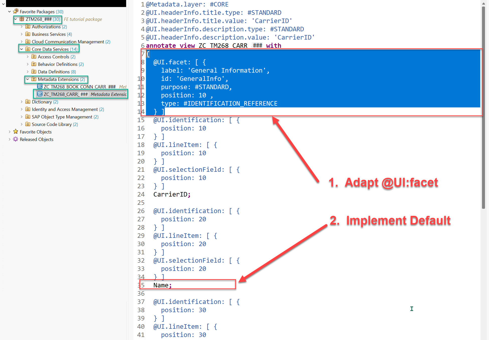</kbd> | <kbd>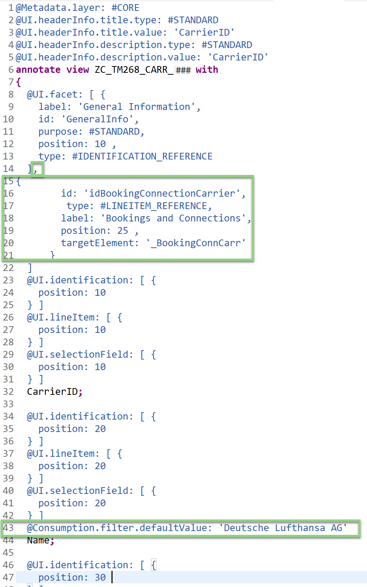</kbd> |

 3. ℹ️ Activate the Metadata Extension by pressing `Ctrl+F3` or clicking the activate icon .

    ---

    With all four changes in place, the RAP Application now exposes a dedicated Bookings and Connections section on the carrier object page, populated directly from the Read-Only UI Service you tuned in Exercises 1–5.

    To verify the result:
    - Open the Service Binding **`ZUI_TM268_CARR_###_O4`** and click **`Preview`** to launch the SAP Fiori app.
    - The carrier list appears. Select the row with **Airline ID = `LH`** (`Deutsche Lufthansa AG`).
    - On the object page, you will now see two sections:
      - General Information — the original carrier details.
      - Bookings and Connections — the new facet, pre-filtered to `Deutsche Lufthansa AG` via the default filter value you added.
      - The result should match the right-hand view shown in the introduction:

      | Original Navigation in RAP App | Enhanced Navigation with Reporting List |
      |---|---|
      | <kbd></kbd> | <kbd></kbd> |

 </details>


## Summary and Back
[^Top of page](#)

You have completed Exercise 6. The goal of this exercise was to enhance an existing RAP Application by enabling navigation from the carrier list to a well-tuned Read-Only UI Service — giving end users direct access to booking and connection data without leaving the app.

To achieve this, you learned how to:
- Generate a RAP Application from a database table with just a few clicks,
- Create an association between two CDS Consumption Views to connect the RAP app with the Read-Only UI Service,
- Extend the Service Definition to expose the additional CDS View via OData,
- Add a new UI facet in the Metadata Extension to surface the booking data as a dedicated section on the object page.

Congratulations on completing this hands-on session! 🎉

Thank you for stopping by!

**[↑ Back to Tutorial Home - TM268](/README.md#-exercises)**.

## License

Copyright (c) 2026 SAP SE or an SAP affiliate company. All rights reserved. This project is licensed under the Apache Software License, version 2.0 except as noted otherwise in the [LICENSE](/LICENSE) file.