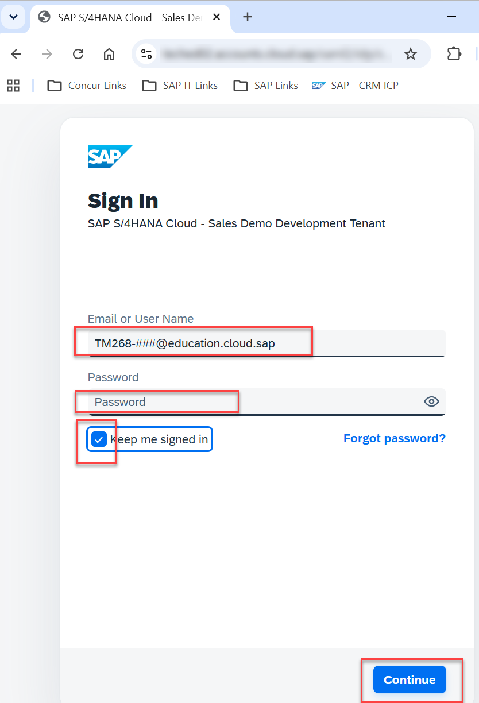
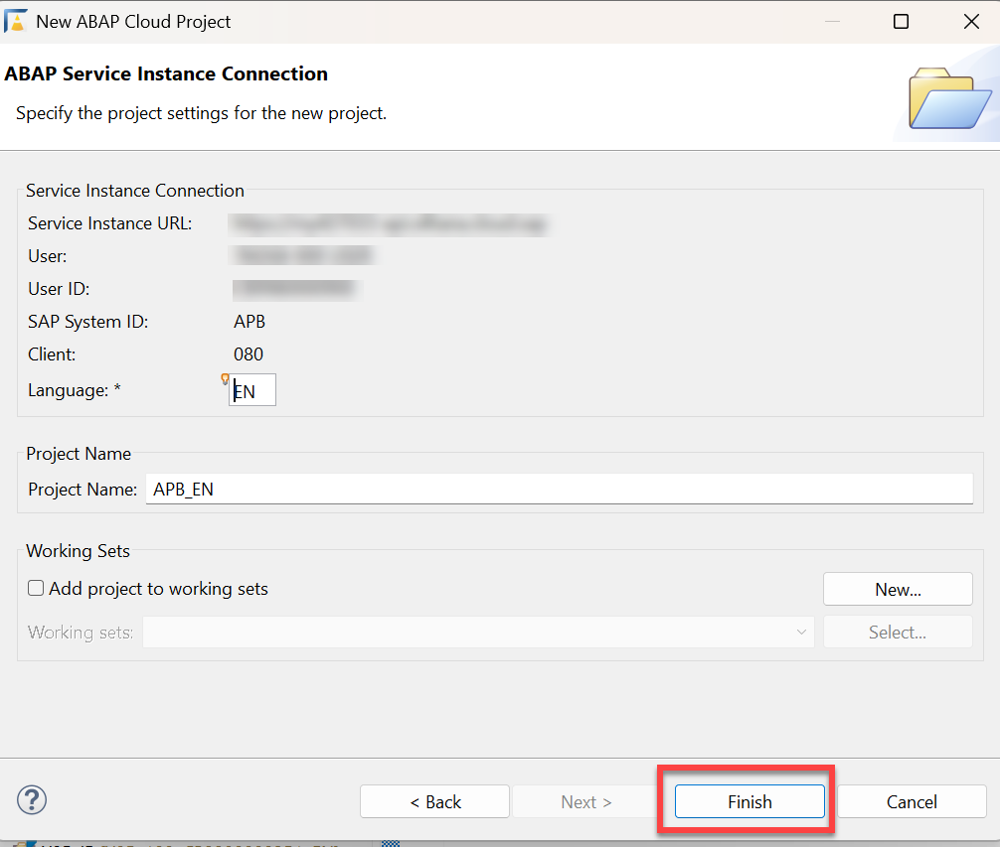
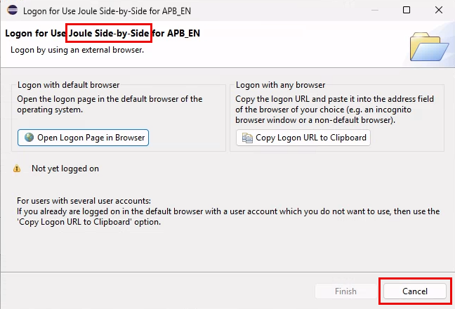
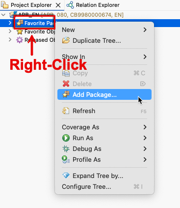
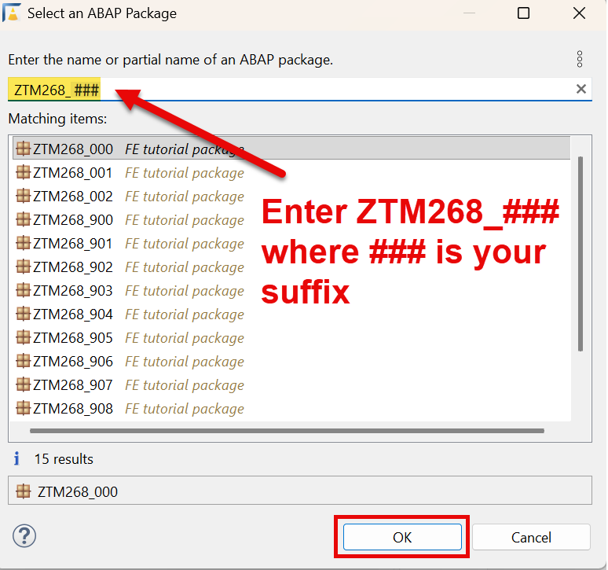
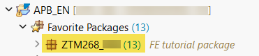
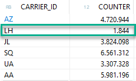

[Home - TM268](/README.md#-exercises)

# Getting Started and Overview of the Model and ABAP Code

## Introduction
This section provides information on how to conduct the exercises and an introduction to the model and ABAP code used.
It covers how to log on to the system and how to access your package for these exercises, and briefly introduces the SAP Fiori app used in the exercises.

- [Getting Started and Overview of the Model and ABAP Code](#getting-started-and-overview-of-the-model-and-abap-code)
  - [Getting Started: About the Session](#getting-started-about-the-session)
  - [Getting Started: Overview of the Model and CDS Views](#getting-started-overview-of-the-model-and-cds-views)

## Summary
- [Summary & First Exercise](#summary--first-exercise)

## Getting Started: About the Session 
[^Top of page](#)

### Logon Information
| Field | Value |
|---|---|
| **System** | `APB` — https://my427033-api.s4hana.cloud.sap |
| **User** | `TM268-###@education.cloud.sap` |
| **Password** | `Password is provided in the session (see handout)` |
| **Exercise Package** | `ZTM268_###` |

> [!IMPORTANT]
> Replace **all** occurrences of **`###`** with your personal suffix throughout all exercise steps. <br>
> **Check the suffix `###` of your demo user (e.g. TM268-###@education.cloud.sap).**
> Only perform changes in your package **`ZTM268_###`**.

> [!NOTE]
> The screenshots in this document have been taken using the suffix **`000`** and the system **`APB`**. 
> Using the assigned suffix **`000`** is not recommended — using it may overwrite shared data.

> [!NOTE]
> Please note that ADT dialogs and views as well as SAP Fiori UIs may change in upcoming releases.

---
### Logon and Connect 

1. Start **ABAP Development Tools (ADT)**
2. Create a new Cloud Project via **`Create an ABAP cloud project`**

   

3. Enter the URL of system APB and click **`Next`** (_System URL provided in the session_)
   

4. Log on using the credentials from the Logon Information above (replace `###` with your personal suffix):
   
   > **User:** ```TM268-###@education.cloud.sap```

   > **Password:** Provided in the session (see handout)

   

5. Finish the New Project Creation Wizard

   

6. Logon screen for **Joule** can be ignored and cancelled for now.

   

---

### Add the exercise package **`ZTM268_###`** to your favorite packages 

1. Add your exercise package to **`Favorite Packages`**

   

2. Make sure to select **your** package (e.g. **`ZTM268_000`** for suffix `000`), not someone else's

   

3. Expand your favorite packages to access your package

   

---

### About the Material
All the CDS views and database tables for these exercises are contained in a single package:

- **Exercise package:** **`ZTM268_###`** — one package per participant, identified by your suffix
  
- **Scope:** All CDS views and tables needed for the functional and performance analysis, a read-only reporting SAP Fiori list app, and a RAP application
  
- **CDS views you will change:**
  - **`ZTM268_C_BOOKING_CONN_CARR_###`** ([Exercise 1](../exercise-01/readme.md) and [Exercise 5](../exercise-05/readme.md))
  - **`ZTM268_I_BOOKING_UNION_###`** ([Exercise 3](../exercise-03/readme.md) to [Exercise 5](../exercise-05/readme.md))

- **RAP application:** Created for table **`ZTM268_CARR_###`** with a custom enhancement [Exercise 6](../exercise-06/readme.md).

> [!IMPORTANT]
> **Check the suffix `###` of your demo user (e.g. TM268-###@education.cloud.sap).**
> Only perform changes in your package **`ZTM268_###`**.

---

## Getting Started: Overview of the Model and CDS Views
[^Top of page](#)

The exercises start with a read-only List Report app based on Consumption View **`ZTM268_C_BOOKING_CONN_CARR_###`**.
This app is filtered by airline name (`Deutsche Lufthansa AG`) and returns the following fields:

| Field Name | Description |
|---|---|
| Airline ID | Carrier code identifying the airline (e.g. `LH`) |
| Airline Name | Full airline name — used as the selection filter in the SAP Fiori app (e.g. `Deutsche Lufthansa AG`) |
| Flight Number | Identifies the flight connection (e.g. `400`) |
| Flight Date | Date on which the flight operates |
| Booking Date | Date on which the booking was made |
| Departure | IATA code of the departure airport (e.g. `FRA`) |
| Destination | IATA code of the destination airport (e.g. `JFK`) |
| price_class | Price class of the booking:<br>`PREMIUM` (> 1,500)<br>`BUSINESS` (1,000–1,500)<br>`STANDARD` (< 1,000) |
| booking_per_class | Total number of bookings per combination of the above grouping dimensions |

### CDS Data Model Overview

This exercise is based on the **SAP Flight Reference Scenario** (`/DMO/FLIGHT`), the standard demo model used in ABAP training. Three tables play the central role:

| Table | Content | Role in the exercise | Number of Entries |
|---|---|---|---|
| **`/DMO/CARRIER`** | Airlines (LH, AA, JL, …) | **Left side** of the LEFT OUTER JOIN — provides the selective filter | 16 rows|
| **`ZTM268_BOOKING`** | Flight bookings (original model `/DMO/BOOKING`) — large fact table | **Right side** — contains the fields to be classified | **24.396.722** rows with the following distribution: <br>  |
| **`/DMO/CONNECTION`** | Flight connections with departure and arrival airports | **Enrichment** — added via join or association | 20 rows |

The airline `Deutsche Lufthansa AG` is used throughout as the filter — it has about 3000 times fewer entries than the other airlines in **`ZTM268_BOOKING`**.

The field `price_class` in **`ZTM268_BOOKING`** has different flight prices which are used for classification:
- `> 1500` — Premium class
- `1000 - 1500` — Business class
- `< 1000` — Standard class

This split is used to create three separate, non-overlapping `UNION` branches.

---

### The View Stack of the Model

The exercises have the following five-level structure:

```
ZTM268_C_BOOKING_CONN_CARR_###
│
└── /DMO/CARRIER                                     ← Level 5 | Consumer
|
└── LEFT OUTER JOIN ZTM268_I_BOOKING_CONN_###        ← Level 4 | Enrichment
      │
      └── ZTM268_I_BOOKING_UNION_###                 ← Level 3 | UNION layer (main focus)
      │    │
      │    ├── ZTM268_I_PREMIUM_###                  ← Level 2 | Price class: Premium
      │    |   | 
      │    |   └── ZTM268_BOOKING                    ← Level 1 | Base data (fact table)
      │    |
      │    ├── ZTM268_I_BUSINESS_###                 ← Level 2 | Price class: Business 
      │    |   | 
      │    |   └── ZTM268_BOOKING                    ← Level 1 | Base data (fact table)           
      │    | 
      │    └── ZTM268_I_STANDARD_###                 ← Level 2 | Price class: Standard 
      │        | 
      │        └── ZTM268_BOOKING                    ← Level 1 | Base data (fact table)
      |
      └── LEFT OUTER JOIN /DMO/CONNECTION            ← Level 4 | Enrichment
```

The difference between the three branches lies exclusively at Level 3. This is where the anti-pattern is introduced and then resolved.

---
 
## Summary & First Exercise
[^Top of page](#)

Now that you have made yourself familiar with how to log on and access your package, you can continue to [Exercise 1](../exercise-01/readme.md).

**[↑ Back to Tutorial Home - TM268](/README.md#-exercises)**.